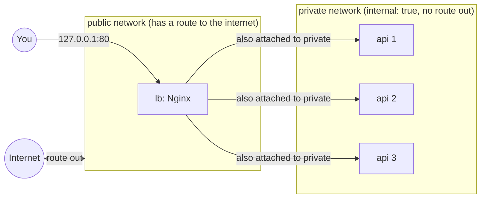

# Lab 03 — Networking (VPC, subnets, security groups)

> **AWS equivalent:** Virtual Private Cloud (VPC), public and private subnets, security groups  ·  **Time:** ~45 min  ·  **Difficulty:** ★★☆
> **Builds on:** [Lab 02](./02-load-balancing.md)  ·  **Reference solution:** commit `ce59529` (step 8) on `dev`

> **Status:** in progress. Step 8 is written; step 9 (the isolation test) and the closing sections (5–11) come next.

## 1. What you will learn
- Explain what a **network**, a **subnet** and a **VPC** are, and why an architecture is split into a *public* and a
  *private* part.
- Say which pieces of an application belong in the public part (almost nothing) and which in the private part (almost everything).
- Build that split with two Docker networks and one load balancer that touches both.
- Prove, with real commands, that a private container cannot reach the internet while the load balancer can.

## 2. Theory

### 2.1 The concept
Until now every container sat on one flat network, like all the rooms of a building opening onto one corridor with
the street door at the end: anyone who gets into the corridor can knock on any door, and any room can walk out to the street.

A real building has **zones**. The lobby is open to visitors. The offices behind the reception desk are only
reachable through the lobby, and the vault has no window at all. If someone breaks into the lobby, the vault is still not
in reach.

Architectures do the same with **networks**:
- A **public** zone holds the only components that visitors must reach (here: the load balancer). It has a route to
  the internet and the internet can reach it.
- A **private** zone holds everything else (the API now, the database, the cache and the queue later). It cannot be
  reached from the internet, and its machines have no direct way out.

This is called *defence in depth*: an attacker has to get through several layers, and a bug in the API does not
automatically expose the database.

### 2.2 How AWS does it
In AWS the zone is a **VPC** (Virtual Private Cloud): your own isolated network inside AWS, described by an address
range such as `10.0.0.0/16`. A VPC is cut into **subnets**, each living in one Availability Zone:

| AWS piece | What it is |
|---|---|
| **VPC** | Your private network in AWS. Nothing gets in or out unless you add a door. |
| **Public subnet** | A subnet whose route table sends internet traffic to an **Internet Gateway** (the door to the internet). Holds the load balancer. |
| **Private subnet** | A subnet with **no** route to the Internet Gateway. Holds servers and databases. |
| **NAT Gateway** | Optional: lets private machines start connections *out* (for updates) without letting anyone start connections *in*. |
| **Security group** | A virtual firewall attached to each resource: "who may connect to me, on which port". Rules can name another security group ("only the load balancer's group may reach port 8000"). |

In the console: **VPC → Your VPCs / Subnets / Route tables / Internet gateways / Security groups**.
The load balancer from Lab 02 is placed in the public subnets, and its targets in the private ones.

### 2.3 How we reproduce it locally
| Concept | AWS | This lab |
|---|---|---|
| VPC | one VPC | the Compose project (`aws-local-lab`) |
| Public subnet | route to an Internet Gateway | Docker network `public` (a normal bridge network) |
| Private subnet | no route out | Docker network `private` with `internal: true` |
| Resource in a subnet | instance / task in a subnet | a service listing the network under `networks:` |
| A resource in two subnets | an ALB spans several subnets | the `lb` service is listed in **both** networks |
| Security group "only the ALB may reach the API" | inbound rule from the ALB's group | the API is on `private` only, so only containers that share `private` can reach it (**step 9** tests it) |

A Docker network is a stand-in for a subnet: it has an address range and a gateway, and only containers attached to it
can talk to each other. `internal: true` removes the gateway to the outside, which is what makes a subnet "private".

**What is not the same:** a security group filters per resource and per port. Docker has nothing like it: inside the
`private` network every container can talk to every other one. We will note this again in "Going to real AWS".

### 2.4 Diagram


## 3. Prerequisites
- [Lab 02](./02-load-balancing.md) completed: `make up` starts the `lb` and three healthy `api` containers, and `make test` is green.

## 4. Steps

> Try each step yourself first, then compare with the reference commit.

### Step 8 — Public and private networks
**Why:** the API must only be reachable through the load balancer, and it must have no way to the internet (a private
subnet). The load balancer is the one component that needs both: a door to the outside and a door to the API.

**First, look at where we start.** Until now Compose put everything on its automatic `default` network, so the API can
reach the internet. This one-liner (Python's standard library, because the slim image has no `curl`) tries to download a page:

```bash
docker compose exec -T --index 1 api python -c "import urllib.request; r = urllib.request.urlopen('http://example.com', timeout=5); print('internet: reachable, HTTP', r.status)"
```
```text
internet: reachable, HTTP 200
```
Flags: `exec` runs a command in a running container, `-T` turns off the interactive terminal (needed in scripts),
`--index 1` picks the first of the three `api` replicas.

**Do it.** Edit `docker-compose.yml`: declare the two networks at the bottom of the file, then attach each service to the
network(s) it belongs to. Changed parts:

```yaml
services:
  api:
    # ... (unchanged) ...
    networks:
      # Private subnet: only this network, so no route to the internet and no door to the host.
      - private

  lb:
    # ... (unchanged) ...
    networks:
      # The load balancer has a foot in both: public (the door) and private (to reach the API).
      - public
      - private

networks:
  # Like the public subnets of a VPC: has a route to the internet. Only the load balancer joins it.
  public:
  # Like the private subnets: "internal" means no route out and no published ports.
  private:
    internal: true
```

| Line | What it does | If you change or remove it |
|---|---|---|
| `networks:` at the bottom | Declares the networks of the project. Compose names them `<project>_<name>`: `aws-local-lab_public`, `aws-local-lab_private`. | Without it, the names under each service would be an error ("refers to undefined network"). |
| `public:` (empty) | A normal network with default settings, which includes a gateway to the outside world. | Add `internal: true` and the load balancer could no longer be reached from your browser. |
| `private:` + `internal: true` | A network with **no gateway**: containers on it can talk to each other and to nothing else. | Remove `internal: true` and the API could reach the internet again (try it, then run the check below). |
| `api` → `networks: [private]` | The API joins only the private network. | Add `public` and the API would sit next to the load balancer in the public zone: the isolation is gone. |
| `lb` → `networks: [public, private]` | The load balancer joins both: it receives traffic on `public` and forwards it on `private`. | Remove `private` and Nginx can no longer resolve or reach `api` (502 / "host not found"). |
| `ports:` on `lb` (unchanged) | Publishes port 80 on your machine, only on `127.0.0.1`. | Unchanged: it works because `lb` is on the non-internal `public` network. |

**Apply it:**
```bash
docker compose up -d --remove-orphans
```
Compose notices that the network settings changed and re-creates the containers it must; `--remove-orphans` also removes
containers of services that no longer exist in the file. Wait until all four containers are `healthy`:

```bash
docker compose ps --format 'table {{.Service}}\t{{.Status}}\t{{.Ports}}'
```
```text
SERVICE   STATUS                    PORTS
api       Up 13 seconds (healthy)   8000/tcp
api       Up 14 seconds (healthy)   8000/tcp
api       Up 13 seconds (healthy)   8000/tcp
lb        Up 7 seconds (healthy)    127.0.0.1:80->80/tcp
```

**Check 1 — the networks exist, and `private` is internal:**
```bash
docker network ls --filter name=aws-local-lab --format 'table {{.Name}}\t{{.Driver}}\t{{.Internal}}'
```
```text
NAME                    DRIVER    INTERNAL
aws-local-lab_default   bridge    false
aws-local-lab_private   bridge    true
aws-local-lab_public    bridge    false
```
`DRIVER bridge` is Docker's ordinary single-host network. `INTERNAL true` is the "private subnet" flag.
(`aws-local-lab_default` is the old automatic network. It is now empty and `docker compose down` removes it.)

**Check 2 — who is attached to which network, and the address range ("subnet") of each:**
```bash
for n in public private; do
  echo "$n:"
  docker network inspect aws-local-lab_$n --format '{{range .Containers}}  {{.Name}}  {{.IPv4Address}}{{"\n"}}{{end}}{{range .IPAM.Config}}  subnet {{.Subnet}} gateway {{.Gateway}}{{"\n"}}{{end}}'
done
```
```text
public:
  aws-local-lab-lb-1  172.24.0.2/16
  subnet 172.24.0.0/16 gateway 172.24.0.1

private:
  aws-local-lab-api-1  172.23.0.3/16
  aws-local-lab-lb-1  172.23.0.5/16
  aws-local-lab-api-3  172.23.0.4/16
  aws-local-lab-api-2  172.23.0.2/16
  subnet 172.23.0.0/16 gateway 172.23.0.1
```
`docker network inspect` prints everything Docker knows about a network; `--format` is a Go template that keeps only the
containers and the address range. Read it like an AWS console: `public` contains only the load balancer, `private`
contains the load balancer and the three API replicas. The load balancer has **two addresses**, one per network.
(Your addresses may differ: Docker picks free ranges.)

**Check 3 — the application still works through the load balancer:**
```bash
curl -s -i localhost/health | head -1
for i in 1 2 3 4 5 6; do curl -s localhost/whoami; echo; done | sort | uniq -c
```
```text
HTTP/1.1 200 OK
      2 {"hostname":"216f87fe11c7"}
      3 {"hostname":"a26c46f4f0dd"}
      1 {"hostname":"ace790a9d92c"}
```
All three replicas answer, so Nginx still finds them through Docker DNS, now over the `private` network.

**Check 4 — the private container has no way out, the load balancer does:**
```bash
docker compose exec -T --index 1 api python -c "import urllib.request; r = urllib.request.urlopen('http://example.com', timeout=5); print('internet: reachable, HTTP', r.status)"
docker compose exec -T lb wget -q -O /dev/null -T 5 http://example.com && echo "internet: reachable"
```
```text
internet: NOT reachable -> URLError <urlopen error [Errno -3] Temporary failure in name resolution>
internet: reachable
```
The same one-liner that printed `HTTP 200` before now fails: the API is on `private` only. The load balancer, which is also
on `public`, still reaches the internet (`wget -q -O /dev/null -T 5` downloads quietly, throws the page away and gives up after 5 seconds).

**What just happened:**
- You rebuilt the VPC idea: one zone with a door to the internet (`public`) and one without (`private`).
- The load balancer is the only bridge between them, exactly like an ALB placed in the public subnets and forwarding to
  targets in private ones.
- The error says *name resolution* rather than "timeout": on an `internal` network Docker does not forward DNS queries
  outside either, so the name `example.com` is not even looked up. In a real private subnet without a NAT Gateway the DNS
  lookup works but the connection times out. The conclusion is the same: **nothing leaves**.
- Containers did not move: they were re-created with the new settings. The data of a container is lost this way, which does not matter
  for a stateless API (Lab 01) but will matter for the database (Lab 04, named volumes).

**Regression check:** the Lab 02 tests still pass with the new networks.
```bash
make test
```
```text
== tests/02_failover.sh
  PASS  60 of 60 requests succeeded with one replica dead
  PASS  replica 216f87fe11c7 rejoined the rotation
02_failover: all checks passed
== tests/02_load_balancing.sh
  PASS  3 api replicas running
  PASS  30 requests reached 3 different replicas (fewest: 10)
  PASS  api has no published port
02_load_balancing: all checks passed
```
(Trimmed to the key lines.)

> Step 9 adds a dedicated isolation test (`tests/03_network_isolation.sh`) and the closing sections of this lab.

## 5–11. To be completed in step 9
Verify, Troubleshooting, Going to real AWS, Clean up, Check your understanding, Exercises and Further reading are
written when the lab ends (step 9), as the course rules require.
