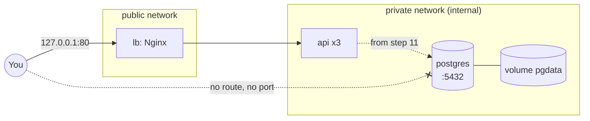

# Lab 04 — Database (RDS)

> **AWS equivalent:** Amazon RDS for PostgreSQL, DB subnet groups, security groups, snapshots  ·  **Time:** ~75 min  ·  **Difficulty:** ★★☆
> **Builds on:** [Lab 03](./03-networking.md)  ·  **Reference solution:** commit `b29c466` (step 10) on `dev`

> **Status:** in progress. Step 10 is written; steps 11–14 (migrations, notes API, admin profile, tests) and the closing sections (5–11) come next.

## 1. What you will learn
- Explain why an application keeps its data in a **database** and not in its own files or memory.
- Name the parts of an AWS RDS database (instance, engine, storage, subnet group, security group, endpoint) and their local counterparts.
- Run PostgreSQL in a container: private network only, data in a **named volume**, password from `.env`, with a healthcheck.
- Prove that the database is not reachable from your machine, and that its data outlives its container.

## 2. Theory

### 2.1 The concept
So far the API remembers nothing: ask it the same question twice and it answers from scratch, and if a replica restarts, whatever it knew is gone.
That is deliberate (**stateless** apps are easy to copy and replace, see Lab 01), but real applications must remember: users, notes, orders.

A **database** is a specialised program whose only job is to store data safely and answer questions about it quickly. Think of a **filing room with a
clerk**: the clerk (the database server) keeps the folders in order, finds any folder in milliseconds, makes sure two people never write on the same page
at once, and does not lose a folder when the lights go out. The application never opens the cabinets itself; it asks the clerk.

This lab uses a **relational** database, **PostgreSQL**: data lives in *tables* (rows and columns) that can be linked to each other, and you ask questions in the
SQL language. The course module [Databases 01](../courses/README.md) explains the vocabulary from zero.

Two consequences shape the architecture:
- The database is the one place that **must not lose data**, so it gets its own protected storage (a *volume*) and is never thrown away casually.
- It holds everything valuable, so it lives on the **private** network and nothing outside may talk to it except the API ([Lab 03](./03-networking.md)).

### 2.2 How AWS does it
**Amazon RDS** (Relational Database Service) runs databases for you. You choose an engine (PostgreSQL, MySQL…), a size, and AWS handles installation, patches, backups and
failover:

| RDS piece | What it is |
|---|---|
| **DB instance** | The database server itself (engine + version + CPU/RAM size). |
| **Storage** | A disk (EBS) attached to the instance, with a size and a type; this is where the data lives and survives restarts. |
| **DB subnet group** | The list of **private** subnets where the instance may live (at least two zones). |
| **Security group** | The firewall: "allow 5432 only from the API's security group" ([Networking 07](../courses/networking/07-firewalls-and-security-groups.md)). |
| **Endpoint** | A DNS name (like `mydb.abc123.eu-west-1.rds.amazonaws.com`) that applications use; AWS repoints it on failover. |
| **Master user and password** | The first account; often stored in AWS Secrets Manager rather than in a file. |
| **Backups / snapshots** | Automatic daily backups and manual snapshots, restorable to a new instance. |
| **Multi-AZ** | A standby copy in another zone that takes over automatically. |

In the console: **RDS → Databases**, plus **VPC → Security groups** for the firewall.

### 2.3 How we reproduce it locally
| Concept | AWS | This lab |
|---|---|---|
| DB instance | RDS DB instance (PostgreSQL) | the `postgres` service (official image `postgres:18.7-alpine3.24`) |
| Storage that survives | EBS volume | Docker **named volume** `pgdata` |
| Private placement | private subnets via the subnet group | the `private` (internal) Docker network, and **no** `ports:` |
| Who may connect | security group rule from the API's group | membership of `private`; later, the password |
| Endpoint | DNS name of the instance | the service name `postgres` (Docker DNS resolves it on `private`) |
| Master password | Secrets Manager | `POSTGRES_PASSWORD` in `.env` (gitignored) |
| Health | RDS status `Available` | Docker healthcheck with `pg_isready` |
| Snapshots, Multi-AZ, patching | managed by AWS | not simulated (backups: course module [Databases 09](../courses/README.md)) |

### 2.4 Diagram


## 3. Prerequisites
- [Lab 03](./03-networking.md) completed: `make up` runs, `make test` is green.
- A database password in your `.env`. Compose refuses to start without one (on purpose). Generate a random fake one and append it without printing it:
  ```bash
  printf '\nPOSTGRES_PASSWORD=%s\n' "$(openssl rand -hex 12)" >> .env
  ```
  (or add any `POSTGRES_PASSWORD=...` line by hand). `.env.example` shows the variables; `.env` is gitignored and never committed.

## 4. Steps

> Try each step yourself first, then compare with the reference commit.

### Step 10 — The Postgres container
**Why:** this is the "RDS instance" of the architecture: a database server on the private network, with storage that outlives the container and a password
that is not in the repository.

**Do it.** Add the service and a volume to `docker-compose.yml`:

```yaml
services:
  # ... api and lb unchanged ...

  # The database (RDS in AWS). Private network only, and no "ports:" at all: nothing on the
  # host can reach it, only containers on "private" (the API will, from step 11 on).
  postgres:
    image: postgres:18.7-alpine3.24
    environment:
      POSTGRES_USER: ${POSTGRES_USER:-lab}
      POSTGRES_DB: ${POSTGRES_DB:-lab}
      # No default on purpose: a missing password stops "docker compose" with a clear message.
      POSTGRES_PASSWORD: ${POSTGRES_PASSWORD:?set POSTGRES_PASSWORD in .env (see .env.example)}
    volumes:
      # Postgres 18 images keep the data in /var/lib/postgresql/18/docker and declare
      # /var/lib/postgresql as their volume: the named volume goes there.
      - pgdata:/var/lib/postgresql
    networks:
      - private
    healthcheck:
      # $$ stops Compose from replacing the variables: the shell inside the container does it.
      test: ["CMD-SHELL", "pg_isready -U $${POSTGRES_USER} -d $${POSTGRES_DB}"]
      interval: 10s
      timeout: 3s
      retries: 5
      start_period: 10s

# ... networks unchanged ...

volumes:
  # Survives "docker compose down" (like an RDS storage volume survives a reboot).
  pgdata:
```
And add the variables to `.env.example` (placeholders only):
```bash
# Database (Lab 04). Fake local values. POSTGRES_PASSWORD has no default: put your own in .env.
POSTGRES_USER=lab
POSTGRES_DB=lab
POSTGRES_PASSWORD=change-me-local-only
```

| Line | What it does | If you change or remove it |
|---|---|---|
| `image: postgres:18.7-alpine3.24` | The official PostgreSQL image, **pinned** to exact version 18.7 on Alpine 3.24 (small). | `postgres:latest` would change under you (forbidden in this project); another major version needs a data migration. |
| `POSTGRES_USER` / `POSTGRES_DB` with `:-lab` | Name of the first account and database, created **the first time** the container starts. `:-lab` = "use `lab` if the variable is not set". | A different name only takes effect on an *empty* volume. |
| `POSTGRES_PASSWORD: ${...:?message}` | The password, read from `.env`. `:?message` = "if it is missing, stop with this message". | A default value here would put a password in the repository; remove the `:?` and an empty password would be accepted. |
| `volumes: - pgdata:/var/lib/postgresql` | Mounts the named volume where the image keeps its data (Postgres 18: `/var/lib/postgresql/18/docker`). | Without it the data lives in the container's writable layer and disappears with the container ([Docker 01](../courses/docker/01-images-and-containers.md)). |
| `networks: - private` | Joins only the internal network. | Add `public` and the database sits next to the load balancer. |
| *(no `ports:`)* | Nothing is published on your machine. | `ports: ["5432:5432"]` would open the database to the host: step 13 adds that only behind an admin profile. |
| `healthcheck: pg_isready ...` | Docker runs it every 10 s; `healthy` means Postgres accepts connections. `$$` keeps the variables for the container's shell. | Without it, `depends_on: condition: service_healthy` (step 11) cannot wait for the database. |
| `start_period: 10s` | Failures during the first 10 s do not count (first start creates the database). | Too short and a slow first start shows `unhealthy`. |
| top-level `volumes: pgdata:` | Declares the named volume; Docker stores it as `aws-local-lab_pgdata`. | Without the declaration Compose rejects the file. |

**Check the file first** (`-q` prints nothing when it is valid and never prints values). Before you added the password to `.env`, this is what you get:
```bash
docker compose config -q
```
```text
error while interpolating services.postgres.environment.POSTGRES_PASSWORD: required variable POSTGRES_PASSWORD is missing a value: set POSTGRES_PASSWORD in .env (see .env.example)
```
With the password in `.env` it prints nothing and exits with code 0. Start the stack and wait until all five containers are `healthy`:
```bash
docker compose up -d --remove-orphans
docker compose ps --format 'table {{.Service}}\t{{.Status}}\t{{.Ports}}'
```
```text
SERVICE    STATUS                    PORTS
api        Up 55 minutes (healthy)   8000/tcp
api        Up 55 minutes (healthy)   8000/tcp
api        Up 55 minutes (healthy)   8000/tcp
lb         Up 55 minutes (healthy)   127.0.0.1:80->80/tcp
postgres   Up 5 seconds (healthy)    5432/tcp
```
`5432/tcp` without an arrow means "the image *exposes* it inside Docker", not "published on your machine" (compare `127.0.0.1:80->80/tcp` for the load balancer).

**Check 1 — `pg_isready`, the step's check:**
```bash
docker compose exec -T postgres pg_isready -U lab -d lab
```
```text
/var/run/postgresql:5432 - accepting connections
```
`pg_isready` asks the server "are you accepting connections?" and answers with its address (here the local socket) and the verdict.

**Check 2 — it is only on `private`, and nothing is published:**
```bash
docker inspect -f '{{range $k,$v := .NetworkSettings.Networks}}network: {{$k}}{{end}}' $(docker compose ps -q postgres)
docker compose port postgres 5432
```
```text
network: aws-local-lab_private
:0
```
`:0` is Docker's way of saying "no published port".

**Check 3 — the host cannot reach it, a container on `private` can:**
```bash
timeout 3 bash -c '</dev/tcp/127.0.0.1/5432' && echo OPEN || echo "closed / not reachable from the host"
docker compose exec -T --index 1 api python -c "import socket; socket.create_connection(('postgres', 5432), timeout=3); print('api -> postgres:5432 connected')"
```
```text
closed / not reachable from the host
api -> postgres:5432 connected
```
The first command tries to open a TCP connection to port 5432 on your machine (Bash's built-in `/dev/tcp`); it fails. The second runs inside an API replica: the
name `postgres` resolves through Docker DNS and the port answers. This is the private-subnet picture of [Lab 03](./03-networking.md) with a database in it.

**Check 4 — the password protects connections from other containers:**
```bash
docker run --rm --network aws-local-lab_private -e PGCONNECT_TIMEOUT=5 postgres:18.7-alpine3.24 psql -h postgres -U lab -d lab -w -tA -c "select 1"
```
```text
psql: error: connection to server at "postgres" (172.23.0.6), port 5432 failed: fe_sendauth: no password supplied
```
A throw-away client container on `private` reaches the server but is refused without a password (`-w` = never ask for one). Inside the database container itself, `psql`
connects without a password: the image trusts connections that come from the container itself (its local socket and `127.0.0.1`); everything arriving over the
network needs the password.

**Check 5 — the data lives in the volume, not in the container:**
```bash
docker compose exec -T postgres psql -U lab -d lab -tA -c "create table persist_check (id serial primary key, note text); insert into persist_check (note) values ('written before the container was re-created'); select id, note from persist_check;"
docker compose up -d --force-recreate postgres        # new container, same volume
docker compose exec -T postgres psql -U lab -d lab -tA -c "select id, note from persist_check;"
docker compose exec -T postgres psql -U lab -d lab -tA -c "drop table persist_check;"
```
```text
CREATE TABLE
INSERT 0 1
1|written before the container was re-created
 Container aws-local-lab-postgres-1 Recreated
 Container aws-local-lab-postgres-1 Started
1|written before the container was re-created
DROP TABLE
```
(The container id changed, `af686299626b` then `d88be49bd9ba`, yet the row is still there.) `--force-recreate` throws the old container away and starts a new one from the same image; the table was
kept because it lives in `aws-local-lab_pgdata`. The last command cleans up the demo table. Step 14 repeats this idea as a proper test with `down && up`.

**Regression check:** the earlier tests still pass with Postgres in the stack, including the isolation test (only the load balancer publishes a port, `postgres` does not).
```bash
make test
```
```text
02_failover: all checks passed
02_load_balancing: all checks passed
03_network_isolation: all checks passed
```
(Trimmed to the summary lines. `02_failover.sh` is occasionally red by itself, one request out of 60 failing: a known intermittent problem of the Lab 02 test, see its
troubleshooting entry once the fix lands. Re-run it.)

**What just happened:**
- You added the architecture's "RDS instance": a database on the private network that nothing but the API will be able to reach.
- The password is the first real **secret**: it lives in `.env` (ignored by Git), the repository only has a placeholder, and Compose refuses to start without it.
- Postgres creates the user, database and password **only when it starts on an empty volume**. Changing `POSTGRES_PASSWORD` in `.env` afterwards does *not* change the
  password stored in the existing volume; to start over you must delete the volume (`make clean`, which asks first).
- The data directory moved in version 18: the image keeps it in `/var/lib/postgresql/18/docker` and declares `/var/lib/postgresql` as its volume, so that is where the named volume is
  mounted (older tutorials mount `/var/lib/postgresql/data`; we did not test that path with 18).

## 5–11. To be completed in step 14
Verify, Troubleshooting, Going to real AWS, Clean up, Check your understanding, Exercises and Further reading are written when the lab ends (step 14).
