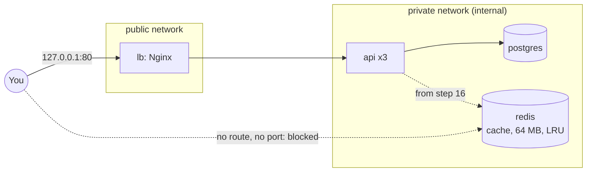

# Lab 05 — Caching (ElastiCache)

> **AWS equivalent:** Amazon ElastiCache (Redis OSS / Valkey), subnet groups, security groups  ·  **Time:** ~60 min  ·  **Difficulty:** ★★☆
> **Builds on:** [Lab 04](./04-database.md)  ·  **Reference solution:** commit `b382737` (step 15) on `dev`

> **Status:** in progress. Step 15 is written; steps 16–17 (cache-aside on `GET /notes/{id}`, the cache test) and the closing sections (5–11) come next.

## 1. What you will learn
- Explain what a **cache** is, what a **hit** and a **miss** are, and why a cache is allowed to forget.
- Name the parts of an AWS ElastiCache setup (cluster, node, subnet group, security group, endpoint, auth) and their local counterparts.
- Run **Redis** in a container: private network only, password from `.env`, a memory limit with the `allkeys-lru` eviction policy, and no persistence.
- Prove with commands that the cache needs the password, is unreachable from your machine, and **evicts old keys** instead of running out of memory.

## 2. Theory

### 2.1 The concept
Some questions are expensive to answer: a database query that joins big tables, a page that must be built from ten sources. If the same question is asked a thousand times a minute, answering it from scratch every time wastes time and
puts the database under needless load.

A **cache** keeps a **copy of the answer** somewhere much faster, so the next identical question is answered from the copy. Think of a **sticky note on your desk with a phone number**: looking in the phone book (the database) takes a minute,
reading the note takes a second. If the number is on the note, that is a **hit**; if not, you look in the phone book (a **miss**) and write a new note.

A cache comes with three rules you must accept:
- **It can be wrong.** The copy may be older than the original. That is why every cached value gets a **TTL** (*time to live*: it expires after a while) and why the application removes (*invalidates*) it when the original changes. This is the hardest part and is the subject of step 16.
- **It is small.** Fast memory is limited, so when it is full the cache must **evict** something. A common rule is **LRU** (*least recently used*): throw away what has been unused the longest.
- **It may disappear.** The cache is only an accelerator. If it is emptied, the system must still work, just slower. So it never holds the only copy of anything important.

**Redis** is the program used here: an **in-memory key-value store**. You store a value under a name (a *key*: `note:7`) and fetch it back by that name, in a fraction of a millisecond because everything lives in RAM. It can also be configured with a memory limit and an eviction rule, which is exactly what a cache needs.

### 2.2 How AWS does it
**Amazon ElastiCache** runs Redis-compatible (Redis OSS or Valkey) and Memcached caches for you. You choose a node size, and AWS handles installation, patching, failure detection and replacement:

| ElastiCache piece | What it is |
|---|---|
| **Cluster / replication group** | The cache itself: one or more **nodes** (servers); with replicas in other availability zones for failover. |
| **Node type** | The size of each node (CPU and memory, for example `cache.t4g.micro`). It limits how much the cache can hold. |
| **Subnet group** | The private subnets where the nodes may live ([AWS 04](../courses/aws/04-vpc.md)). |
| **Security group** | The firewall: "allow port 6379 only from the API's security group". |
| **Endpoint** | A DNS name the application connects to; AWS repoints it on failover. |
| **Authentication and TLS** | A password or user (AUTH) and optional encryption in transit, set at creation. |
| **Parameter group** | The engine settings, such as the **eviction policy** (`maxmemory-policy`). |

In the console: **ElastiCache → Redis OSS caches** (or *Valkey*), plus **VPC → Security groups**.

### 2.3 How we reproduce it locally
| Concept | AWS | This lab |
|---|---|---|
| The cache | ElastiCache cluster | the `redis` service (official image `redis:8.10.3-alpine3.23`) |
| Node size | node type (memory) | `--maxmemory 64mb` |
| Eviction policy | parameter group, `maxmemory-policy` | `--maxmemory-policy allkeys-lru` |
| Private placement | subnet group, private subnets | the `private` (internal) Docker network, and **no** `ports:` |
| Who may connect | security group rule from the API's group | membership of `private`, plus the password |
| Endpoint | DNS name of the cluster | the service name `redis` (Docker DNS, see [Docker 07](../courses/docker/07-networks.md)) |
| Authentication | AUTH token | `REDIS_PASSWORD` in `.env` (gitignored) |
| Health | cluster status `available` | Docker healthcheck with `redis-cli ping` |
| Replicas, Multi-AZ failover, backups, TLS | managed by AWS | not simulated |

### 2.4 Diagram


## 3. Prerequisites
- [Lab 04](./04-database.md) completed: `make up` runs, `make test` is green.
- A Redis password in your `.env`. Like the database password, it has **no default** on purpose, so from this step on `docker compose` refuses to run without it. Generate a random fake one and append it without printing it:
  ```bash
  printf '\nREDIS_PASSWORD=%s\n' "$(openssl rand -hex 12)" >> .env
  ```
  (or add any `REDIS_PASSWORD=...` line by hand). `.env.example` shows the variable; `.env` is gitignored and never committed.

## 4. Steps

> Try each step yourself first, then compare with the reference commit.

### Step 15 — The Redis container
**Why:** this is the "ElastiCache cluster" of the architecture: a fast in-memory store on the private network, protected by a password, that can never use more than a fixed amount of memory.

**Do it.** Add the service to `docker-compose.yml`, after `postgres`:

```yaml
  # The cache (ElastiCache in AWS). Private network only and no "ports:": like the database, only
  # containers on "private" can reach it. A cache holds copies that can be rebuilt, so there is no
  # volume: if the container is re-created, the cache starts empty.
  redis:
    image: redis:8.10.3-alpine3.23
    environment:
      # No default on purpose (see POSTGRES_PASSWORD): a missing password stops "docker compose".
      REDIS_PASSWORD: ${REDIS_PASSWORD:?set REDIS_PASSWORD in .env (see .env.example)}
    # The shell reads the password from the environment, so it is not written in this file.
    #   --maxmemory + allkeys-lru: never grow past 64 MB; when full, evict the least recently used key
    #   --save "" + --appendonly no: no snapshot or log on disk (a cache is disposable)
    command:
      - sh
      - -c
      - exec redis-server --requirepass "$$REDIS_PASSWORD" --maxmemory 64mb --maxmemory-policy allkeys-lru --save "" --appendonly no
    # The image declares /data as a volume: an in-memory folder stops Docker from creating a hidden one.
    tmpfs:
      - /data
    networks:
      - private
    healthcheck:
      # redis-cli reads the password from REDISCLI_AUTH; $$ keeps the variable for the container's shell.
      test: ["CMD-SHELL", "REDISCLI_AUTH=\"$${REDIS_PASSWORD}\" redis-cli ping | grep -q PONG"]
      interval: 10s
      timeout: 3s
      retries: 5
      start_period: 5s
```
and the placeholder in `.env.example`:
```bash
# Cache (Lab 05). Fake local value. REDIS_PASSWORD has no default: put your own in .env.
REDIS_PASSWORD=change-me-local-only
```

| Line | What it does | If you change or remove it |
|---|---|---|
| `image: redis:8.10.3-alpine3.23` | The official Redis image, **pinned** to Redis 8.10.3 on Alpine 3.23 (small). | `redis:latest` would change under you (forbidden here); a new major version can change defaults. |
| `REDIS_PASSWORD: ${REDIS_PASSWORD:?message}` | Reads the password from `.env` and passes it to the container; `:?` stops Compose with the message if it is missing. | A default here would put a password in the repository. |
| `command: [sh, -c, exec redis-server ...]` | Starts Redis through a shell so that `"$$REDIS_PASSWORD"` is expanded **inside the container** (`$$` is a literal `$` for Compose); `exec` makes Redis the main process so it receives stop signals. | Writing the password straight into `command:` would put it in the file. |
| `--requirepass` | Clients must authenticate with this password before any command. | Without it anyone on `private` could read and wipe the cache. |
| `--maxmemory 64mb` | Hard limit for the data. | Without it Redis grows until the machine runs out of memory. |
| `--maxmemory-policy allkeys-lru` | When full, evict the **approximately least recently used** key among **all** keys. | The default `noeviction` makes writes **fail** when memory is full: bad for a cache. |
| `--save ""` / `--appendonly no` | No snapshot file and no append log: nothing is written to disk. | By default Redis snapshots to `/data`; for a pure cache that is wasted work. |
| `tmpfs: - /data` | Mounts an in-memory folder on `/data`. The image *declares* `/data` as a volume, and without this Docker would silently create an anonymous volume for it on every container creation. | Remove it and a hidden volume appears each time the container is re-created. |
| `networks: - private`, no `ports:` | Only containers on the internal network can reach Redis. | `ports: ["6379:6379"]` would open the cache to your machine (and cannot work on an internal network anyway, see [Lab 04, step 13](./04-database.md)). |
| `healthcheck: ... redis-cli ping \| grep -q PONG` | Docker runs it every 10 s; `healthy` means Redis answers `PONG`. `REDISCLI_AUTH` is the variable `redis-cli` reads its password from. | Without it `depends_on: condition: service_healthy` (step 16) cannot wait for the cache. |

**Check the file first.** Before the password is in `.env` (or in your shell), this is what you get:
```bash
docker compose config -q
```
```text
error while interpolating services.redis.environment.REDIS_PASSWORD: required variable REDIS_PASSWORD is missing a value: set REDIS_PASSWORD in .env (see .env.example)
```
This also means **every** `docker compose` command (and `make test`) now needs the variable: add it to `.env` as shown in section 3. (In the run below the variable was set in the shell for the session instead, with a throw-away fake value, so `.env` was not touched.)

Start the stack and wait until Redis is `healthy`:
```bash
docker compose up -d
docker compose ps --format 'table {{.Service}}\t{{.Status}}\t{{.Ports}}'
```
```text
SERVICE    STATUS                    PORTS
lb         Up 4 minutes (healthy)    127.0.0.1:8081->80/tcp
postgres   Up 4 minutes (healthy)    5432/tcp
redis      Up 11 seconds (healthy)   6379/tcp
```
(`api` rows left out; `lb` is on 8081 because port 80 is busy on this machine.) `6379/tcp` without an arrow means "exposed inside Docker only", like `postgres`.

**Check 1 — `redis-cli ping`, the step's check:**
```bash
docker compose exec -T redis sh -c 'REDISCLI_AUTH="$REDIS_PASSWORD" redis-cli ping'
```
```text
PONG
```
`ping` asks "are you alive?"; `PONG` is the answer. The `sh -c` and `REDISCLI_AUTH` give `redis-cli` the password from the container's own environment, so the password never appears in the command you type.

**Check 2 — the password is required:**
```bash
docker compose exec -T redis redis-cli ping
```
```text
NOAUTH Authentication required.
```
The same command without the password is refused.

**Check 3 — the settings really are the ones we asked for:**
```bash
docker compose exec -T redis sh -c 'REDISCLI_AUTH="$REDIS_PASSWORD" redis-cli config get maxmemory'    # and the same for maxmemory-policy, save, appendonly
```
```text
maxmemory	67108864
maxmemory-policy	allkeys-lru
save	
appendonly	no
```
(The four answers of `config get` are joined for readability; `save` is empty, meaning no snapshots.) `67108864` bytes is 64 MiB.

**Check 4 — store, read and expire a key:**
```bash
docker compose exec -T redis sh -c 'export REDISCLI_AUTH="$REDIS_PASSWORD"; redis-cli set greeting hello; redis-cli get greeting; redis-cli set short-lived x ex 30; redis-cli ttl short-lived; redis-cli del greeting short-lived'
```
```text
OK
hello
OK
30
2
```
`set` stored `greeting`, `get` read it back. `set short-lived x ex 30` stores a key that **expires in 30 seconds**; `ttl` shows the seconds left (30). `del` removed both keys (it printed `2`, the number deleted). The TTL is the tool step 16 uses to keep cached notes from getting too old.

**Check 5 — it is private:**
```bash
docker compose port redis 6379
timeout 3 bash -c '</dev/tcp/127.0.0.1/6379' 2>/dev/null && echo "OPEN on the host" || echo "127.0.0.1:6379 closed"
docker compose exec -T --index 1 api python -c "import socket; socket.create_connection(('redis', 6379), timeout=3); print('api -> redis:6379 connected')"
docker inspect $(docker compose ps -q redis) --format 'volumes/bind mounts: {{len .Mounts}}   tmpfs: {{.HostConfig.Tmpfs}}'
```
```text
:0
127.0.0.1:6379 closed
api -> redis:6379 connected
volumes/bind mounts: 0   tmpfs: map[/data:]
```
`:0` means no published port, and the host cannot connect. An API replica **can** reach `redis:6379` on the private network (the control: the cache is running). The last line shows no volume at all, only the in-memory `/data`.

**Check 6 — when full, it evicts instead of failing.** Write about 100 MB of 1 kB values into the 64 MB cache with Redis's own benchmark tool (`-n` requests, `-d` bytes per value, `-r` random keys):
```bash
docker compose exec -T redis sh -c 'export REDISCLI_AUTH="$REDIS_PASSWORD"; redis-cli info stats | grep evicted_keys; redis-benchmark -a "$REDIS_PASSWORD" -q -t set -n 100000 -d 1024 -r 1000000; redis-cli info memory | grep -E "^used_memory_human|^maxmemory_human"; redis-cli info stats | grep evicted_keys; redis-cli dbsize'
```
```text
evicted_keys:0
SET: 62421.97 requests per second, p50=0.407 msec
used_memory_human:63.59M
maxmemory_human:64.00M
evicted_keys:47266
49132
```
(The benchmark prints a progress line that is trimmed here to its last line.) Before: **0** evicted keys. The benchmark wrote 100,000 values of 1 kB (about 100 MB), more than the cache may hold. After: memory is **63.59 MB of 64 MB**, Redis **evicted 47,266 keys** to make room, and **49,132 keys** are left
(the 47,266 evicted plus the 49,132 left make about 96,000 keys stored in total; the benchmark's keys are random, so some of the 100,000 writes hit a key that already existed). No write failed. This is `allkeys-lru` doing its job. Clean up: `redis-cli flushall` empties the cache (it printed `OK`, then `dbsize` was `0`).

**Regression check:** the isolation test from Lab 03 still passes with Redis in the stack (only the load balancer publishes a port):
```bash
bash tests/03_network_isolation.sh
```
```text
  PASS  only lb publishes a port (127.0.0.1:8081->80/tcp)
  PASS  postgres publishes no port
03_network_isolation: all checks passed
```
(Filtered to the interesting lines.)

**What just happened:**
- You added the architecture's "ElastiCache cluster": a memory store that nothing but the API will be able to reach, behind a password, with a hard memory ceiling.
- Redis is **configured as a cache, not as a database**: it may forget (eviction), it keeps nothing on disk, and re-creating the container empties it. That is the right behaviour for copies of data that live safely in Postgres.
- The password is a second **secret** in `.env`. Like Postgres's, it has no default, so a forgotten setting stops Compose instead of starting an unprotected cache.
- The password is read by the shell inside the container, so it is not written in `docker-compose.yml`. It is still visible to anyone who can run `docker inspect` on the machine (see [Docker 06](../courses/docker/06-config-and-secrets.md)); that is acceptable for local fake credentials.

## 5–11. To be completed in step 17
Verify, Troubleshooting, Going to real AWS, Clean up, Check your understanding, Exercises and Further reading are written when the lab ends (step 17).
