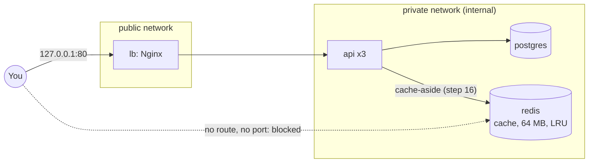

# Lab 05 — Caching (ElastiCache)

> **AWS equivalent:** Amazon ElastiCache (Redis OSS / Valkey), subnet groups, security groups  ·  **Time:** ~60 min  ·  **Difficulty:** ★★☆
> **Builds on:** [Lab 04](./04-database.md)  ·  **Reference solution:** commits `b382737` (step 15), `c50f45d` (step 16) and `6b61ddb` (step 17) on `dev`

## 1. What you will learn
- Explain what a **cache** is, what a **hit** and a **miss** are, and why a cache is allowed to forget.
- Name the parts of an AWS ElastiCache setup (cluster, node, subnet group, security group, endpoint, auth) and their local counterparts.
- Run **Redis** in a container: private network only, password from `.env`, a memory limit with the `allkeys-lru` eviction policy, and no persistence.
- Prove with commands that the cache needs the password, is unreachable from your machine, and **evicts old keys** instead of running out of memory.
- Implement the **cache-aside** pattern: a TTL on every copy, invalidation when a note changes, an `X-Cache` header to see what happened, and a cache that is allowed to fail without taking the API down.

## 2. Theory

### 2.1 The concept
Some questions are expensive to answer: a database query that joins big tables, a page that must be built from ten sources. If the same question is asked a thousand times a minute, answering it from scratch every time wastes time and
puts the database under needless load.

A **cache** keeps a **copy of the answer** somewhere much faster, so the next identical question is answered from the copy. Think of a **sticky note on your desk with a phone number**: looking in the phone book (the database) takes a minute,
reading the note takes a second. If the number is on the note, that is a **hit**; if not, you look in the phone book (a **miss**) and write a new note.

A cache comes with three rules you must accept:
- **It can be wrong.** The copy may be older than the original. That is why every cached value gets a **TTL** (*time to live*: it expires after a while) and why the application removes (*invalidates*) it when the original changes. This is the hardest part and is the subject of step 16.
- **It is small.** Fast memory is limited, so when it is full the cache must **evict** something. A common rule is **LRU** (*least recently used*): throw away what has been unused the longest.
- **It may disappear.** The cache is only an accelerator. If it is emptied, the system must still work, just slower. So it never holds the only copy of anything important.

The most common way to use a cache is **cache-aside** (also called *lazy loading*), where the application itself manages the copies. To **read**: ask the cache; if the answer is there (a hit) return it; if not (a miss) ask the database, store the answer in the cache with a TTL, and return it. To **write**: change the database first, then **delete** the cached copy (rather than updating it), so the next read fetches and stores the fresh version.
Between a change and the next refill a copy can be out of date, so the TTL sets the longest time anything can stay wrong.

**Redis** is the program used here: an **in-memory key-value store**. You store a value under a name (a *key*: `note:7`) and fetch it back by that name, in a fraction of a millisecond because everything lives in RAM. It can also be configured with a memory limit and an eviction rule, which is exactly what a cache needs.

### 2.2 How AWS does it
**Amazon ElastiCache** runs Redis-compatible (Redis OSS or Valkey) and Memcached caches for you. You choose a node size, and AWS handles installation, patching, failure detection and replacement:

| ElastiCache piece | What it is |
|---|---|
| **Cluster / replication group** | The cache itself: one or more **nodes** (servers); with replicas in other availability zones for failover. |
| **Node type** | The size of each node (CPU and memory, for example `cache.t4g.micro`). It limits how much the cache can hold. |
| **Subnet group** | The private subnets where the nodes may live ([AWS 04](../courses/aws/04-vpc.md)). |
| **Security group** | The firewall: "allow port 6379 only from the API's security group". |
| **Endpoint** | A DNS name the application connects to; AWS repoints it on failover. |
| **Authentication and TLS** | A password or user (AUTH) and optional encryption in transit, set at creation. |
| **Parameter group** | The engine settings, such as the **eviction policy** (`maxmemory-policy`). |

In the console: **ElastiCache → Redis OSS caches** (or *Valkey*), plus **VPC → Security groups**.

### 2.3 How we reproduce it locally
| Concept | AWS | This lab |
|---|---|---|
| The cache | ElastiCache cluster | the `redis` service (official image `redis:8.10.3-alpine3.23`) |
| Node size | node type (memory) | `--maxmemory 64mb` |
| Eviction policy | parameter group, `maxmemory-policy` | `--maxmemory-policy allkeys-lru` |
| Private placement | subnet group, private subnets | the `private` (internal) Docker network, and **no** `ports:` |
| Who may connect | security group rule from the API's group | membership of `private`, plus the password |
| Endpoint | DNS name of the cluster | the service name `redis` (Docker DNS, see [Docker 07](../courses/docker/07-networks.md)) |
| Authentication | AUTH token | `REDIS_PASSWORD` in `.env` (gitignored) |
| Cache logic | application code that talks to the cluster endpoint | `read_note` in `api/main.py` (cache-aside) |
| How long a copy may be stale | TTL on each key | `CACHE_TTL_SECONDS` (60) |
| Health | cluster status `available` | Docker healthcheck with `redis-cli ping` |
| Replicas, Multi-AZ failover, backups, TLS | managed by AWS | not simulated |

> **Later use (Lab 07, step 22):** the job queue lives in this same Redis. With these cache settings (`allkeys-lru`, no snapshot, no append-only file) queued jobs are lost when Redis restarts, and could be evicted when memory is full: see [Lab 07, step 22](./07-queues-workers.md#step-22--post-jobs-and-get-jobsid).

### 2.4 Diagram


## 3. Prerequisites
- [Lab 04](./04-database.md) completed: `make up` runs, `make test` is green.
- A Redis password in your `.env`. Like the database password, it has **no default** on purpose, so from this step on `docker compose` refuses to run without it. Generate a random fake one and append it without printing it:
  ```bash
  printf '\nREDIS_PASSWORD=%s\n' "$(openssl rand -hex 12)" >> .env
  ```
  (or add any `REDIS_PASSWORD=...` line by hand). `.env.example` shows the variable; `.env` is gitignored and never committed.

## 4. Steps

> Try each step yourself first, then compare with the reference commit.

### Step 15 — The Redis container
**Why:** this is the "ElastiCache cluster" of the architecture: a fast in-memory store on the private network, protected by a password, that can never use more than a fixed amount of memory.

**Do it.** Add the service to `docker-compose.yml`, after `postgres`:

```yaml
  # The cache (ElastiCache in AWS). Private network only and no "ports:": like the database, only
  # containers on "private" can reach it. A cache holds copies that can be rebuilt, so there is no
  # volume: if the container is re-created, the cache starts empty.
  redis:
    image: redis:8.10.3-alpine3.23
    environment:
      # No default on purpose (see POSTGRES_PASSWORD): a missing password stops "docker compose".
      REDIS_PASSWORD: ${REDIS_PASSWORD:?set REDIS_PASSWORD in .env (see .env.example)}
    # The shell reads the password from the environment, so it is not written in this file.
    #   --maxmemory + allkeys-lru: never grow past 64 MB; when full, evict the least recently used key
    #   --save "" + --appendonly no: no snapshot or log on disk (a cache is disposable)
    command:
      - sh
      - -c
      - exec redis-server --requirepass "$$REDIS_PASSWORD" --maxmemory 64mb --maxmemory-policy allkeys-lru --save "" --appendonly no
    # The image declares /data as a volume: an in-memory folder stops Docker from creating a hidden one.
    tmpfs:
      - /data
    networks:
      - private
    healthcheck:
      # redis-cli reads the password from REDISCLI_AUTH; $$ keeps the variable for the container's shell.
      test: ["CMD-SHELL", "REDISCLI_AUTH=\"$${REDIS_PASSWORD}\" redis-cli ping | grep -q PONG"]
      interval: 10s
      timeout: 3s
      retries: 5
      start_period: 5s
```
and the placeholder in `.env.example`:
```bash
# Cache (Lab 05). Fake local value. REDIS_PASSWORD has no default: put your own in .env.
REDIS_PASSWORD=change-me-local-only
```

| Line | What it does | If you change or remove it |
|---|---|---|
| `image: redis:8.10.3-alpine3.23` | The official Redis image, **pinned** to Redis 8.10.3 on Alpine 3.23 (small). | `redis:latest` would change under you (forbidden here); a new major version can change defaults. |
| `REDIS_PASSWORD: ${REDIS_PASSWORD:?message}` | Reads the password from `.env` and passes it to the container; `:?` stops Compose with the message if it is missing. | A default here would put a password in the repository. |
| `command: [sh, -c, exec redis-server ...]` | Starts Redis through a shell so that `"$$REDIS_PASSWORD"` is expanded **inside the container** (`$$` is a literal `$` for Compose); `exec` makes Redis the main process so it receives stop signals. | Writing the password straight into `command:` would put it in the file. |
| `--requirepass` | Clients must authenticate with this password before any command. | Without it anyone on `private` could read and wipe the cache. |
| `--maxmemory 64mb` | Hard limit for the data. | Without it Redis grows until the machine runs out of memory. |
| `--maxmemory-policy allkeys-lru` | When full, evict the **approximately least recently used** key among **all** keys. | The default `noeviction` makes writes **fail** when memory is full: bad for a cache. |
| `--save ""` / `--appendonly no` | No snapshot file and no append log: nothing is written to disk. | By default Redis snapshots to `/data`; for a pure cache that is wasted work. |
| `tmpfs: - /data` | Mounts an in-memory folder on `/data`. The image *declares* `/data` as a volume, and without this Docker would silently create an anonymous volume for it on every container creation. | Remove it and a hidden volume appears each time the container is re-created. |
| `networks: - private`, no `ports:` | Only containers on the internal network can reach Redis. | `ports: ["6379:6379"]` would open the cache to your machine (and cannot work on an internal network anyway, see [Lab 04, step 13](./04-database.md)). |
| `healthcheck: ... redis-cli ping \| grep -q PONG` | Docker runs it every 10 s; `healthy` means Redis answers `PONG`. `REDISCLI_AUTH` is the variable `redis-cli` reads its password from. | Without it `depends_on: condition: service_healthy` (step 16) cannot wait for the cache. |

**Check the file first.** Before the password is in `.env` (or in your shell), this is what you get:
```bash
docker compose config -q
```
```text
error while interpolating services.redis.environment.REDIS_PASSWORD: required variable REDIS_PASSWORD is missing a value: set REDIS_PASSWORD in .env (see .env.example)
```
This also means **every** `docker compose` command (and `make test`) now needs the variable: add it to `.env` as shown in section 3. (In the run below the variable was set in the shell for the session instead, with a throw-away fake value, so `.env` was not touched.)

Start the stack and wait until Redis is `healthy`:
```bash
docker compose up -d
docker compose ps --format 'table {{.Service}}\t{{.Status}}\t{{.Ports}}'
```
```text
SERVICE    STATUS                    PORTS
lb         Up 4 minutes (healthy)    127.0.0.1:8081->80/tcp
postgres   Up 4 minutes (healthy)    5432/tcp
redis      Up 11 seconds (healthy)   6379/tcp
```
(`api` rows left out; `lb` is on 8081 because port 80 is busy on this machine.) `6379/tcp` without an arrow means "exposed inside Docker only", like `postgres`.

**Check 1 — `redis-cli ping`, the step's check:**
```bash
docker compose exec -T redis sh -c 'REDISCLI_AUTH="$REDIS_PASSWORD" redis-cli ping'
```
```text
PONG
```
`ping` asks "are you alive?"; `PONG` is the answer. The `sh -c` and `REDISCLI_AUTH` give `redis-cli` the password from the container's own environment, so the password never appears in the command you type.

**Check 2 — the password is required:**
```bash
docker compose exec -T redis redis-cli ping
```
```text
NOAUTH Authentication required.
```
The same command without the password is refused.

**Check 3 — the settings really are the ones we asked for:**
```bash
docker compose exec -T redis sh -c 'REDISCLI_AUTH="$REDIS_PASSWORD" redis-cli config get maxmemory'    # and the same for maxmemory-policy, save, appendonly
```
```text
maxmemory	67108864
maxmemory-policy	allkeys-lru
save	
appendonly	no
```
(The four answers of `config get` are joined for readability; `save` is empty, meaning no snapshots.) `67108864` bytes is 64 MiB.

**Check 4 — store, read and expire a key:**
```bash
docker compose exec -T redis sh -c 'export REDISCLI_AUTH="$REDIS_PASSWORD"; redis-cli set greeting hello; redis-cli get greeting; redis-cli set short-lived x ex 30; redis-cli ttl short-lived; redis-cli del greeting short-lived'
```
```text
OK
hello
OK
30
2
```
`set` stored `greeting`, `get` read it back. `set short-lived x ex 30` stores a key that **expires in 30 seconds**; `ttl` shows the seconds left (30). `del` removed both keys (it printed `2`, the number deleted). The TTL is the tool step 16 uses to keep cached notes from getting too old.

**Check 5 — it is private:**
```bash
docker compose port redis 6379
timeout 3 bash -c '</dev/tcp/127.0.0.1/6379' 2>/dev/null && echo "OPEN on the host" || echo "127.0.0.1:6379 closed"
docker compose exec -T --index 1 api python -c "import socket; socket.create_connection(('redis', 6379), timeout=3); print('api -> redis:6379 connected')"
docker inspect $(docker compose ps -q redis) --format 'volumes/bind mounts: {{len .Mounts}}   tmpfs: {{.HostConfig.Tmpfs}}'
```
```text
:0
127.0.0.1:6379 closed
api -> redis:6379 connected
volumes/bind mounts: 0   tmpfs: map[/data:]
```
`:0` means no published port, and the host cannot connect. An API replica **can** reach `redis:6379` on the private network (the control: the cache is running). The last line shows no volume at all, only the in-memory `/data`.

**Check 6 — when full, it evicts instead of failing.** Write about 100 MB of 1 kB values into the 64 MB cache with Redis's own benchmark tool (`-n` requests, `-d` bytes per value, `-r` random keys):
```bash
docker compose exec -T redis sh -c 'export REDISCLI_AUTH="$REDIS_PASSWORD"; redis-cli info stats | grep evicted_keys; redis-benchmark -a "$REDIS_PASSWORD" -q -t set -n 100000 -d 1024 -r 1000000; redis-cli info memory | grep -E "^used_memory_human|^maxmemory_human"; redis-cli info stats | grep evicted_keys; redis-cli dbsize'
```
```text
evicted_keys:0
SET: 62421.97 requests per second, p50=0.407 msec
used_memory_human:63.59M
maxmemory_human:64.00M
evicted_keys:47266
49132
```
(The benchmark prints a progress line that is trimmed here to its last line.) Before: **0** evicted keys. The benchmark wrote 100,000 values of 1 kB (about 100 MB), more than the cache may hold. After: memory is **63.59 MB of 64 MB**, Redis **evicted 47,266 keys** to make room, and **49,132 keys** are left
(the 47,266 evicted plus the 49,132 left make about 96,000 keys stored in total; the benchmark's keys are random, so some of the 100,000 writes hit a key that already existed). No write failed. This is `allkeys-lru` doing its job. Clean up: `redis-cli flushall` empties the cache (it printed `OK`, then `dbsize` was `0`).

**Regression check:** the isolation test from Lab 03 still passes with Redis in the stack (only the load balancer publishes a port):
```bash
bash tests/03_network_isolation.sh
```
```text
  PASS  only lb publishes a port (127.0.0.1:8081->80/tcp)
  PASS  postgres publishes no port
03_network_isolation: all checks passed
```
(Filtered to the interesting lines.)

**What just happened:**
- You added the architecture's "ElastiCache cluster": a memory store that nothing but the API will be able to reach, behind a password, with a hard memory ceiling.
- Redis is **configured as a cache, not as a database**: it may forget (eviction), it keeps nothing on disk, and re-creating the container empties it. That is the right behaviour for copies of data that live safely in Postgres.
- The password is a second **secret** in `.env`. Like Postgres's, it has no default, so a forgotten setting stops Compose instead of starting an unprotected cache.
- The password is read by the shell inside the container, so it is not written in `docker-compose.yml`. It is still visible to anyone who can run `docker inspect` on the machine (see [Docker 06](../courses/docker/06-config-and-secrets.md)); that is acceptable for local fake credentials.

### Step 16 — Cache-aside on `GET /notes/{id}`
**Why:** Redis is running but nothing uses it. This step teaches the API to keep a copy of each note it reads, so the second, third, hundredth read of the same note is answered from memory without asking Postgres, and to **throw the copy away when the note changes**.

**Do it.** Three changes.

1. Pin the Redis client library, `api/requirements.txt` (one new line at the end):
   ```text
   redis==8.1.0
   ```

2. Give the API the cache's address and wait for the cache, in `docker-compose.yml` (the `api` service; only the new lines are marked):
   ```yaml
     api:
       # ... build, image, deploy unchanged ...
       environment:
         <<: *db-env
         UVICORN_LOG_LEVEL: ${API_LOG_LEVEL:-info}
         # The cache address (like an ElastiCache endpoint) and how long a cached note stays valid.   # new
         REDIS_URL: redis://:${REDIS_PASSWORD:?set REDIS_PASSWORD in .env (see .env.example)}@redis:6379/0   # new
         CACHE_TTL_SECONDS: ${CACHE_TTL_SECONDS:-60}                                                   # new
       depends_on:
         migrate:
           condition: service_completed_successfully
         # ... and once the cache answers (the API still works without it, see api/main.py).          # new
         redis:                                                                                         # new
           condition: service_healthy                                                                   # new
       # ... networks and healthcheck unchanged ...
   ```
   `CACHE_TTL_SECONDS` is optional (60 if unset); to change it, add `CACHE_TTL_SECONDS=...` to your `.env`.

3. The cache logic in `api/main.py`. At the top, the new imports and the cache client (the rest of the imports are unchanged):
   ```python
   import logging
   import os
   import socket
   from datetime import datetime
   from typing import Annotated, Iterator

   import redis
   from fastapi import Depends, FastAPI, HTTPException, Response, status
   # ... pydantic, sqlalchemy and db imports unchanged ...

   app = FastAPI(title="aws-local-lab API")

   # Uvicorn's logger: it is already set up, so our lines show in "docker compose logs api".
   log = logging.getLogger("uvicorn.error")

   # The cache. Short timeouts: a slow or dead cache must not make the API slow too.
   cache = redis.Redis.from_url(
       os.environ["REDIS_URL"], decode_responses=True, socket_connect_timeout=1, socket_timeout=1
   )
   CACHE_TTL = int(os.environ.get("CACHE_TTL_SECONDS", "60"))
   ```
   Then replace the `GET`, `PUT` and `DELETE` of one note (the list and `POST` routes are unchanged):
   ```python
   def forget(note_id: int) -> None:
       """Remove a note from the cache (the original changed). A dead cache must not break a write."""
       try:
           cache.delete(f"note:{note_id}")
       except redis.RedisError as exc:
           log.warning("cache DELETE failed for note:%s (%s)", note_id, exc)


   @app.get("/notes/{note_id}", response_model=NoteOut)
   def read_note(note_id: int, db: DbSession):
       """Cache-aside: look in the cache first; on a miss read the database and keep a copy."""
       key = f"note:{note_id}"
       state = "MISS"
       try:
           cached = cache.get(key)
           if cached is not None:
               log.info("cache HIT  %s", key)
               return Response(content=cached, media_type="application/json", headers={"X-Cache": "HIT"})
       except redis.RedisError as exc:
           state = "BYPASS"  # the cache is down: answer from the database, never fail because of it
           log.warning("cache unavailable (%s): reading %s from the database", exc, key)
       body = NoteOut.model_validate(get_note_or_404(db, note_id)).model_dump_json()
       if state == "MISS":
           log.info("cache MISS %s (stored for %ss)", key, CACHE_TTL)
           try:
               cache.set(key, body, ex=CACHE_TTL)
           except redis.RedisError as exc:
               log.warning("cache SET failed for %s (%s)", key, exc)
       return Response(content=body, media_type="application/json", headers={"X-Cache": state})


   @app.put("/notes/{note_id}", response_model=NoteOut)
   def update_note(note_id: int, data: NoteIn, db: DbSession):
       note = get_note_or_404(db, note_id)
       note.title = data.title
       note.body = data.body
       db.commit()
       forget(note_id)  # the cached copy is now wrong: drop it, the next read refills it
       return note


   @app.delete("/notes/{note_id}", status_code=status.HTTP_204_NO_CONTENT)
   def delete_note(note_id: int, db: DbSession):
       db.delete(get_note_or_404(db, note_id))
       db.commit()
       forget(note_id)
       return Response(status_code=status.HTTP_204_NO_CONTENT)
   ```

| Line | What it does | If you change or remove it |
|---|---|---|
| `redis==8.1.0` | The Python client for Redis, pinned. | Unpinned, a new version could change behaviour between two builds. |
| `REDIS_URL: redis://:PASSWORD@redis:6379/0` | One address with everything needed: scheme, password (the empty user before `:`), host `redis` (Docker DNS), port, database number `0`. `${REDIS_PASSWORD:?...}` stops Compose if the password is missing. | A wrong host or password makes every cache call fail (the API still answers, see `BYPASS`). |
| `CACHE_TTL_SECONDS: ${...:-60}` | How long a copy stays valid, 60 s unless you set it. | A long TTL means longer staleness; a short one means more misses. |
| `depends_on: redis: service_healthy` | The API starts once Redis answers `PONG`. | Without it the first requests after a cold start would run without a cache. |
| `redis.Redis.from_url(..., socket_connect_timeout=1, socket_timeout=1)` | The client. `decode_responses=True` returns text instead of bytes. The 1-second timeouts mean a dead cache costs at most about a second, not a minute. | Without timeouts, an unreachable Redis could hang every request. |
| `log = logging.getLogger("uvicorn.error")` | Reuses Uvicorn's logger, already configured, so `log.info` lines appear in `docker compose logs api`. | A new logger would print nothing unless you configure logging. |
| `key = f"note:{note_id}"` | The cache key: one per note, named by kind and id. | A key without a prefix could clash with other data later. |
| `cache.get(key)` → `HIT` | If the key exists, return the stored JSON **as is**, with `X-Cache: HIT`. The database is not touched. | Always querying the database is what the cache is meant to avoid. |
| `except redis.RedisError` → `state = "BYPASS"` | If Redis is unreachable, read from the database and mark the answer `BYPASS`. The cache must be **optional**: it speeds things up, it must never take the API down. | Without it, a stopped Redis would turn every read into a `500`. |
| `NoteOut.model_validate(...).model_dump_json()` | Read the row (`404` if missing) and turn it into the same JSON the API always returns. | A missing note is **not** cached: only found notes are stored. |
| `cache.set(key, body, ex=CACHE_TTL)` | On a miss, store the JSON with an **expiry** (`ex` = seconds). | Without `ex` the copy would live until evicted, and could be wrong for ever. |
| `forget(note_id)` after `commit()` in `PUT` and `DELETE` | Delete the cached copy **after** the database change is saved. The next read is a miss and stores the fresh version. | Without it a read right after an update returns the **old** note until the TTL ends. |
| `return Response(..., headers={"X-Cache": state})` | The header the lab uses to *see* what happened: `HIT`, `MISS` or `BYPASS`. | Without it you would have to guess from timings or logs. |

**Rebuild and restart:**
```bash
docker compose up -d --build           # add LB_HOST_PORT=8081 in front if port 80 is busy
docker compose ps --format 'table {{.Service}}\t{{.Status}}'
```
```text
SERVICE    STATUS
api        Up 16 seconds (healthy)
api        Up 16 seconds (healthy)
api        Up 15 seconds (healthy)
lb         Up 30 minutes (healthy)
postgres   Up 31 minutes (healthy)
redis      Up 3 minutes (healthy)
```
(`migrate` is not listed: it ran and exited.)

**Check — the step's check: first read MISS, second HIT, after an update MISS again.**
```bash
B=localhost:8081
ID=$(curl -s -X POST $B/notes -H 'Content-Type: application/json' -d '{"title":"cache me","body":"first version"}' | sed -n 's/.*"id":\([0-9]*\).*/\1/p')
G() { curl -s -D - $B/notes/$ID | tr -d '\r' | grep -i -E '^(HTTP|x-cache)|^\{' ; }     # print the status line, X-Cache and the body
G; G; G
curl -s -o /dev/null -w 'PUT [HTTP %{http_code}]\n' -X PUT $B/notes/$ID -H 'Content-Type: application/json' -d '{"title":"cache me (edited)","body":"second version"}'
G; G
```
```text
--- read 1
HTTP/1.1 200 OK
x-cache: MISS
{"title":"cache me","body":"first version","id":6,"created_at":"2026-11-18T23:56:53.276168Z"}
--- read 2
HTTP/1.1 200 OK
x-cache: HIT
{"title":"cache me","body":"first version","id":6,"created_at":"2026-11-18T23:56:53.276168Z"}
--- read 3
HTTP/1.1 200 OK
x-cache: HIT
{"title":"cache me","body":"first version","id":6,"created_at":"2026-11-18T23:56:53.276168Z"}
--- update, then read
PUT [HTTP 200]
HTTP/1.1 200 OK
x-cache: MISS
{"title":"cache me (edited)","body":"second version","id":6,"created_at":"2026-11-18T23:56:53.276168Z"}
--- read again
HTTP/1.1 200 OK
x-cache: HIT
{"title":"cache me (edited)","body":"second version","id":6,"created_at":"2026-11-18T23:56:53.276168Z"}
```
(The `--- read ...` labels were added with `echo` between the calls; the header name is printed in lower case, `x-cache`; HTTP header names are case-insensitive, so `X-Cache` and `x-cache` are the same header.) Read it as a story: **MISS** (nothing cached, the database was asked and a copy stored), **HIT** twice (answered from Redis), then the **update**
dropped the copy, so the next read is a **MISS** that returns the **new** text (`cache me (edited)`), and the one after is a **HIT** again with the new text. The cache never served the old version after the update.

**Check — the log lines, and the key itself:**
```bash
docker compose logs api | grep -E "cache (HIT|MISS)"
docker compose exec -T redis sh -c "export REDISCLI_AUTH=\"\$REDIS_PASSWORD\"; redis-cli keys 'note:*'; redis-cli get note:$ID; redis-cli ttl note:$ID"
```
```text
api-1 | INFO:     cache HIT  note:6
api-3 | INFO:     cache HIT  note:6
api-3 | INFO:     cache MISS note:6 (stored for 60s)
api-1 | INFO:     cache HIT  note:6
api-2 | INFO:     cache MISS note:6 (stored for 60s)
note:6
{"title":"cache me (edited)","body":"second version","id":6,"created_at":"2026-11-18T23:56:53.276168Z"}
52
```
(`docker compose logs` groups lines per container, so they are not in time order.) The lines come from **three different replicas** (`api-1`, `api-2`, `api-3`) and yet a read on one replica is a `HIT` for a copy stored by another: the cache is **shared**, because it lives in Redis, not in the API's memory.
That is the point of a separate cache service. The key `note:6` holds the JSON, and `ttl` shows **52 seconds left** of its 60.

**What if…? Experiment A — the database changes behind the API's back:**
```bash
docker compose exec -T postgres sh -c "psql -U \"\$POSTGRES_USER\" -d \"\$POSTGRES_DB\" -tA -c \"update notes set title = 'changed in SQL' where id = $ID returning title;\""
G                                                          # read: what does the cache say?
docker compose exec -T redis sh -c "export REDISCLI_AUTH=\"\$REDIS_PASSWORD\"; redis-cli del note:$ID"; G
```
```text
changed in SQL
UPDATE 1
HTTP/1.1 200 OK
x-cache: HIT
{"title":"cache me (edited)","body":"second version","id":6,"created_at":"2026-11-18T23:56:53.276168Z"}
1
HTTP/1.1 200 OK
x-cache: MISS
{"title":"changed in SQL","body":"second version","id":6,"created_at":"2026-11-18T23:56:53.276168Z"}
```
The title was changed **in the database** with `psql`, not through the API, so nobody told the cache. The read is a `HIT` and returns the **old** title: that is a **stale** value, the price of a cache. It would correct itself when the TTL runs out (at most 60 s later); `redis-cli del` (it printed `1`, one key deleted) forces it, and the next read is a
`MISS` with the new title. Lesson: **invalidate on every write that goes through the application**, and keep a **TTL** as the safety net for everything else.

**Experiment B — `DELETE` removes the copy too:**
```bash
curl -s -o /dev/null -w 'DELETE [HTTP %{http_code}]\n' -X DELETE $B/notes/$ID
docker compose exec -T redis sh -c "export REDISCLI_AUTH=\"\$REDIS_PASSWORD\"; redis-cli exists note:$ID"
G
```
```text
DELETE [HTTP 204]
0
HTTP/1.1 404 Not Found
{"detail":"note not found"}
```
After the delete, `exists` prints `0` (the key is gone) and reading the note gives `404`. Without `forget()` in `delete_note`, a deleted note would keep being served from the cache for up to a minute.

**Experiment C — Redis goes away, the API keeps working:**
```bash
docker compose stop redis
G; G                                                     # two reads while the cache is down
curl -s -o /dev/null -w 'PUT [HTTP %{http_code}]\n' -X PUT $B/notes/$ID -H 'Content-Type: application/json' -d '{"title":"edited while redis was down","body":"y"}'
docker compose start redis
G; G                                                     # two reads after it is back
docker compose logs api | grep -E "unavailable|DELETE failed"
```
```text
--- redis up:
HTTP/1.1 200 OK x-cache: MISS
HTTP/1.1 200 OK x-cache: HIT
--- redis STOPPED:
HTTP/1.1 200 OK x-cache: BYPASS
HTTP/1.1 200 OK x-cache: BYPASS
--- a write while the cache is down:
PUT [HTTP 200]
--- redis back (it restarted empty):
HTTP/1.1 200 OK x-cache: MISS
HTTP/1.1 200 OK x-cache: HIT
      1 WARNING:  cache DELETE failed for note:7 (Error -3 connecting to redis:6379. Temporary failure in name resolution.)
      2 WARNING:  cache unavailable (Error -3 connecting to redis:6379. Temporary failure in name resolution.): reading note:7 from the database
```
(Here the note had id 7; this run used a variant of `G` that prints status and header on one line, and `echo` labels were added; the "redis up" reads, `MISS` then `HIT`, were part of the same run. The warnings are the lines the API logged, counted with `sort | uniq -c`.) With Redis stopped, reads still returned `200`, marked **`BYPASS`** (answered from the database), and the `PUT` still succeeded: the cache is an accelerator, not a dependency. When Redis came back it
was **empty** (nothing is written to disk, step 15), so the first read was a `MISS` and the second a `HIT`. One caveat: if Redis were only *unreachable* for a moment but kept its data, a `PUT` during that time could not delete the cached copy, which would stay stale until its TTL ended. That is exactly what the TTL is for.

**Regression check — the whole suite:**
```bash
make test                                 # add LB_HOST_PORT=8081 in front if port 80 is busy
```
```text
== tests/02_failover.sh
02_failover: all checks passed
== tests/02_load_balancing.sh
02_load_balancing: all checks passed
== tests/03_network_isolation.sh
03_network_isolation: all checks passed
== tests/04_persistence.sh
04_persistence: all checks passed
```
(Trimmed to the summary lines; `make` exited with code 0.)

**What just happened:**
- You implemented **cache-aside** (also called *lazy loading*): the application itself decides when to use the cache. **Read:** ask the cache; on a *miss* ask the database, store the answer with a TTL, and return it. **Write:** change the database first, then **delete** the cached copy (invalidate rather than update it: simpler, and the next read refills it correctly).
- Three safety nets keep the cache honest: an **expiry** on every copy, **invalidation** on writes made through the API, and the fact that the cache is **optional** (`BYPASS`).
- Only `GET /notes/{id}` is cached. The list (`GET /notes`) is not: it changes with every create and delete, which would make invalidation much harder. Choosing *what* to cache is part of the design.
- The header `X-Cache` and the log lines make the cache **observable**. In step 17 the test reads them to prove the behaviour; the same idea in production is the *cache hit ratio* metric in CloudWatch.

### Step 17 — The cache test
**Why:** in step 16 you checked the cache by hand. A test script turns that check into something you can run in 20 seconds after **any** later change (a new route, a new Nginx rule, a Redis upgrade) and get a clear yes or no. Like `04_persistence.sh`, it tests the **behaviour** through the load balancer, not the internals.

**Do it.** Create `tests/05_cache.sh` (`make test` runs every `tests/*.sh`, so nothing else needs to change):

```bash
#!/usr/bin/env bash
# Lab 05 test: cache-aside on GET /notes/{id}. Checks the X-Cache header (MISS, HIT, MISS after an
# update, 404 not cached), the TTL stored in Redis, the Redis password, and that the API keeps
# working (X-Cache: BYPASS) while Redis is stopped.
# Needs the stack to be up (make up). Takes about 20 seconds. The test note is deleted at the end.
set -u
cd "$(dirname "$0")/.."

fail=0
ok()  { echo "  PASS  $1"; }
bad() { echo "  FAIL  $1"; fail=1; }

addr=$(docker compose port lb 80 2>/dev/null)
if [ -z "$addr" ] || [ "$addr" = ":0" ]; then
  echo "  FAIL  the lb service is not running: start the lab with 'make up' first"
  exit 1
fi
url="http://${addr/0.0.0.0/127.0.0.1}"

echo "Lab 05 - cache ($url)"

# Value of the X-Cache header of GET /notes/<id> (empty if there is none), and the HTTP code.
xcache() { curl -s -o /dev/null -D - --max-time 5 "$url/notes/$1" | tr -d '\r' | sed -n 's/^[Xx]-[Cc]ache: *//p'; }
code_of() { curl -s -o /dev/null --max-time 5 -w '%{http_code}' "$url/notes/$1"; }
# redis-cli inside the redis container, authenticated with the password the container already has.
rcli() { docker compose exec -T redis sh -c 'REDISCLI_AUTH="$REDIS_PASSWORD" redis-cli "$@"' sh "$@" 2>/dev/null | tr -d '\r'; }

# 1. Create a note.
title="cache-test-$(date +%s)"
resp=$(curl -s --max-time 5 -X POST "$url/notes" -H 'Content-Type: application/json' \
  -d "{\"title\":\"$title\",\"body\":\"v1\"}")
id=$(echo "$resp" | sed -n 's/.*"id":\([0-9]*\).*/\1/p')
if [ -z "$id" ]; then
  echo "  FAIL  could not create a note: $resp"
  exit 1
fi
cleanup() {
  docker compose start redis >/dev/null 2>&1   # in case the test stopped it and failed half way
  curl -s -o /dev/null --max-time 5 -X DELETE "$url/notes/$id"
  [ -n "${id2:-}" ] && curl -s -o /dev/null --max-time 5 -X DELETE "$url/notes/$id2"   # the BYPASS note (step 7)
}
trap cleanup EXIT
ok "created note $id"

# 2. The first read goes to the database (MISS), the next ones are served by Redis (HIT).
#    The load balancer spreads the requests over 3 replicas: a HIT on all of them proves the
#    cache is shared, not kept inside one replica.
first=$(xcache "$id")
[ "$first" = "MISS" ] && ok "first read: X-Cache: MISS" || bad "first read: expected MISS, got '${first:-no header}'"
hits=0
for _ in 1 2 3 4 5 6; do [ "$(xcache "$id")" = "HIT" ] && hits=$((hits + 1)); done
[ "$hits" = 6 ] && ok "next 6 reads (different replicas): all X-Cache: HIT" || bad "next 6 reads: only $hits of 6 were HIT"

# 3. The entry has a time to live in Redis.
ttl=$(rcli ttl "note:$id")
max=$(docker compose exec -T api printenv CACHE_TTL_SECONDS 2>/dev/null | tr -d '\r')   # the TTL the API really uses
if [ -n "$ttl" ] && [ "$ttl" -gt 0 ] 2>/dev/null && [ "$ttl" -le "${max:-60}" ]; then
  ok "key note:$id has a TTL of ${ttl}s (it expires by itself)"
else
  bad "key note:$id: unexpected TTL '${ttl:-none}'"
fi

# 4. An update removes the entry: the next read is a MISS and shows the new text, then HIT again.
curl -s -o /dev/null --max-time 5 -X PUT "$url/notes/$id" -H 'Content-Type: application/json' \
  -d "{\"title\":\"$title\",\"body\":\"v2\"}"
after=$(xcache "$id")
[ "$after" = "MISS" ] && ok "read after PUT: X-Cache: MISS (entry was invalidated)" || bad "read after PUT: expected MISS, got '${after:-no header}'"
if curl -s --max-time 5 "$url/notes/$id" | grep -q '"body":"v2"'; then ok "the cached copy holds the new body (v2)"; else bad "the cached copy is stale"; fi

# 5. A missing note is never cached.
curl -s -o /dev/null --max-time 5 -X DELETE "$url/notes/$id"
[ "$(code_of "$id")" = "404" ] && ok "deleted note: 404 (not served from the cache)" || bad "deleted note: expected 404"
[ "$(rcli exists "note:$id")" = "0" ] && ok "no cache entry left for the deleted note" || bad "a cache entry is left for the deleted note"

# 6. Redis asks for a password.
noauth=$(docker compose exec -T redis redis-cli ping 2>&1 | tr -d '\r')
echo "$noauth" | grep -q 'NOAUTH' && ok "redis-cli without a password is refused (NOAUTH)" || bad "redis answered without a password: $noauth"

# 7. Redis down is a slower API, not a broken one: reads still work and say BYPASS.
resp=$(curl -s --max-time 5 -X POST "$url/notes" -H 'Content-Type: application/json' -d "{\"title\":\"$title-bypass\"}")
id2=$(echo "$resp" | sed -n 's/.*"id":\([0-9]*\).*/\1/p')
if [ -n "$id2" ]; then
  docker compose stop redis >/dev/null 2>&1
  b=$(xcache "$id2"); c=$(code_of "$id2")
  [ "$b" = "BYPASS" ] && [ "$c" = "200" ] && ok "Redis stopped: HTTP 200 with X-Cache: BYPASS" || bad "Redis stopped: expected 200 + BYPASS, got $c + '${b:-no header}'"
  docker compose start redis >/dev/null 2>&1
  for _ in $(seq 20); do [ "$(rcli ping)" = "PONG" ] && break; sleep 1; done
  [ "$(rcli ping)" = "PONG" ] && ok "Redis started again" || bad "Redis did not come back"
  curl -s -o /dev/null --max-time 5 -X DELETE "$url/notes/$id2"
else
  bad "could not create the note for the BYPASS check: $resp"
fi

[ "$fail" = 0 ] && echo "05_cache: all checks passed" || echo "05_cache: FAILED"
exit "$fail"
```

| Part | What it does | If you change or remove it |
|---|---|---|
| `addr=$(docker compose port lb 80)` and `url=...` | Finds the address the load balancer really publishes (80, or 8081 if you changed `LB_HOST_PORT`), so the test works on any machine. | A fixed `localhost:80` fails where port 80 is busy. |
| `xcache()` | Calls `GET /notes/<id>`, throws the body away (`-o /dev/null`), dumps the headers (`-D -`), removes the carriage returns and prints only the value of `X-Cache`. The pattern `[Xx]-[Cc]ache` accepts any letter case (header names are case-insensitive). | Reading the body instead would not tell HIT from MISS: both return the same JSON. |
| `rcli()` | Runs `redis-cli` **inside** the redis container with the password the container already has (`REDISCLI_AUTH`), so the test never needs your `.env`. | Calling `redis-cli` from the host fails: there is no published port (step 15). |
| `trap cleanup EXIT` | Whatever happens (a failed check, Ctrl+C), the test restarts Redis and deletes both of its notes. | Without it a test that fails half way could leave Redis stopped, and the next test would fail for the wrong reason. |
| Step 2: one `MISS`, then six reads that must all be `HIT` | Six reads are spread by the load balancer over the three replicas. All `HIT` means the copy is **shared** (it lives in Redis, not in one replica's memory). | With a per-replica cache (a Python dict) some reads would be `MISS`. |
| Step 3: `ttl` between 1 and `CACHE_TTL_SECONDS` | The copy has an expiry that is not longer than the configured one. The limit is read from the API container, so it follows your `.env`. `-1` would mean "no expiry". | A key without `ex=` would stay for ever and could be stale for ever. |
| Step 4: `PUT`, then `MISS`, then the new body | The write invalidated the copy, and the refill holds the new text. | A missing `forget()` shows up here as `HIT` with the old body. |
| Step 5: `DELETE`, then `404` and `exists` = `0` | A removed note is gone from the cache as well, and a `404` is never stored. | Caching "not found" answers would hide a note that is created a second later. |
| Step 6: `redis-cli ping` without a password | The answer must contain `NOAUTH`. | If Redis answers `PONG`, the cache is open to every container on `private`. |
| Step 7: `docker compose stop redis`, then `200` + `BYPASS` | The API must survive the loss of the cache. Then the test starts Redis and waits for `PONG`. | A cache that is a hard dependency would make this a `500`. |

**Run it:**
```bash
bash tests/05_cache.sh                 # add LB_HOST_PORT=8081 in front if port 80 is busy
```
```text
Lab 05 - cache (http://127.0.0.1:8081)
  PASS  created note 9
  PASS  first read: X-Cache: MISS
  PASS  next 6 reads (different replicas): all X-Cache: HIT
  PASS  key note:9 has a TTL of 59s (it expires by itself)
  PASS  read after PUT: X-Cache: MISS (entry was invalidated)
  PASS  the cached copy holds the new body (v2)
  PASS  deleted note: 404 (not served from the cache)
  PASS  no cache entry left for the deleted note
  PASS  redis-cli without a password is refused (NOAUTH)
  PASS  Redis stopped: HTTP 200 with X-Cache: BYPASS
  PASS  Redis started again
05_cache: all checks passed
```
Every line is a promise from the theory section turned into a check. The exit code is `0` when all pass and `1` otherwise, which is what `make test` looks at.

**The whole suite:**
```bash
make test                              # add LB_HOST_PORT=8081 in front if port 80 is busy
```
```text
== tests/02_failover.sh
02_failover: all checks passed
== tests/02_load_balancing.sh
02_load_balancing: all checks passed
== tests/03_network_isolation.sh
03_network_isolation: all checks passed
== tests/04_persistence.sh
04_persistence: all checks passed
== tests/05_cache.sh
05_cache: all checks passed
```
(Trimmed to the summary lines; `make` exited with code 0. `04_persistence.sh` runs `docker compose down` and `up`, so the suite restarts the whole stack in the middle.)

**What just happened:**
- The lab gained its fifth executable check. Together the five scripts prove: traffic is balanced, a dead replica does not hurt, the private side is unreachable from the host, data survives a restart, and the cache is shared, expires, is invalidated, is password protected, and is optional.
- The test is **deterministic**: it creates its own note (named with the time, so two runs never clash) and removes it, and it never asserts on timings, only on the header and on Redis's own answers.
- It deliberately **stops Redis**. That is the one place where a test touches the shared stack, so the `trap` restarts the cache even when the test fails.

## 5. Verify it works
With the lab up (`make up`; if port 80 is busy on your machine use `LB_HOST_PORT=8081 make up` and add the same prefix to the commands below):
```bash
make test
```
All five scripts must print `all checks passed`, and `make` must exit with code 0. To look by hand as well:
```bash
docker compose ps --format 'table {{.Service}}\t{{.Status}}'                                                       # api x3, lb, postgres, redis: healthy
curl -si -X POST localhost/notes -H 'Content-Type: application/json' -d '{"title":"hello"}' | tail -1                # create a note, note its id
curl -si localhost/notes/<id> | grep -i x-cache; curl -si localhost/notes/<id> | grep -i x-cache                      # MISS, then HIT
docker compose exec -T redis redis-cli ping                                                                         # NOAUTH Authentication required.
docker compose port redis 6379                                                                                      # prints :0, not published
```
(In PowerShell, write `curl.exe`, and put the JSON in a file or escape the quotes.)

## 6. Troubleshooting
| Symptom | Cause | Fix |
|---|---|---|
| `required variable REDIS_PASSWORD is missing a value: set REDIS_PASSWORD in .env (see .env.example)` on **any** `docker compose` command | The Redis password has no default on purpose, and Compose checks the whole file, so every command needs it (also `make test`). | Add a `REDIS_PASSWORD=...` line to `.env` (section 3). Like `POSTGRES_PASSWORD`, it must be a fake local value. |
| `no such manifest: docker.io/library/redis:8.10.3-alpine3.24` (from `docker manifest inspect`; `docker compose pull` fails the same way) | That tag does not exist: Redis 8.10.3 is published for Alpine 3.23, not 3.24. Guessing the next tag number is a trap: only the publisher decides which tags exist. | Use the tag that exists: `redis:8.10.3-alpine3.23`. Check a tag **before** pinning it: `docker manifest inspect <image>:<tag>` prints a manifest if it exists. |
| `Bind for 0.0.0.0:80 failed: port is already allocated` | Another project already publishes port 80 on your machine. | Set `LB_HOST_PORT=8081` in `.env` (or in front of the command) and use `localhost:8081`. Same as [Lab 04](./04-database.md). |
| After `docker compose stop redis`, the API answers with `X-Cache: BYPASS` and the log says `Temporary failure in name resolution` | **Expected:** Docker's DNS stops answering for a stopped container, so the name `redis` cannot be resolved. The API is designed to survive this. | Start the cache again: `docker compose start redis`. It comes back empty, so the first reads are `MISS`. |
| A note you changed with `psql` still shows the old text | The cache holds a copy and nobody told it about the change (only the API invalidates). | Wait for the TTL (60 s), or delete the key: `redis-cli del note:<id>` inside the container. Make changes through the API. |

## 7. Going to real AWS
- **What changes:** an **ElastiCache** replication group (Redis OSS or Valkey) in **private subnets** chosen with a **cache subnet group**. Its **security group** allows port 6379 **only from the API's security group**. You pick a **node type** (memory), the number of **replicas** and, for failover, **Multi-AZ**. The application connects to the group's **primary endpoint** (a DNS name that AWS repoints when a node fails) and the **reader endpoint** for reads.
- **Authentication and encryption:** switch on **in-transit encryption (TLS)** and **AUTH** (a token or, better, Redis ACL users with IAM authentication), and **encryption at rest** if the cache holds anything sensitive. In the app the URL scheme becomes `rediss://` (two `s`: TLS). Secrets live in **Secrets Manager**, not in a file.
- **Parameter group:** the `maxmemory-policy` we pass on the command line is a **parameter** here. AWS's default parameter groups usually set `volatile-lru` (evict only keys that have a TTL) rather than our `allkeys-lru`: check the value in your parameter group and choose it on purpose.
- **Cluster mode:** big data sets are split across **shards** (cluster mode enabled); the client must then be cluster-aware. This lab uses one node, which is the simpler "cluster mode disabled" shape.
- **What this lab does not simulate:** replicas and failover, Multi-AZ, backups and snapshots (we turned persistence off), TLS, ACL users, node sizing and the network limits of a node type, maintenance windows, and CloudWatch metrics such as `CacheHitRate` and `Evictions`. A single `redis` container is a single point of failure, and so is a single node.
- **Rough cost:** ElastiCache bills per **node-hour** of the node type (more nodes with replicas cost more), plus backup storage beyond the free allowance, plus data transfer between zones. A small node costs in the range of tens of USD per month (see the [ElastiCache pricing page](https://aws.amazon.com/elasticache/pricing/); prices vary by region and change). A **serverless** option bills for data stored and requests. Delete test caches: they bill while they exist.

## 8. Clean up
```bash
make down          # removes the containers and networks; the cache is empty again when you come back
make up            # starts again: the notes are in Postgres (the volume is kept), the cache starts empty
make clean         # deletes the Postgres volume too (ALL lab data); it asks you to type "yes" first - run it yourself
```
Redis has **no volume** (step 15), so any `down` empties the cache, with or without `-v`: that is by design, and why no data may live only in Redis. To empty the cache without stopping anything: `docker compose exec -T redis sh -c 'REDISCLI_AUTH="$REDIS_PASSWORD" redis-cli flushall'`.

## 9. Check your understanding
1. In cache-aside, what does the application do on a **miss**, and what does it do after a **write**? Why does it delete the cached copy instead of updating it?
2. Why must every cached note have a **TTL**, even though the API already invalidates the copy on `PUT` and `DELETE`?
3. The test sends six reads through three API replicas and expects six `HIT`s. What does that prove, and what would a per-replica cache (a Python dictionary) have shown?
4. Why does `redis` have `--maxmemory-policy allkeys-lru` and no `--appendonly yes`? What would each change cost you?
5. The API answers `200` with `X-Cache: BYPASS` while Redis is stopped. Why was the cache code written this way, and what is the price?

<details><summary>Answers</summary>

1. On a **miss** it reads the database, stores the answer in the cache **with a TTL**, and returns it. After a **write** it saves to the database first, then **deletes** the cached copy. Deleting is simpler and safer than updating: the next read refills the cache from the database, the single source of truth, so there is no second code path that could store a different value.
2. Invalidation only covers changes made **through the API**. Someone editing the database with `psql` (Experiment A), a failed delete while Redis was unreachable, or a bug can all leave a wrong copy. The TTL is the safety net: nothing stays wrong for longer than the TTL.
3. It proves the copy is **shared**: it lives in Redis, reachable by all replicas. A per-replica dictionary would give a `MISS` the first time **each** replica sees the note (about three `MISS`es), and a stale copy in each replica after an update.
4. `allkeys-lru` makes a full cache **evict** the least recently used key instead of refusing writes (the default `noeviction` fails writes). Turning on `appendonly` would write every change to disk: slower and useless for copies that can be rebuilt from Postgres. The price of no persistence is an **empty cache after a restart** (a burst of misses).
5. The cache is an accelerator, not a dependency: if it fails the system must be slower, not down. The price: while Redis is down every read hits Postgres (more load, slower), and a `PUT` during the outage cannot delete the cached copy, so it may stay stale until its TTL ends if Redis comes back with its data.

</details>

## 10. Exercises (optional)
- Change the TTL: add `CACHE_TTL_SECONDS=5` to `.env`, run `docker compose up -d`, read a note, wait 6 seconds, read again. What does `X-Cache` say, and what does `redis-cli ttl note:<id>` show in between? Then run `tests/05_cache.sh` and see that the TTL check follows your value.
- Make the test catch a bug: comment out `forget(note_id)` in `update_note`, rebuild (`docker compose up -d --build`), run `tests/05_cache.sh`. Which line fails, and what does the failure message say? Put the line back.
- Cache the list: write `GET /notes` with the same pattern under the key `notes:all`. Which writes must now invalidate it (`POST`, `PUT`, `DELETE`)? Is it still worth it?
- Watch the hit ratio: `redis-cli info stats | grep keyspace` shows `keyspace_hits` and `keyspace_misses`. Make 100 reads of one note and compute hits ÷ (hits + misses). This is the number CloudWatch graphs as `CacheHitRate`.
- Try the other eviction policies: set `--maxmemory-policy noeviction` in a copy of the compose file (different project name and `LB_HOST_PORT`), repeat the benchmark of step 15 (check 6) and see what Redis answers when it is full.

## 11. Further reading
- [Amazon ElastiCache: what it is](https://docs.aws.amazon.com/AmazonElastiCache/latest/dg/WhatIs.html) and [caching strategies (lazy loading, write-through, TTL)](https://docs.aws.amazon.com/AmazonElastiCache/latest/dg/Strategies.html) (AWS)
- [Redis key eviction](https://redis.io/docs/latest/develop/reference/eviction/) and [the `EXPIRE` command](https://redis.io/docs/latest/commands/expire/) (Redis)
- [redis-py documentation](https://redis-py.readthedocs.io/en/stable/) (Python client)
- [HTTP caching and the `X-Cache` idea in CDNs](https://developer.mozilla.org/en-US/docs/Web/HTTP/Caching) (MDN)
- [Docker Compose: `tmpfs`](https://docs.docker.com/reference/compose-file/services/#tmpfs) (Docker)

## Go deeper
- Course: [Caching 01 - Why cache](../courses/caching/01-why-cache.md)
- Course: [Caching 02 - Redis basics and data types](../courses/caching/02-redis-data-types.md)
- Course: [Caching 03 - Eviction and maxmemory](../courses/caching/03-eviction-and-maxmemory.md)
- Course: [AWS 07 - ElastiCache](../courses/aws/07-elasticache.md)
