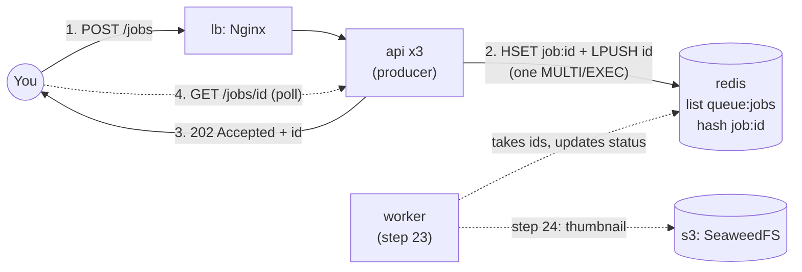

# Lab 07 — Queues and workers (SQS)

> **AWS equivalent:** Amazon SQS (queues, messages, visibility timeout, dead-letter queues) + a worker on ECS or Lambda  ·  **Time:** ~90 min  ·  **Difficulty:** ★★★
> **Builds on:** [Lab 06](./06-object-storage.md)  ·  **Reference solution:** commit `b436700` (step 22) on `dev`

> **Status:** in progress. Step 22 is written. Steps 23–25 (worker, thumbnail job, async test) and the closing sections (5–11) come next.

## 1. What you will learn
- Tell a **synchronous** request from an **asynchronous** one, and say when a queue is the right tool.
- Use the queue vocabulary: **producer**, **consumer (worker)**, **message**, **job**, **acknowledgement**, **at-least-once delivery**.
- Answer a request with **`202 Accepted`** and give the client an id to poll, instead of making it wait.
- Build a queue on a **Redis list** and keep each job's **status** in a Redis **hash** with an expiry.
- Explain why the two writes of an enqueue must be **atomic** (`MULTI`/`EXEC`), and what a queue on a cache-style Redis can lose.

## 2. Theory

### 2.1 The concept
Some work is too slow to do while the user waits: making a thumbnail of a photo, sending an email, generating a report. If the API did it inside the request, the user would stare at a spinner, the request could time out, and a burst of uploads would overload the API. The answer is to **separate asking from doing**: the API writes a note saying "please do this" and answers at once; another program does the work later, at its own pace.

Think of a **restaurant kitchen**. The waiter (the API) does not cook: he clips an **order ticket** on the **rail** (the queue) and goes back to the customers. The cooks (the **workers**) take tickets from the rail one by one. When the restaurant is busy, tickets pile up on the rail instead of the waiters collapsing; if you hire two more cooks, the pile shrinks faster.

The vocabulary:
- A **queue** holds **messages** in order. The first message in is, normally, the first out (**FIFO**: first in, first out).
- The **producer** puts messages in (here, the API). The **consumer** (or **worker**) takes them out and does the work.
- A **job** is the unit of work. The message says which job; a **job record** says what it is and how it is going (`queued`, `processing`, `done`, `failed`).
- The consumer **acknowledges** (acks) a message when the work is done, so the queue can forget it. If the worker crashes before that, the message must come back, so another worker can try again. This is **at-least-once delivery**: a job runs *at least* once, possibly twice, so the work should be **idempotent** (running it twice does no harm).
- The client does not get the result in the answer, so it asks again later with the job's id (**polling**).

**Why it helps:** the API stays fast, spikes are absorbed by the queue (**load levelling**), the API and the worker can be scaled, deployed and fail **independently** (**decoupling**), and a failed job can be retried.

### 2.2 How AWS does it
**Amazon SQS** (*Simple Queue Service*) is the AWS queue: fully managed, nothing to run.

| SQS piece | What it is |
|---|---|
| **Queue** | The container, with a name and an URL. **Standard** queues: very high throughput, at-least-once delivery, order not guaranteed. **FIFO** queues: strict order and no duplicates, lower throughput. |
| **Message** | The body (text, often JSON) plus attributes. The producer calls `SendMessage`. |
| **Receive and delete** | A consumer calls `ReceiveMessage` (with **long polling**, waiting up to 20 s instead of asking in a loop), does the work, then `DeleteMessage`. |
| **Visibility timeout** | When a message is received it is not deleted, only **hidden** for a while (30 s by default). If the consumer does not delete it in time (it crashed), the message becomes visible again and another consumer receives it. This is how SQS gives at-least-once delivery. |
| **Dead-letter queue (DLQ)** | A second queue where a message goes after it failed too many times (`maxReceiveCount`), so one bad message does not loop forever and you can inspect it. |
| **Retention** | How long an unprocessed message is kept (4 days by default, up to 14). |
| **Consumers** | Your own worker (a container on **ECS** or **EKS** polling the queue), or **Lambda** with an event source mapping that calls your function for each batch. |

SQS has **no job status**: a message is either waiting, hidden or gone. When the client needs to ask "is my job done?", the status is usually kept in a database such as **DynamoDB**, keyed by the job id. In the console: **SQS → Queues**.

### 2.3 How we reproduce it locally
| Concept | AWS | This lab |
|---|---|---|
| The queue | SQS queue | the Redis list `queue:jobs` (the ids of the waiting jobs) |
| Send a message | `SendMessage` | `LPUSH queue:jobs <id>` (inside `POST /jobs`) |
| Receive and hide | `ReceiveMessage` + visibility timeout | `BLMOVE queue:jobs queue:processing` (step 23): the id moves to a second list instead of disappearing |
| Delete after success | `DeleteMessage` | `LREM queue:processing` (step 23) |
| The job's status | DynamoDB item | the Redis hash `job:<id>` (`status`, `type`, `payload`, `created_at`) with an expiry |
| The consumer | ECS task / Lambda | the `worker` container (step 23) |
| Dead-letter queue, retention, FIFO guarantees, encryption | built in | not simulated |

The message in the list is only the **id**: the job's data lives in the hash. That keeps the queue small and gives the status a home. Redis is a fair stand-in for learning the pattern, but it is **not** a managed queue: see "What just happened" in step 22 for what it can lose. In Lab 13 (Terraform against an emulator) the worker learns to use SQS through a setting.

### 2.4 Diagram

Solid arrows exist after step 22; dashed ones come in the next steps.

## 3. Prerequisites
- [Lab 06](./06-object-storage.md) completed: `make up` runs, `make test` is green (six scripts).
- Nothing new in `.env`: the queue uses the Redis of [Lab 05](./05-caching.md), reached with the same `REDIS_URL`.
- If port 80 is busy on your machine, `LB_HOST_PORT` (and `S3_PUBLIC_ENDPOINT_URL`) in `.env`, as in Lab 06. The commands below use port **8088**: replace it by yours.

## 4. Steps

> Try each step yourself first, then compare with the reference commit.

### Step 22 — `POST /jobs` and `GET /jobs/{id}`
**Why:** the lab has a queue in theory and nothing to put in it. This step builds the **producer** side: an API route that accepts a job, stores it and answers immediately, and a second route to ask how it is going. There is no worker yet, so every job stays `queued`: that is exactly what the step checks.

**Which Redis structures.** Two, each for what it is good at:
- a **list**, `queue:jobs`, for the **order**: `LPUSH` adds an id at the head, and (step 23) the worker will take ids from the tail, so the oldest job goes first;
- a **hash**, `job:<id>`, for the **record**: a set of fields (`type`, `status`, `payload`, `created_at`) that the worker can update one by one. It gets an **expiry** (`EXPIRE`) so records do not pile up forever.

The three Redis commands of an enqueue run in one **`MULTI`/`EXEC`** block (a Redis *transaction*): Redis runs the three as one block with no other client's command in between, and runs none of them if the connection breaks before `EXEC`. (It is not a SQL-style rollback: if one command fails by itself, the others still run.) Without it, a crash between "write the record" and "push the id" would leave a record nobody will ever process, and the reverse order would leave an id with no record.

**Do it.** Four changes, all in `api/main.py` (nothing in `docker-compose.yml`: `REDIS_URL` is already there).

1. Imports (merge with the existing ones): `json` at the top, `timezone` next to `datetime`, `Path` next to the other FastAPI names:
   ```python
   import json
   from datetime import datetime, timezone
   from fastapi import Depends, FastAPI, File, HTTPException, Path, Response, UploadFile, status
   ```

2. The queue client and its settings, just before `MAX_UPLOAD_BYTES = ...`:
   ```python
   # The job queue (SQS in AWS). Same Redis server as the cache, but here Redis is a hard dependency:
   # a job that could not be queued must never be reported as accepted (the routes answer 503).
   queue = redis.Redis.from_url(
       os.environ["REDIS_URL"], decode_responses=True, socket_connect_timeout=1, socket_timeout=2
   )
   QUEUE_KEY = "queue:jobs"  # a Redis list: the ids of the jobs waiting for a worker
   JOB_TTL = int(os.environ.get("JOB_TTL_SECONDS", "86400"))  # how long a job record is kept (24 h)
   ```

3. The models and two small helpers, before `get_note_or_404`:
   ```python
   class JobIn(BaseModel):
       """What a client sends to ask for a job."""

       type: str = Field(min_length=1, max_length=50)  # what to do, e.g. "thumbnail" (step 24)
       payload: dict[str, str] = Field(default_factory=dict, max_length=10)  # its inputs


   class JobOut(BaseModel):
       id: str
       type: str
       status: str  # "queued" now; a worker will move it on (step 23)
       created_at: datetime
       payload: dict[str, str]


   def job_key(job_id: str) -> str:
       return f"job:{job_id}"  # the Redis hash that holds one job's record


   def job_out(job_id: str, record: dict[str, str]) -> dict:
       return {
           "id": job_id,
           "type": record["type"],
           "status": record["status"],
           "created_at": record["created_at"],
           "payload": json.loads(record["payload"]),
       }
   ```

4. The two routes, at the end of the file:
   ```python
   @app.post("/jobs", response_model=JobOut, status_code=status.HTTP_202_ACCEPTED)
   def create_job(data: JobIn):
       """Queue a job and answer at once. 202 means "accepted", not "done": a worker does the work later."""
       job_id = uuid4().hex
       record = {
           "type": data.type,
           "status": "queued",
           "payload": json.dumps(data.payload),
           "created_at": datetime.now(timezone.utc).isoformat(),
       }
       try:
           pipe = queue.pipeline(transaction=True)  # MULTI/EXEC: sent and run as one block, nothing in between
           pipe.hset(job_key(job_id), mapping=record)  # the record first ...
           pipe.expire(job_key(job_id), JOB_TTL)  # ... that disappears by itself after a day ...
           pipe.lpush(QUEUE_KEY, job_id)  # ... then the id joins the queue
           pipe.execute()
       except redis.RedisError as exc:
           log.error("could not queue job %s: %s", job_id, exc)
           raise HTTPException(status_code=503, detail="job queue unavailable")
       log.info("queued job %s (%s)", job_id, data.type)
       return job_out(job_id, record)


   @app.get("/jobs/{job_id}", response_model=JobOut)
   def get_job(job_id: Annotated[str, Path(pattern=r"^[0-9a-f]{32}$")]):
       """The current state of a job: poll this until the status is "done"."""
       try:
           record = queue.hgetall(job_key(job_id))
       except redis.RedisError as exc:
           log.error("could not read job %s: %s", job_id, exc)
           raise HTTPException(status_code=503, detail="job queue unavailable")
       if not record:
           raise HTTPException(status_code=404, detail="job not found")
       return job_out(job_id, record)
   ```

| Line | What it does | If you change or remove it |
|---|---|---|
| `queue = redis.Redis.from_url(os.environ["REDIS_URL"], ...)` | A second client for the same server as `cache`, kept apart because the two have different rules. Timeouts: 1 s to connect, 2 s per command. | Reusing `cache` works, but mixes a "may fail silently" client with a "must not fail silently" one. |
| `QUEUE_KEY = "queue:jobs"` | The name of the list. The `queue:` prefix keeps queue keys apart from the cache's `note:<id>` keys. | Another name works as long as the API and the worker agree. |
| `JOB_TTL` (86400 s) | How long a job record lives. Redis deletes the hash by itself afterwards. The value is a default in the code: `docker-compose.yml` does not pass `JOB_TTL_SECONDS` to the API yet. | No expiry: finished jobs stay in memory forever. |
| `class JobIn` / `type`, `payload` | The body clients send. `type` is required (1–50 characters); `payload` is optional, at most 10 entries, **strings only**. | Without `max_length` a client could store a huge record in Redis. |
| `status_code=status.HTTP_202_ACCEPTED` | `202`: "I accepted your request, the work is not done". | `201 Created` or `200 OK` would suggest the work exists or is finished. |
| `uuid4().hex` | A random, unique 32-character id; the client cannot guess or choose one. | Sequential ids (`1`, `2`, ...) let anyone read other people's jobs by counting. |
| `json.dumps(data.payload)` | A Redis hash stores flat strings, so the payload dict is stored as a JSON text and decoded in `job_out`. | |
| `queue.pipeline(transaction=True)` | Collects the commands and sends them wrapped in `MULTI` ... `EXEC`: Redis runs them as one block, with nothing in between. | `transaction=False` still batches them but without that guarantee (other commands could slip in between, and a broken connection could leave only some of them applied). |
| `hset`, `expire`, `lpush` | Write the record, set its expiry, push the id on the queue's head. The record goes **first**. | If the id were pushed first, a very fast worker could look up a record that does not exist yet. |
| `except redis.RedisError` → `503` | When Redis is down, the route answers `503 Service Unavailable` and logs the cause. | Without it the client would get an ugly `500`. A `202` without a queued job would be worse: a lie. |
| `Path(pattern=r"^[0-9a-f]{32}$")` | `GET /jobs/{job_id}` accepts only 32 lower-case hex characters, the shape of our ids. Anything else is `422` ([FastAPI 03](../courses/fastapi/03-parameters.md)). | Without it, any string would be turned into a Redis key. |
| `queue.hgetall(...)` / `if not record` | Reads the whole hash; a missing hash comes back as an empty dict, which means `404`. | |

**Rebuild and restart:**
```bash
docker compose up -d --build --wait api
```
(Re-creates the three `api` containers. Give Nginx about 5 seconds to pick up their new addresses, see [Lab 06](./06-object-storage.md) troubleshooting.)

**Check 1 — the step's check: a job id is returned and the status is `queued`.**
```bash
curl -s -w ' [HTTP %{http_code}]\n' -X POST localhost:8088/jobs -H 'Content-Type: application/json' \
  -d '{"type":"thumbnail","payload":{"key":"originals/demo.png"}}'
curl -s -w ' [HTTP %{http_code}]\n' localhost:8088/jobs/<the id>
```
```text
{"id":"a1633017d8cb4ad0ab100e6abe71feb5","type":"thumbnail","status":"queued","created_at":"2026-11-22T16:12:28.456738Z","payload":{"key":"originals/demo.png"}} [HTTP 202]
{"id":"a1633017d8cb4ad0ab100e6abe71feb5","type":"thumbnail","status":"queued","created_at":"2026-11-22T16:12:28.456738Z","payload":{"key":"originals/demo.png"}} [HTTP 200]
```
The first call answers **`202`** with the job's id and `"status":"queued"`; the second, a moment later, still reads `queued`, because nobody is processing jobs yet. The `id` is the handle the client keeps.

**Check 2 — what Redis really holds.** `redis-cli` inside the container, authenticated with the password the container already has (as in Lab 05):
```bash
rcli() { docker compose exec -T redis sh -c 'REDISCLI_AUTH="$REDIS_PASSWORD" redis-cli "$@"' sh "$@" | tr -d '\r'; }
rcli llen queue:jobs
rcli lrange queue:jobs 0 -1
rcli ttl job:<the id>
rcli hgetall job:<the id>
```
```text
LLEN queue:jobs = 1
LRANGE queue:jobs 0 -1 = a1633017d8cb4ad0ab100e6abe71feb5
TTL job:a1633017d8cb4ad0ab100e6abe71feb5 = 86399
type thumbnail
status queued
payload {"key": "originals/demo.png"}
created_at 2026-11-22T16:12:28.456738+00:00
```
(The `LLEN ... =` labels were added with `echo`, and `hgetall`'s name/value lines were paired with `paste` to save space.) The **list** holds the id, the **hash** holds the record, and the record's **TTL** is about a day (86399 s, one second after creation).

**Check 3 — the order of the queue.** Three more jobs through the load balancer (so several API replicas), then the list:
```bash
for i in 1 2 3; do curl -s -X POST localhost:8088/jobs -H 'Content-Type: application/json' -d "{\"type\":\"noop\",\"payload\":{\"n\":\"$i\"}}"; done
rcli llen queue:jobs
rcli lrange queue:jobs 0 3
```
```text
LLEN = 4
first 4 entries (newest first): a2ac3fe0 6cb601ce 8553077e a1633017
```
(Ids cut to 8 characters.) `LPUSH` puts each new id at the **head**, so the list reads newest first: the oldest job, `a1633017`, is at the **tail**. The worker of step 23 will take from the tail, which gives first in, first out. The three requests went through the load balancer, which spreads requests over the three replicas, and all the jobs landed in one queue: it is **shared**, like the cache.

**Check 4 — bad input.**
```bash
curl -s -w ' [HTTP %{http_code}]\n' localhost:8088/jobs/00000000000000000000000000000000      # a well-formed id that does not exist
curl -s -w ' [HTTP %{http_code}]\n' localhost:8088/jobs/not-an-id
curl -s -w ' [HTTP %{http_code}]\n' -X POST localhost:8088/jobs -H 'Content-Type: application/json' -d '{"payload":{}}'
curl -s -w ' [HTTP %{http_code}]\n' -X POST localhost:8088/jobs -H 'Content-Type: application/json' -d '{"type":"x","payload":{"n":1}}'
```
```text
{"detail":"job not found"} [HTTP 404]
{"detail":[{"type":"string_pattern_mismatch","loc":["path","job_id"],"msg":"String should match pattern '^[0-9a-f]{32}$'","input":"not-an-id","ctx":{"pattern":"^[0-9a-f]{32}$"}}]} [HTTP 422]
{"detail":[{"type":"missing","loc":["body","type"],"msg":"Field required","input":{"payload":{}}}]} [HTTP 422]
{"detail":[{"type":"string_type","loc":["body","payload","n"],"msg":"Input should be a valid string","input":1}]} [HTTP 422]
```
An unknown id is `404`; a malformed id, a body without `type` and a payload value that is a number (`"n": 1`) are all `422` with the exact place (`loc`). After these four requests `LLEN` was still 4: **rejected requests queue nothing**.

**Check 5 — Redis goes away: the queue is a hard dependency.**
```bash
docker compose stop redis
curl -s -m 10 -w ' [HTTP %{http_code}]\n' -X POST localhost:8088/jobs -H 'Content-Type: application/json' -d '{"type":"noop"}'
curl -s -m 10 -w ' [HTTP %{http_code}]\n' localhost:8088/jobs/<the id>
curl -s -o /dev/null -w 'GET /notes [HTTP %{http_code}]\n' localhost:8088/notes
docker compose logs api | grep -E 'could not (queue|read) job' | tail -2
docker compose start redis
```
```text
{"detail":"job queue unavailable"} [HTTP 503]
{"detail":"job queue unavailable"} [HTTP 503]
GET /notes [HTTP 200]
api-2  | ERROR:    could not read job a1633017d8cb4ad0ab100e6abe71feb5: Error -3 connecting to redis:6379. Temporary failure in name resolution.
api-3  | ERROR:    could not read job a1633017d8cb4ad0ab100e6abe71feb5: Error -3 connecting to redis:6379. Temporary failure in name resolution.
```
Compare with Lab 05: the **cache** failing made the API *slower* (`X-Cache: BYPASS`, still `200`). The **queue** failing makes the job routes answer **`503`**, because there is no sensible fallback: pretending to accept a job that was never queued would lose it silently. Other routes (`GET /notes`) are not affected. The same `Temporary failure in name resolution` as in Lab 05: Docker's DNS stops answering for a stopped container.

**Check 6 — what a restart does to a queue on this Redis.** After `docker compose start redis` (Check 5):
```bash
rcli llen queue:jobs
curl -s -w ' [HTTP %{http_code}]
' localhost:8088/jobs/<the first id>
rcli config get maxmemory-policy; rcli config get appendonly; rcli config get save
```
```text
LLEN queue:jobs after the restart = 0
{"detail":"job not found"} [HTTP 404]
redis settings: maxmemory-policy allkeys-lru  appendonly no  save
```
The four queued jobs and the job record are **gone**. The Redis of this lab was configured in Lab 05 as a **cache**: no snapshot, no append-only file (`appendonly no`, `save ""`), and `allkeys-lru`, which may evict **any** key, jobs included, when the 64 MB are full. See "What just happened".

**Clean up the test jobs** (so the worker of step 23 does not start on them): the restart above already emptied Redis here; otherwise `redis-cli del queue:jobs` and delete the `job:*` keys.

**Regression check — the whole suite:**
```bash
make test
```
```text
== tests/02_failover.sh
02_failover: all checks passed
== tests/02_load_balancing.sh
02_load_balancing: all checks passed
== tests/03_network_isolation.sh
03_network_isolation: all checks passed
== tests/04_persistence.sh
04_persistence: all checks passed
== tests/05_cache.sh
05_cache: all checks passed
== tests/06_storage.sh
06_storage: all checks passed
```
(Trimmed to the headings and summary lines; `make` exited with code 0.)

**What just happened:**
- The API is now a **producer**: `POST /jobs` takes a few milliseconds, whatever the job will cost later, and answers `202` with an id. That is the whole point of a queue: the client's wait no longer depends on the work.
- A job lives in **two** places that must stay consistent: an id in a **list** (the order) and a record in a **hash** (the details). One `MULTI`/`EXEC` writes both, or neither.
- The **status** is the contract with the client: `queued` now, `processing` and `done` or `failed` once the worker of step 23 exists. The client polls `GET /jobs/{id}`; AWS would typically keep that status in DynamoDB, since SQS has none.
- **A queue on a cache-style Redis can lose jobs.** Three ways, all caused by the Lab 05 settings: a restart empties it (Check 6), a full memory may evict a job (`allkeys-lru`), and a crash in the middle of a job loses it unless the worker uses the reliable pattern of step 23. SQS stores messages durably in several zones and never evicts them. For a real project the queue would get its **own** Redis with a persistence file and the `noeviction` policy (or simply use SQS); here the plan keeps one Redis to stay small, and the limit is part of the lesson. The API also says it plainly: a job is only `queued` once Redis has accepted it, otherwise `503`.
- `job:<id>` records expire after 24 hours (the default of `JOB_TTL`; to change it, pass `JOB_TTL_SECONDS` to the `api` service in `docker-compose.yml`), so even a finished job's record is temporary: a client that polls late gets `404`.

## 5–11. To be completed at the end of Lab 07
Verify, Troubleshooting, Going to real AWS, Clean up, Check your understanding, Exercises and Further reading are written when the lab ends (step 25). No new problem was met in step 22.
