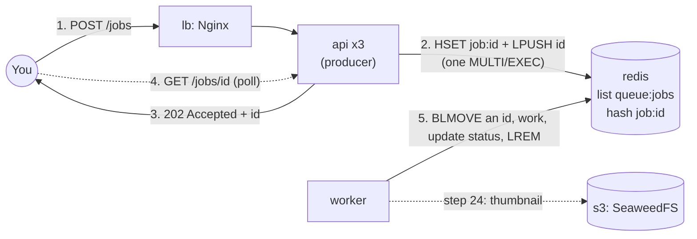

# Lab 07 — Queues and workers (SQS)

> **AWS equivalent:** Amazon SQS (queues, messages, visibility timeout, dead-letter queues) + a worker on ECS or Lambda  ·  **Time:** ~90 min  ·  **Difficulty:** ★★★
> **Builds on:** [Lab 06](./06-object-storage.md)  ·  **Reference solution:** commits `b436700` (step 22) and `89a7d7c` (step 23) on `dev`

> **Status:** in progress. Steps 22–23 are written. Steps 24–25 (thumbnail job, async test) and the closing sections (5–11) come next.

## 1. What you will learn
- Tell a **synchronous** request from an **asynchronous** one, and say when a queue is the right tool.
- Use the queue vocabulary: **producer**, **consumer (worker)**, **message**, **job**, **acknowledgement**, **at-least-once delivery**.
- Answer a request with **`202 Accepted`** and give the client an id to poll, instead of making it wait.
- Build a queue on a **Redis list** and keep each job's **status** in a Redis **hash** with an expiry.
- Explain why the two writes of an enqueue must be **atomic** (`MULTI`/`EXEC`), and what a queue on a cache-style Redis can lose.
- Write a **worker** with the **reliable-queue pattern** (`BLMOVE` to a processing list, acknowledge with `LREM`), and show that a killed worker loses no job.
- Handle **`SIGTERM`** so `docker stop` finishes the current job, and explain what a restart policy does and does not do.

## 2. Theory

### 2.1 The concept
Some work is too slow to do while the user waits: making a thumbnail of a photo, sending an email, generating a report. If the API did it inside the request, the user would stare at a spinner, the request could time out, and a burst of uploads would overload the API. The answer is to **separate asking from doing**: the API writes a note saying "please do this" and answers at once; another program does the work later, at its own pace.

Think of a **restaurant kitchen**. The waiter (the API) does not cook: he clips an **order ticket** on the **rail** (the queue) and goes back to the customers. The cooks (the **workers**) take tickets from the rail one by one. When the restaurant is busy, tickets pile up on the rail instead of the waiters collapsing; if you hire two more cooks, the pile shrinks faster.

The vocabulary:
- A **queue** holds **messages** in order. The first message in is, normally, the first out (**FIFO**: first in, first out).
- The **producer** puts messages in (here, the API). The **consumer** (or **worker**) takes them out and does the work.
- A **job** is the unit of work. The message says which job; a **job record** says what it is and how it is going (`queued`, `processing`, `done`, `failed`).
- The consumer **acknowledges** (acks) a message when the work is done, so the queue can forget it. If the worker crashes before that, the message must come back, so another worker can try again. This is **at-least-once delivery**: a job runs *at least* once, possibly twice, so the work should be **idempotent** (running it twice does no harm).
- The client does not get the result in the answer, so it asks again later with the job's id (**polling**).

**Why it helps:** the API stays fast, spikes are absorbed by the queue (**load levelling**), the API and the worker can be scaled, deployed and fail **independently** (**decoupling**), and a failed job can be retried.

### 2.2 How AWS does it
**Amazon SQS** (*Simple Queue Service*) is the AWS queue: fully managed, nothing to run.

| SQS piece | What it is |
|---|---|
| **Queue** | The container, with a name and an URL. **Standard** queues: very high throughput, at-least-once delivery, order not guaranteed. **FIFO** queues: strict order and no duplicates, lower throughput. |
| **Message** | The body (text, often JSON) plus attributes. The producer calls `SendMessage`. |
| **Receive and delete** | A consumer calls `ReceiveMessage` (with **long polling**, waiting up to 20 s instead of asking in a loop), does the work, then `DeleteMessage`. |
| **Visibility timeout** | When a message is received it is not deleted, only **hidden** for a while (30 s by default). If the consumer does not delete it in time (it crashed), the message becomes visible again and another consumer receives it. This is how SQS gives at-least-once delivery. |
| **Dead-letter queue (DLQ)** | A second queue where a message goes after it failed too many times (`maxReceiveCount`), so one bad message does not loop forever and you can inspect it. |
| **Retention** | How long an unprocessed message is kept (4 days by default, up to 14). |
| **Consumers** | Your own worker (a container on **ECS** or **EKS** polling the queue), or **Lambda** with an event source mapping that calls your function for each batch. |

SQS has **no job status**: a message is either waiting, hidden or gone. When the client needs to ask "is my job done?", the status is usually kept in a database such as **DynamoDB**, keyed by the job id. In the console: **SQS → Queues**.

### 2.3 How we reproduce it locally
| Concept | AWS | This lab |
|---|---|---|
| The queue | SQS queue | the Redis list `queue:jobs` (the ids of the waiting jobs) |
| Send a message | `SendMessage` | `LPUSH queue:jobs <id>` (inside `POST /jobs`) |
| Receive and hide | `ReceiveMessage` + visibility timeout | `BLMOVE queue:jobs queue:processing` (step 23): the id moves to a second list instead of disappearing |
| Delete after success | `DeleteMessage` | `LREM queue:processing` (step 23) |
| The job's status | DynamoDB item | the Redis hash `job:<id>` (`status`, `type`, `payload`, `created_at`) with an expiry |
| The consumer | ECS task / Lambda | the `worker` container (step 23) |
| Dead-letter queue, retention, FIFO guarantees, encryption | built in | not simulated |

The message in the list is only the **id**: the job's data lives in the hash. That keeps the queue small and gives the status a home. Redis is a fair stand-in for learning the pattern, but it is **not** a managed queue: see "What just happened" in step 22 for what it can lose. In Lab 13 (Terraform against an emulator) the worker learns to use SQS through a setting.

### 2.4 Diagram

Solid arrows exist after step 23; dashed ones come in the next steps.

## 3. Prerequisites
- [Lab 06](./06-object-storage.md) completed: `make up` runs, `make test` is green (six scripts).
- Nothing new in `.env`: the queue uses the Redis of [Lab 05](./05-caching.md), reached with the same `REDIS_URL`.
- If port 80 is busy on your machine, `LB_HOST_PORT` (and `S3_PUBLIC_ENDPOINT_URL`) in `.env`, as in Lab 06. The commands below use port **8088**: replace it by yours.

## 4. Steps

> Try each step yourself first, then compare with the reference commit.

### Step 22 — `POST /jobs` and `GET /jobs/{id}`
**Why:** the lab has a queue in theory and nothing to put in it. This step builds the **producer** side: an API route that accepts a job, stores it and answers immediately, and a second route to ask how it is going. There is no worker yet, so every job stays `queued`: that is exactly what the step checks.

**Which Redis structures.** Two, each for what it is good at:
- a **list**, `queue:jobs`, for the **order**: `LPUSH` adds an id at the head, and (step 23) the worker will take ids from the tail, so the oldest job goes first;
- a **hash**, `job:<id>`, for the **record**: a set of fields (`type`, `status`, `payload`, `created_at`) that the worker can update one by one. It gets an **expiry** (`EXPIRE`) so records do not pile up forever.

The three Redis commands of an enqueue run in one **`MULTI`/`EXEC`** block (a Redis *transaction*): Redis runs the three as one block with no other client's command in between, and runs none of them if the connection breaks before `EXEC`. (It is not a SQL-style rollback: if one command fails by itself, the others still run.) Without it, a crash between "write the record" and "push the id" would leave a record nobody will ever process, and the reverse order would leave an id with no record.

**Do it.** Four changes, all in `api/main.py` (nothing in `docker-compose.yml`: `REDIS_URL` is already there).

1. Imports (merge with the existing ones): `json` at the top, `timezone` next to `datetime`, `Path` next to the other FastAPI names:
   ```python
   import json
   from datetime import datetime, timezone
   from fastapi import Depends, FastAPI, File, HTTPException, Path, Response, UploadFile, status
   ```

2. The queue client and its settings, just before `MAX_UPLOAD_BYTES = ...`:
   ```python
   # The job queue (SQS in AWS). Same Redis server as the cache, but here Redis is a hard dependency:
   # a job that could not be queued must never be reported as accepted (the routes answer 503).
   queue = redis.Redis.from_url(
       os.environ["REDIS_URL"], decode_responses=True, socket_connect_timeout=1, socket_timeout=2
   )
   QUEUE_KEY = "queue:jobs"  # a Redis list: the ids of the jobs waiting for a worker
   JOB_TTL = int(os.environ.get("JOB_TTL_SECONDS", "86400"))  # how long a job record is kept (24 h)
   ```

3. The models and two small helpers, before `get_note_or_404`:
   ```python
   class JobIn(BaseModel):
       """What a client sends to ask for a job."""

       type: str = Field(min_length=1, max_length=50)  # what to do, e.g. "thumbnail" (step 24)
       payload: dict[str, str] = Field(default_factory=dict, max_length=10)  # its inputs


   class JobOut(BaseModel):
       id: str
       type: str
       status: str  # "queued" now; a worker will move it on (step 23)
       created_at: datetime
       payload: dict[str, str]


   def job_key(job_id: str) -> str:
       return f"job:{job_id}"  # the Redis hash that holds one job's record


   def job_out(job_id: str, record: dict[str, str]) -> dict:
       return {
           "id": job_id,
           "type": record["type"],
           "status": record["status"],
           "created_at": record["created_at"],
           "payload": json.loads(record["payload"]),
       }
   ```

4. The two routes, at the end of the file:
   ```python
   @app.post("/jobs", response_model=JobOut, status_code=status.HTTP_202_ACCEPTED)
   def create_job(data: JobIn):
       """Queue a job and answer at once. 202 means "accepted", not "done": a worker does the work later."""
       job_id = uuid4().hex
       record = {
           "type": data.type,
           "status": "queued",
           "payload": json.dumps(data.payload),
           "created_at": datetime.now(timezone.utc).isoformat(),
       }
       try:
           pipe = queue.pipeline(transaction=True)  # MULTI/EXEC: sent and run as one block, nothing in between
           pipe.hset(job_key(job_id), mapping=record)  # the record first ...
           pipe.expire(job_key(job_id), JOB_TTL)  # ... that disappears by itself after a day ...
           pipe.lpush(QUEUE_KEY, job_id)  # ... then the id joins the queue
           pipe.execute()
       except redis.RedisError as exc:
           log.error("could not queue job %s: %s", job_id, exc)
           raise HTTPException(status_code=503, detail="job queue unavailable")
       log.info("queued job %s (%s)", job_id, data.type)
       return job_out(job_id, record)


   @app.get("/jobs/{job_id}", response_model=JobOut)
   def get_job(job_id: Annotated[str, Path(pattern=r"^[0-9a-f]{32}$")]):
       """The current state of a job: poll this until the status is "done"."""
       try:
           record = queue.hgetall(job_key(job_id))
       except redis.RedisError as exc:
           log.error("could not read job %s: %s", job_id, exc)
           raise HTTPException(status_code=503, detail="job queue unavailable")
       if not record:
           raise HTTPException(status_code=404, detail="job not found")
       return job_out(job_id, record)
   ```

| Line | What it does | If you change or remove it |
|---|---|---|
| `queue = redis.Redis.from_url(os.environ["REDIS_URL"], ...)` | A second client for the same server as `cache`, kept apart because the two have different rules. Timeouts: 1 s to connect, 2 s per command. | Reusing `cache` works, but mixes a "may fail silently" client with a "must not fail silently" one. |
| `QUEUE_KEY = "queue:jobs"` | The name of the list. The `queue:` prefix keeps queue keys apart from the cache's `note:<id>` keys. | Another name works as long as the API and the worker agree. |
| `JOB_TTL` (86400 s) | How long a job record lives. Redis deletes the hash by itself afterwards. The value is a default in the code: `docker-compose.yml` does not pass `JOB_TTL_SECONDS` to the API yet. | No expiry: finished jobs stay in memory forever. |
| `class JobIn` / `type`, `payload` | The body clients send. `type` is required (1–50 characters); `payload` is optional, at most 10 entries, **strings only**. | Without `max_length` a client could store a huge record in Redis. |
| `status_code=status.HTTP_202_ACCEPTED` | `202`: "I accepted your request, the work is not done". | `201 Created` or `200 OK` would suggest the work exists or is finished. |
| `uuid4().hex` | A random, unique 32-character id; the client cannot guess or choose one. | Sequential ids (`1`, `2`, ...) let anyone read other people's jobs by counting. |
| `json.dumps(data.payload)` | A Redis hash stores flat strings, so the payload dict is stored as a JSON text and decoded in `job_out`. | |
| `queue.pipeline(transaction=True)` | Collects the commands and sends them wrapped in `MULTI` ... `EXEC`: Redis runs them as one block, with nothing in between. | `transaction=False` still batches them but without that guarantee (other commands could slip in between, and a broken connection could leave only some of them applied). |
| `hset`, `expire`, `lpush` | Write the record, set its expiry, push the id on the queue's head. The record goes **first**. | If the id were pushed first, a very fast worker could look up a record that does not exist yet. |
| `except redis.RedisError` → `503` | When Redis is down, the route answers `503 Service Unavailable` and logs the cause. | Without it the client would get an ugly `500`. A `202` without a queued job would be worse: a lie. |
| `Path(pattern=r"^[0-9a-f]{32}$")` | `GET /jobs/{job_id}` accepts only 32 lower-case hex characters, the shape of our ids. Anything else is `422` ([FastAPI 03](../courses/fastapi/03-parameters.md)). | Without it, any string would be turned into a Redis key. |
| `queue.hgetall(...)` / `if not record` | Reads the whole hash; a missing hash comes back as an empty dict, which means `404`. | |

**Rebuild and restart:**
```bash
docker compose up -d --build --wait api
```
(Re-creates the three `api` containers. Give Nginx about 5 seconds to pick up their new addresses, see [Lab 06](./06-object-storage.md) troubleshooting.)

**Check 1 — the step's check: a job id is returned and the status is `queued`.**
```bash
curl -s -w ' [HTTP %{http_code}]\n' -X POST localhost:8088/jobs -H 'Content-Type: application/json' \
  -d '{"type":"thumbnail","payload":{"key":"originals/demo.png"}}'
curl -s -w ' [HTTP %{http_code}]\n' localhost:8088/jobs/<the id>
```
```text
{"id":"a1633017d8cb4ad0ab100e6abe71feb5","type":"thumbnail","status":"queued","created_at":"2026-11-22T16:12:28.456738Z","payload":{"key":"originals/demo.png"}} [HTTP 202]
{"id":"a1633017d8cb4ad0ab100e6abe71feb5","type":"thumbnail","status":"queued","created_at":"2026-11-22T16:12:28.456738Z","payload":{"key":"originals/demo.png"}} [HTTP 200]
```
The first call answers **`202`** with the job's id and `"status":"queued"`; the second, a moment later, still reads `queued`, because nobody is processing jobs yet. The `id` is the handle the client keeps.

**Check 2 — what Redis really holds.** `redis-cli` inside the container, authenticated with the password the container already has (as in Lab 05):
```bash
rcli() { docker compose exec -T redis sh -c 'REDISCLI_AUTH="$REDIS_PASSWORD" redis-cli "$@"' sh "$@" | tr -d '\r'; }
rcli llen queue:jobs
rcli lrange queue:jobs 0 -1
rcli ttl job:<the id>
rcli hgetall job:<the id>
```
```text
LLEN queue:jobs = 1
LRANGE queue:jobs 0 -1 = a1633017d8cb4ad0ab100e6abe71feb5
TTL job:a1633017d8cb4ad0ab100e6abe71feb5 = 86399
type thumbnail
status queued
payload {"key": "originals/demo.png"}
created_at 2026-11-22T16:12:28.456738+00:00
```
(The `LLEN ... =` labels were added with `echo`, and `hgetall`'s name/value lines were paired with `paste` to save space.) The **list** holds the id, the **hash** holds the record, and the record's **TTL** is about a day (86399 s, one second after creation).

**Check 3 — the order of the queue.** Three more jobs through the load balancer (so several API replicas), then the list:
```bash
for i in 1 2 3; do curl -s -X POST localhost:8088/jobs -H 'Content-Type: application/json' -d "{\"type\":\"noop\",\"payload\":{\"n\":\"$i\"}}"; done
rcli llen queue:jobs
rcli lrange queue:jobs 0 3
```
```text
LLEN = 4
first 4 entries (newest first): a2ac3fe0 6cb601ce 8553077e a1633017
```
(Ids cut to 8 characters.) `LPUSH` puts each new id at the **head**, so the list reads newest first: the oldest job, `a1633017`, is at the **tail**. The worker of step 23 will take from the tail, which gives first in, first out. The three requests went through the load balancer, which spreads requests over the three replicas, and all the jobs landed in one queue: it is **shared**, like the cache.

**Check 4 — bad input.**
```bash
curl -s -w ' [HTTP %{http_code}]\n' localhost:8088/jobs/00000000000000000000000000000000      # a well-formed id that does not exist
curl -s -w ' [HTTP %{http_code}]\n' localhost:8088/jobs/not-an-id
curl -s -w ' [HTTP %{http_code}]\n' -X POST localhost:8088/jobs -H 'Content-Type: application/json' -d '{"payload":{}}'
curl -s -w ' [HTTP %{http_code}]\n' -X POST localhost:8088/jobs -H 'Content-Type: application/json' -d '{"type":"x","payload":{"n":1}}'
```
```text
{"detail":"job not found"} [HTTP 404]
{"detail":[{"type":"string_pattern_mismatch","loc":["path","job_id"],"msg":"String should match pattern '^[0-9a-f]{32}$'","input":"not-an-id","ctx":{"pattern":"^[0-9a-f]{32}$"}}]} [HTTP 422]
{"detail":[{"type":"missing","loc":["body","type"],"msg":"Field required","input":{"payload":{}}}]} [HTTP 422]
{"detail":[{"type":"string_type","loc":["body","payload","n"],"msg":"Input should be a valid string","input":1}]} [HTTP 422]
```
An unknown id is `404`; a malformed id, a body without `type` and a payload value that is a number (`"n": 1`) are all `422` with the exact place (`loc`). After these four requests `LLEN` was still 4: **rejected requests queue nothing**.

**Check 5 — Redis goes away: the queue is a hard dependency.**
```bash
docker compose stop redis
curl -s -m 10 -w ' [HTTP %{http_code}]\n' -X POST localhost:8088/jobs -H 'Content-Type: application/json' -d '{"type":"noop"}'
curl -s -m 10 -w ' [HTTP %{http_code}]\n' localhost:8088/jobs/<the id>
curl -s -o /dev/null -w 'GET /notes [HTTP %{http_code}]\n' localhost:8088/notes
docker compose logs api | grep -E 'could not (queue|read) job' | tail -2
docker compose start redis
```
```text
{"detail":"job queue unavailable"} [HTTP 503]
{"detail":"job queue unavailable"} [HTTP 503]
GET /notes [HTTP 200]
api-2  | ERROR:    could not read job a1633017d8cb4ad0ab100e6abe71feb5: Error -3 connecting to redis:6379. Temporary failure in name resolution.
api-3  | ERROR:    could not read job a1633017d8cb4ad0ab100e6abe71feb5: Error -3 connecting to redis:6379. Temporary failure in name resolution.
```
Compare with Lab 05: the **cache** failing made the API *slower* (`X-Cache: BYPASS`, still `200`). The **queue** failing makes the job routes answer **`503`**, because there is no sensible fallback: pretending to accept a job that was never queued would lose it silently. Other routes (`GET /notes`) are not affected. The same `Temporary failure in name resolution` as in Lab 05: Docker's DNS stops answering for a stopped container.

**Check 6 — what a restart does to a queue on this Redis.** After `docker compose start redis` (Check 5):
```bash
rcli llen queue:jobs
curl -s -w ' [HTTP %{http_code}]
' localhost:8088/jobs/<the first id>
rcli config get maxmemory-policy; rcli config get appendonly; rcli config get save
```
```text
LLEN queue:jobs after the restart = 0
{"detail":"job not found"} [HTTP 404]
redis settings: maxmemory-policy allkeys-lru  appendonly no  save
```
The four queued jobs and the job record are **gone**. The Redis of this lab was configured in Lab 05 as a **cache**: no snapshot, no append-only file (`appendonly no`, `save ""`), and `allkeys-lru`, which may evict **any** key, jobs included, when the 64 MB are full. See "What just happened".

**Clean up the test jobs** (so the worker of step 23 does not start on them): the restart above already emptied Redis here; otherwise `redis-cli del queue:jobs` and delete the `job:*` keys.

**Regression check — the whole suite:**
```bash
make test
```
```text
== tests/02_failover.sh
02_failover: all checks passed
== tests/02_load_balancing.sh
02_load_balancing: all checks passed
== tests/03_network_isolation.sh
03_network_isolation: all checks passed
== tests/04_persistence.sh
04_persistence: all checks passed
== tests/05_cache.sh
05_cache: all checks passed
== tests/06_storage.sh
06_storage: all checks passed
```
(Trimmed to the headings and summary lines; `make` exited with code 0.)

**What just happened:**
- The API is now a **producer**: `POST /jobs` takes a few milliseconds, whatever the job will cost later, and answers `202` with an id. That is the whole point of a queue: the client's wait no longer depends on the work.
- A job lives in **two** places that must stay consistent: an id in a **list** (the order) and a record in a **hash** (the details). One `MULTI`/`EXEC` writes both, or neither.
- The **status** is the contract with the client: `queued` now, `processing` and `done` or `failed` once the worker of step 23 exists. The client polls `GET /jobs/{id}`; AWS would typically keep that status in DynamoDB, since SQS has none.
- **A queue on a cache-style Redis can lose jobs.** Three ways, all caused by the Lab 05 settings: a restart empties it (Check 6), a full memory may evict a job (`allkeys-lru`), and a crash in the middle of a job loses it unless the worker uses the reliable pattern of step 23. SQS stores messages durably in several zones and never evicts them. For a real project the queue would get its **own** Redis with a persistence file and the `noeviction` policy (or simply use SQS); here the plan keeps one Redis to stay small, and the limit is part of the lesson. The API also says it plainly: a job is only `queued` once Redis has accepted it, otherwise `503`.
- `job:<id>` records expire after 24 hours (the default of `JOB_TTL`; to change it, pass `JOB_TTL_SECONDS` to the `api` service in `docker-compose.yml`), so even a finished job's record is temporary: a client that polls late gets `404`.

### Step 23 — The worker container
**Why:** step 22 put jobs on a queue and nobody takes them off. This step adds the **consumer**: a separate container, `worker`, that takes job ids from the queue, does the work (a stub for now: it sleeps), and reports the status. Its job is not only to work, but to work **reliably**: if it dies in the middle of a job, the job must not be lost.

**The reliable-queue pattern.** The simplest way to take an id off a list is `RPOP` (remove and return). But then the id exists only in the worker's memory: if the worker crashes one second later, the job is gone for good. The reliable version **moves** the id instead of removing it:
1. `BLMOVE queue:jobs queue:processing RIGHT LEFT 2`: atomically take the id at the **tail** of `queue:jobs` (the oldest, since the API pushes at the head) and put it at the head of a second list, `queue:processing`. `BLMOVE` is the **blocking** version: if the queue is empty it waits up to 2 seconds for an id to arrive instead of asking in a loop.
2. Do the work, updating the status in the hash `job:<id>`.
3. `LREM queue:processing 1 <id>`: the **acknowledge**. Only now is the job finished for good.

An id that stays in `queue:processing` is a job being worked on, or one whose worker died. At start-up the worker moves such ids back to the queue. This is what SQS does with its **visibility timeout**: a received message is hidden, not deleted, and comes back if nobody deletes it. The price is **at-least-once** delivery: a job interrupted half way is done **again** from the start.

**Graceful shutdown.** `docker stop` sends the signal `SIGTERM` and, after a grace period, `SIGKILL` (which cannot be caught). A worker that ignores `SIGTERM` would be killed in the middle of a job, so it installs a handler that only sets a flag: the loop finishes the current job, sees the flag, and exits with code 0.

**Do it.** Three files.

1. `worker/worker.py` (the whole file):
   ```python
   """Queue worker (the consumer of Lab 07): takes job ids from a Redis list, does the work, reports the status.

   Reliable-queue pattern (what SQS does with its visibility timeout):
     1. BLMOVE queue:jobs -> queue:processing : the id is MOVED, not removed, so a crash cannot lose it.
     2. do the work, update the status in the hash job:<id>
     3. LREM queue:processing                  : the "acknowledge": the job is finished for good.
   An id left in queue:processing means a worker died mid-job; at start-up it is put back in the queue.
   No local state: everything lives in Redis, and the settings come from the environment.
   """
   import logging
   import os
   import signal
   import socket
   import time
   from datetime import datetime, timezone

   import redis

   REDIS_URL = os.environ["REDIS_URL"]
   WORK_SECONDS = float(os.environ.get("WORK_SECONDS", "2"))  # how long the stub work lasts
   QUEUE_KEY = "queue:jobs"  # same names as in api/main.py
   PROCESSING_KEY = "queue:processing"
   POLL_SECONDS = 2  # one blocking wait lasts this long: also the longest a stop request waits

   logging.basicConfig(level=logging.INFO, format="%(asctime)s %(levelname)s %(message)s")
   log = logging.getLogger(socket.gethostname())  # the container id, to tell workers apart in the logs

   stopping = False


   def request_stop(signum, frame):
       """SIGTERM is what "docker stop" sends: do not stop now, stop between two jobs."""
       global stopping
       stopping = True
       log.info("signal %s received: finishing the current job, then stopping", signum)


   def now() -> str:
       return datetime.now(timezone.utc).isoformat()


   def requeue_unfinished(r: redis.Redis) -> None:
       """Put back the ids a dead worker left in the processing list (oldest first, ahead of the others)."""
       count = 0
       while r.lmove(PROCESSING_KEY, QUEUE_KEY, "RIGHT", "RIGHT") is not None:
           count += 1
       if count:
           log.warning("requeued %s unfinished job(s) left by a previous worker", count)


   def process(r: redis.Redis, job_id: str) -> None:
       key = f"job:{job_id}"
       if not r.exists(key):  # the record expired while the id waited
           log.warning("job %s has no record any more: dropped", job_id)
           return
       r.hset(key, mapping={"status": "processing", "started_at": now()})
       log.info("picked up job %s (%s)", job_id, r.hget(key, "type"))
       try:
           time.sleep(WORK_SECONDS)  # the stub work: step 24 replaces it with a real task
       except Exception as exc:
           r.hset(key, mapping={"status": "failed", "error": str(exc)[:200], "finished_at": now()})
           log.error("job %s failed: %s", job_id, exc)
           return
       r.hset(key, mapping={"status": "done", "finished_at": now()})
       log.info("job %s done", job_id)


   def main() -> None:
       signal.signal(signal.SIGTERM, request_stop)
       signal.signal(signal.SIGINT, request_stop)
       # The socket timeout must be longer than the blocking wait of BLMOVE.
       r = redis.Redis.from_url(
           REDIS_URL, decode_responses=True, socket_connect_timeout=2, socket_timeout=POLL_SECONDS + 5
       )
       log.info("worker started (work takes %s s per job)", WORK_SECONDS)
       recovered = False
       while not stopping:
           try:
               if not recovered:
                   requeue_unfinished(r)
                   recovered = True
               job_id = r.blmove(QUEUE_KEY, PROCESSING_KEY, POLL_SECONDS, "RIGHT", "LEFT")
               if job_id is None:  # the wait timed out: nothing to do, check the stop flag and wait again
                   continue
               process(r, job_id)
               r.lrem(PROCESSING_KEY, 1, job_id)  # acknowledge
           except redis.RedisError as exc:
               log.error("redis problem: %s (retrying in 2 s)", exc)
               recovered = False  # an id may be stuck in the processing list: look again
               time.sleep(2)
       log.info("stopped")


   if __name__ == "__main__":
       main()
   ```

2. `worker/Dockerfile`:
   ```dockerfile
   FROM python:3.12.16-slim-trixie

   ENV PYTHONDONTWRITEBYTECODE=1 \
       PYTHONUNBUFFERED=1

   WORKDIR /app

   # The only dependency, pinned (same version as the API). Step 24 adds Pillow and boto3.
   RUN pip install --no-cache-dir redis==8.1.0

   COPY worker.py .

   # Never run as root inside the container.
   RUN useradd --system --uid 10001 --no-create-home app
   USER app

   # Exec form: Python is process 1 and receives SIGTERM from "docker stop" directly.
   CMD ["python", "worker.py"]
   ```

3. The service in `docker-compose.yml`, before the `db-proxy` service:
   ```yaml
     # The queue consumer (an ECS service or Lambda in AWS). It takes job ids from the Redis list, does
     # the work and updates the job's status. No port, no volume, no local state: everything is in Redis.
     worker:
       build: ./worker
       image: aws-local-lab-worker:0.1.0
       environment:
         REDIS_URL: redis://:${REDIS_PASSWORD:?set REDIS_PASSWORD in .env (see .env.example)}@redis:6379/0
         # How long the stub work of one job lasts, in seconds (step 24 replaces it with a real task).
         WORK_SECONDS: ${WORK_SECONDS:-2}
       depends_on:
         redis:
           condition: service_healthy
       networks:
         - private
       # Like an ECS service: if the worker dies, start another one (it puts unfinished jobs back in the queue).
       restart: unless-stopped
       # "docker stop" sends SIGTERM; the worker finishes its current job, then exits. Wait that long before SIGKILL.
       stop_grace_period: 30s
   ```

| Line | What it does | If you change or remove it |
|---|---|---|
| `REDIS_URL = os.environ["REDIS_URL"]`, `WORK_SECONDS` | The settings come from the **environment**, like the API: the same image works in any environment. `REDIS_URL` has no default: a missing one stops the worker at start with a `KeyError`. | Hard-coded values would be baked into the image. |
| `QUEUE_KEY`, `PROCESSING_KEY` | The two list names, the same `queue:jobs` as in `api/main.py`. | If the API and the worker disagree, jobs are never found. |
| `POLL_SECONDS = 2` | The length of one blocking wait. It is also the longest a stop request can wait for an idle worker. | A large value makes `docker stop` slow for an idle worker. |
| `signal.signal(signal.SIGTERM, request_stop)` | Installs the handler. It only sets `stopping`: the loop decides when to stop. | Without it, Python as process 1 would ignore `SIGTERM` and `docker stop` would wait the whole grace period, then `SIGKILL` a job in progress. |
| `requeue_unfinished` / `lmove(PROCESSING, QUEUE, "RIGHT", "RIGHT")` | Moves every id left in the processing list back to the **tail** of the queue (the next to be taken), oldest first. | Without it, a job whose worker died would wait in `queue:processing` forever. |
| `r.blmove(QUEUE_KEY, PROCESSING_KEY, POLL_SECONDS, "RIGHT", "LEFT")` | The reliable receive: move the oldest id to the processing list, wait up to 2 s if there is none. Returns `None` on timeout. | `brpop` would lose the job if the worker died right after. |
| `if not r.exists(key)` | The id of a job whose record has expired (24 h) is dropped with a warning, not retried forever. | |
| `hset(... "status": "processing", "started_at": ...)` | Tells the client the job has started (`GET /jobs/{id}` shows it). | |
| `time.sleep(WORK_SECONDS)` | The stub work. Step 24 replaces this one line by a real task. | |
| `except Exception` → `"status": "failed"` | A failing job is marked `failed` with a short error and acknowledged: it is not retried (no retry policy or dead-letter queue yet). | Without it, one bad job would crash the worker in a loop. The stub cannot fail, so this path is not exercised here. |
| `r.lrem(PROCESSING_KEY, 1, job_id)` | The acknowledge: remove the id from the processing list. | Without it, every job would be redone at the next start-up. |
| `except redis.RedisError` ... `recovered = False` | If Redis is unreachable, wait 2 s and try again. An id may be stuck in the processing list, so look again. | Without it, the first Redis restart would stop the worker. |
| `socket_timeout=POLL_SECONDS + 5` | The client must wait longer than `BLMOVE` does, or every empty wait would raise a timeout. | |
| `USER app`, `CMD ["python", "worker.py"]` | Non-root user; exec form, so Python is process 1 and receives `SIGTERM` directly. | The shell form (`CMD python worker.py`) would start a shell that does not pass the signal on. |
| `restart: unless-stopped` | Docker starts the worker again if its process exits, like an ECS service replacing a failed task. | Without it a crashed worker stays down. |
| `stop_grace_period: 30s` | How long `docker stop` waits for the worker to finish before `SIGKILL` (default 10 s). | A job longer than the grace period would be killed anyway. |
| `depends_on: redis: service_healthy` | The worker starts after Redis answers. | |

**Build and start:**
```bash
docker compose up -d --build --wait worker
docker compose logs worker
```
```text
worker-1  | 2026-11-22 16:28:35,092 INFO worker started (work takes 2.0 s per job)
```

**Check 1 — the step's check: the log shows the job picked up, and the status goes to `done`.**
```bash
rcli() { docker compose exec -T redis sh -c 'REDISCLI_AUTH="$REDIS_PASSWORD" redis-cli "$@"' sh "$@" | tr -d '\r'; }
curl -s -X POST localhost:8088/jobs -H 'Content-Type: application/json' -d '{"type":"noop","payload":{"hello":"worker"}}'
curl -s localhost:8088/jobs/<the id>              # once a second, a few times
docker compose logs worker
rcli hgetall job:<the id>
rcli llen queue:jobs; rcli llen queue:processing
```
```text
{"id":"63ca45aee00443218bad08d5c54b18a5","type":"noop","status":"queued","created_at":"2026-11-22T16:28:41.657742Z","payload":{"hello":"worker"}}
t+1s status=processing
t+2s status=processing
t+3s status=done
worker-1  | 2026-11-22 16:28:41,670 INFO picked up job 63ca45aee00443218bad08d5c54b18a5 (noop)
worker-1  | 2026-11-22 16:28:43,671 INFO job 63ca45aee00443218bad08d5c54b18a5 done
type noop
status done
payload {"hello": "worker"}
created_at 2026-11-22T16:28:41.657742+00:00
started_at 2026-11-22T16:28:41.669720+00:00
finished_at 2026-11-22T16:28:43.670606+00:00
queue:jobs=0 queue:processing=0
```
(The `t+Ns status=` lines come from a small shell loop around the `GET`; the hash's name/value lines were paired with `paste`.) The job was created at `…41.657`, **picked up 12 ms later** (`started_at`), worked on for 2 seconds and finished at `…43.670`: the status went `queued` → `processing` → `done`, and both lists are empty at the end.

**Check 2 — first in, first out, and the job in flight.** `WORK_SECONDS=4` (`WORK_SECONDS=4 docker compose up -d --wait worker`), three jobs submitted at once, and a look at the lists 1.5 s later:
```text
job 1 = 7ca7f753
job 2 = 4d42d7f0
job 3 = e537b911
--- while the first one is being worked on:
queue:jobs=2 queue:processing=1 (processing holds: 7ca7f753)
--- worker log, in order:
16:28:59,489 picked up job 7ca7f753... (noop)
16:29:03,490 job 7ca7f753... done
16:29:03,492 picked up job 4d42d7f0... (noop)
16:29:07,493 job 4d42d7f0... done
16:29:07,494 picked up job e537b911... (noop)
16:29:11,495 job e537b911... done
queue:jobs=0 queue:processing=0
```
(Ids cut to 8 characters; the three first lines were printed side by side and are shown one per line here.) Jobs are processed **in the order they were submitted**. While job 1 is being worked on, its id sits in `queue:processing` (not in `queue:jobs`): that is the "received but not acknowledged" state.

**Check 3 — the worker is killed in the middle of a job.** `WORK_SECONDS=12`, one job submitted, then `docker kill` (a `SIGKILL`: the process gets no chance to clean up):
```bash
docker kill aws-local-lab-worker-1
```
```text
job 924d3add... submitted
--- 3 s later the worker is busy:
status=processing queue:jobs=0 queue:processing=1
--- docker kill (SIGKILL): no chance to clean up
right after the kill: status=processing queue:jobs=0 queue:processing=1  <- the id is still in the processing list
```
The worker is dead, the status says `processing`, and the id is **still in the processing list**: nothing was lost. (The restart policy did not start a new worker: see Check 5.) Now start one:
```bash
docker compose start worker
```
```text
the crashed job: 924d3add... status=processing worker running: 0
--- right after the start:
worker-1  | 2026-11-22 16:30:09,258 INFO worker started (work takes 12.0 s per job)
worker-1  | 2026-11-22 16:30:09,275 WARNING requeued 1 unfinished job(s) left by a previous worker
16:30:09,276 INFO picked up job 924d3add... (noop)
--- 12 s later:
status=done queue:jobs=0 queue:processing=0
16:30:21,275 INFO job 924d3add... done
```
The new worker found the orphaned id, **requeued** it (`WARNING requeued 1 unfinished job(s)`), picked it up again 1 ms later and finished it: `done`. The job was started **twice** (once by each worker), finished once: that is **at-least-once delivery**.

**Check 4 — a graceful stop in the middle of a job** (`WORK_SECONDS=6`; `docker compose stop` while the job is running):
```bash
docker compose stop worker
docker inspect -f '{{.State.ExitCode}}' aws-local-lab-worker-1
```
```text
status before the stop: processing
docker compose stop took about 5 s
worker-1  | 2026-11-22 16:30:47,292 INFO signal 15 received: finishing the current job, then stopping
16:30:50,796 INFO job 5d9c2a05... done
worker-1  | 2026-11-22 16:30:50,796 INFO stopped
exit code: 0
status after: done queue:jobs=0 queue:processing=0
```
On `SIGTERM` (signal 15) the worker did **not** stop at once: it finished the job it had (about 3.5 s of the 6 were left), logged `stopped` and exited with code **0**. The stop took 5 s, well inside the 30 s grace period, and nothing was left in either list. Compare with Check 3: a `SIGKILL` loses the work in progress (recovered later), a `SIGTERM` does not.

**Check 5 — what the restart policy does.** After the `docker kill` of Check 3 nobody restarted the worker: `docker compose ps worker` printed nothing. Docker applies a restart policy to a container whose **process exits by itself**, and only once it has been up for 10 seconds; a `docker kill` or `docker stop` is a deliberate stop. A throw-away container shows the difference:
```bash
docker run -d --name restart-demo --restart unless-stopped alpine:3.24 sh -c 'sleep 12; exit 1'
docker inspect -f '{{.RestartCount}}' restart-demo          # at once, then 18 s later
docker rm -f restart-demo
```
```text
restart count at start: 0
after the process exited with code 1 (18 s later): restart count = 1, running = true
```
The process ended with exit code 1 (a crash), and Docker started it again: this is the case `restart: unless-stopped` protects against (an unhandled exception, the kernel killing the process for memory). The worker's own recovery (Check 3) then puts unfinished jobs back.

**Regression check — the whole suite:**
```bash
make test
```
```text
== tests/02_failover.sh
02_failover: all checks passed
== tests/02_load_balancing.sh
02_load_balancing: all checks passed
== tests/03_network_isolation.sh
03_network_isolation: all checks passed
== tests/04_persistence.sh
04_persistence: all checks passed
== tests/05_cache.sh
05_cache: all checks passed
== tests/06_storage.sh
  wait  upload attempt 1 answered HTTP 502, trying again
06_storage: all checks passed
```
(Trimmed to the headings and summary lines; `make` exited with code 0.) The `wait` line is new, and comes from a real failure met in this step: the first run of `make test` after adding the worker failed in `tests/06_storage.sh` with `upload failed (HTTP 000)`, twice in a row. After `04_persistence.sh` has stopped and started the whole stack, the **first** upload to the S3 server can answer `502` after about 10 seconds (the API log says `Read timeout on endpoint URL`), and the test's 10 s limit turned that into `000`. It is the "first upload right after a start" problem of Lab 06, and the extra container made the start busier. `tests/06_storage.sh` now tries the first upload up to 5 times (commit `dec7783`; see Lab 06, step 21 and its Troubleshooting).

**What just happened:**
- The lab now has a complete **asynchronous pipeline**: `POST /jobs` returns in milliseconds, the worker does the work later, `GET /jobs/{id}` shows the progress. The API and the worker share **nothing but Redis**: they are different images, can be scaled and deployed separately, and one can fail without the other.
- **A crash does not lose a job** (Check 3), and a **graceful stop does not interrupt one** (Check 4). The cost of the crash case is **at-least-once** delivery: a job can run twice, so real work must be **idempotent** (running it twice must do no harm; a thumbnail that overwrites the same key is).
- The worker has **no local state** and takes its settings from the environment: it could run on ECS, Kubernetes or Lambda unchanged. Its identity in the logs is the container id.
- **Limits of this version, on purpose:** (1) the recovery at start-up moves **every** id in the processing list back, which is right for one worker but would steal the jobs other running workers are busy with if you started several (they would then be done twice); SQS avoids this with a per-message visibility timeout, a per-worker processing list with a heartbeat would be the Redis answer. (2) A failing job is marked `failed` and not retried, and there is no dead-letter queue. (3) The queue still lives in the cache-style Redis of Lab 05 (restart = empty queue, see step 22): the status hash and the lists are lost together, so a restart loses jobs **consistently**, but it does lose them.

## 5–11. To be completed at the end of Lab 07
Verify, Troubleshooting, Going to real AWS, Clean up, Check your understanding, Exercises and Further reading are written when the lab ends (step 25). The problems met so far:

| Symptom | Cause | Fix |
|---|---|---|
| After `docker kill` the worker is **not** started again by `restart: unless-stopped` (`docker compose ps worker` prints nothing, `RestartCount` stays 0) | Docker applies a restart policy when the container's process exits by itself, and only after the container has been up for 10 seconds. `docker kill` and `docker stop` are deliberate stops. | Start it yourself (`docker compose start worker`). A real crash (exit code 1, out of memory) is restarted: see step 23, Check 5. |
| `make test` fails in `tests/06_storage.sh` with `upload failed (HTTP 000)` after the worker was added | Right after `04_persistence.sh` restarts the stack, the first upload can answer `502` after about 10 s (`Read timeout on endpoint URL` in the API log) and the test's 10 s curl limit gave up. | `tests/06_storage.sh` tries the first upload up to 5 times (commit `dec7783`). |
| A job stays `processing` forever | Its worker died and no worker has started since: the id waits in `queue:processing`. | Start a worker: at start-up it requeues the id and redoes the job (step 23, Check 3). |
