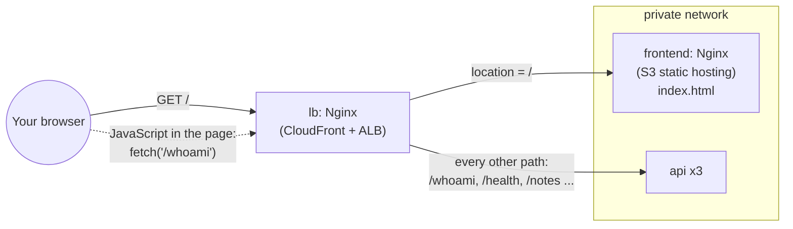
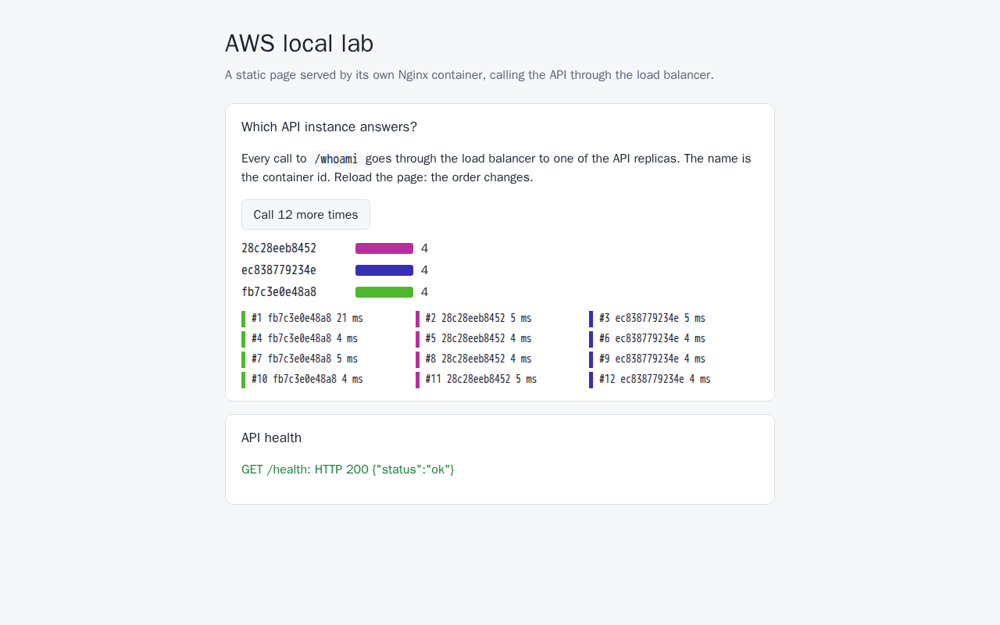
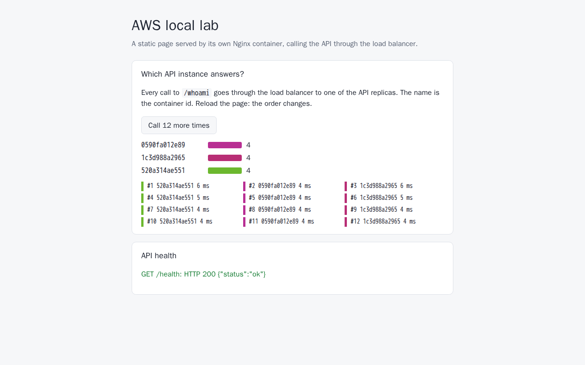

# Lab 08 — Frontend and CDN (S3 static hosting + CloudFront)

> **AWS equivalent:** Amazon S3 static website hosting + Amazon CloudFront (and ACM for HTTPS)  ·  **Time:** ~60 min  ·  **Difficulty:** ★★☆
> **Builds on:** [Lab 07](./07-queues-workers.md)  ·  **Reference solution:** commits `64587b8` and `f2536a0` (step 26), `9ebb73b` (step 27), `5834d55` (step 28) on `dev`

> **Status:** complete. Steps 26–28 and the closing sections (5–11) are written.

## 1. What you will learn
- Explain the difference between **static** and **dynamic** content, and why static files are served by something other than the API.
- Describe how AWS hosts a static website (**S3 static website hosting** or a private bucket behind **CloudFront**) and what a **CDN** adds.
- Serve a static page from its **own Nginx container** and route it through the load balancer by **path**, without breaking the API.
- Make a page call the API from the browser (**same origin**, no CORS) and show which replica answered.
- Take a screenshot of a web page with a pinned Playwright container, and use a browser run as a test.

## 2. Theory

### 2.1 The concept
A web application has two kinds of content. **Dynamic** content is built by code at the moment of the request: the list of your notes, the status of a job. **Static** content is a **file that is the same for everybody**: an HTML page, a stylesheet, a JavaScript file, an image. A static file needs no program to produce it, only a place to be **stored** and a way to be **delivered** quickly.

So the two are served by different things. The API (Python, a database behind it) is expensive to run and scale; a static file can sit in object storage and be handed out by a very simple, very fast server. The page, once in the browser, runs its own JavaScript and **calls the API** for the dynamic parts. This is the shape of most modern sites: a static "shell" plus an API.

A **CDN** (*content delivery network*) goes one step further: it keeps **copies** of your static files on servers all around the world (**edge locations**), so a visitor in Casablanca gets the file from a server near them instead of one in Virginia. The copies are kept as long as the **caching headers** of the response allow (step 27).

### 2.2 How AWS does it
| Piece | What it is |
|---|---|
| **S3 static website hosting** | A bucket with **website hosting** switched on serves its objects over plain HTTP, with an `index.html` for the root. You upload the files (`aws s3 sync`), and that is the whole deployment. |
| **CloudFront** | The AWS CDN. A **distribution** has one or more **origins** (where the original files are: an S3 bucket, a load balancer, any server) and **behaviors** (rules such as "paths `/api/*` go to origin A, everything else to origin B"). It caches responses at the **edge locations** according to a **cache policy** and the origin's headers. |
| **Origin Access Control (OAC)** | Lets CloudFront read a **private** bucket, so the bucket is not public and the only way in is the CDN (the recommended setup today). |
| **ACM** | *AWS Certificate Manager*: free public **TLS certificates** for CloudFront and load balancers, so the site is served over HTTPS (step 28). |
| **Route 53** | DNS: the site's name points to the CloudFront distribution. |
| **Invalidation** | Telling CloudFront to forget cached copies after you deploy a new version. |

Console: **S3** and **CloudFront → Distributions**. A very common setup mirrors this lab: one distribution with an S3 origin for `/` (the page) and an **ALB origin** for `/api/*`, so the browser sees **one site** and no CORS is needed.

### 2.3 How we reproduce it locally
| Concept | AWS | This lab |
|---|---|---|
| The static files | objects in an S3 bucket | the files of the `frontend/` folder |
| The static web server | S3 website hosting | the `frontend` service: a plain Nginx serving that folder, read-only |
| One entry point, routing by path | CloudFront behaviors (`/` → S3, `/api/*` → ALB) | the `lb` Nginx: `location = /` → frontend, every other path → API |
| Caching at the edge | CloudFront cache policy, `Cache-Control` from the origin | step 27: `Cache-Control`, `ETag` (the "edge" is your browser) |
| HTTPS certificate | ACM | step 28 (optional): a self-signed certificate made with OpenSSL (`make cert`); mkcert would also work |
| Edge locations around the world | CloudFront's network | **not simulated** (one machine) |
| Invalidation, WAF, custom domain | CloudFront / WAF / Route 53 | not simulated |

### 2.4 Diagram

The page comes from `frontend`; the calls it makes afterwards go to the **same address**, so the browser treats it as one site.

## 3. Prerequisites
- [Lab 07](./07-queues-workers.md) completed (at least Lab 02): `make up` runs. If port 80 is busy on your machine, `LB_HOST_PORT` in `.env` (the commands below use **8088**: replace it by yours).
- For screenshots: `scripts/screenshot.sh` runs a **pinned Playwright container** (`mcr.microsoft.com/playwright/python`, Chromium inside). Docker pulls that image the first time, which is **large** and slow; nothing is installed on your machine.

## 4. Steps

> Try each step yourself first, then compare with the reference commit.

### Step 26 — The static frontend
**Why:** until now the only thing at `http://localhost:8088/` was a `404` from the API. This step adds a **web page** and gives it its own home: a separate container, like a bucket with static hosting, behind the same load balancer. The page also proves the setup works from a **browser**: it calls the API through the load balancer and shows which replica answered each call, so you can **see** the load balancing of [Lab 02](./02-load-balancing.md).

**Do it.** Three files, plus the plan tick.

1. `frontend/index.html`: one page, with its CSS and JavaScript inline (no build step, nothing to install). This is the file **as it is at the end of this step**; [step 27](#step-27--caching-headers) moves the JavaScript into a separate, hashed file. The JavaScript calls `GET /whoami` 12 times, one after the other, and `GET /health` once; for each answer it adds a line and updates a tally per container id. The whole file:
   ```html
   <!doctype html>
   <html lang="en">
   <head>
     <meta charset="utf-8">
     <meta name="viewport" content="width=device-width, initial-scale=1">
     <title>AWS local lab</title>
     <style>
       :root { --bg: #f6f7f9; --card: #fff; --text: #1d2330; --muted: #5b6475; --line: #dde1e8; --ok: #1a7f37; --bad: #cf222e; }
       @media (prefers-color-scheme: dark) {
         :root { --bg: #14171f; --card: #1d222d; --text: #e8ebf2; --muted: #9aa3b5; --line: #2e3544; --ok: #3fb950; --bad: #ff7b72; }
       }
       body { margin: 0; background: var(--bg); color: var(--text); font: 16px/1.5 system-ui, sans-serif; }
       main { max-width: 44rem; margin: 0 auto; padding: 2rem 1rem; }
       h1 { margin: 0 0 .25rem; }
       h2 { font-size: 1.1rem; margin: 0 0 .5rem; }
       .sub { color: var(--muted); margin: 0 0 1.5rem; }
       section { background: var(--card); border: 1px solid var(--line); border-radius: .6rem; padding: 1rem 1.25rem; margin-bottom: 1rem; }
       button { font: inherit; padding: .4rem .9rem; border-radius: .4rem; border: 1px solid var(--line); background: var(--bg); color: var(--text); cursor: pointer; }
       button:disabled { opacity: .5; cursor: progress; }
       code { background: var(--bg); padding: .05rem .3rem; border-radius: .25rem; }
       ul, ol { padding-left: 0; list-style: none; margin: .75rem 0 0; }
       #tally li { display: flex; align-items: center; gap: .6rem; margin: .25rem 0; }
       #tally .name { width: 8.5rem; font-family: ui-monospace, monospace; }
       #tally .bar { height: .9rem; border-radius: .2rem; min-width: .5rem; }
       #calls { display: grid; grid-template-columns: repeat(auto-fill, minmax(10.5rem, 1fr)); gap: .35rem; }
       #calls li { font-family: ui-monospace, monospace; font-size: .85rem; border-left: .35rem solid; padding-left: .5rem; }
       .ok { color: var(--ok); } .bad { color: var(--bad); }
     </style>
   </head>
   <body>
   <main>
     <h1>AWS local lab</h1>
     <p class="sub">A static page served by its own Nginx container, calling the API through the load balancer.</p>

     <section>
       <h2>Which API instance answers?</h2>
       <p>Every call to <code>/whoami</code> goes through the load balancer to one of the API replicas.
          The name is the container id. Reload the page: the order changes.</p>
       <button id="again" type="button">Call 12 more times</button>
       <ul id="tally" aria-live="polite"></ul>
       <ol id="calls"></ol>
     </section>

     <section>
       <h2>API health</h2>
       <p id="health">checking…</p>
     </section>
   </main>

   <script>
     const COUNT = 12;      // calls per run
     const tally = {};      // container id -> number of answers so far

     // A stable colour per name, so the same instance always looks the same.
     function colour(name) {
       let h = 0;
       for (const c of name) h = (h * 31 + c.charCodeAt(0)) % 360;
       return `hsl(${h} 60% 45%)`;
     }

     async function whoami() {
       const start = performance.now();
       const res = await fetch('/whoami', { cache: 'no-store' });   // no-store: never answer from the browser cache
       const { hostname } = await res.json();
       return { hostname, ms: Math.round(performance.now() - start) };
     }

     function showTally() {
       const total = Object.values(tally).reduce((a, b) => a + b, 0);
       document.getElementById('tally').replaceChildren(...Object.entries(tally).sort().map(([name, n]) => {
         const li = document.createElement('li');
         li.innerHTML = `<span class="name"></span><span class="bar"></span><span>${n}</span>`;
         li.querySelector('.name').textContent = name;
         Object.assign(li.querySelector('.bar').style, { background: colour(name), width: `${(n / total) * 14}rem` });
         return li;
       }));
     }

     async function run() {
       const button = document.getElementById('again');
       button.disabled = true;
       for (let i = 1; i <= COUNT; i++) {
         try {
           const { hostname, ms } = await whoami();
           tally[hostname] = (tally[hostname] || 0) + 1;
           const li = document.createElement('li');
           li.textContent = `#${i} ${hostname} ${ms} ms`;
           li.style.borderColor = colour(hostname);
           document.getElementById('calls').appendChild(li);
           showTally();
         } catch (err) {
           document.getElementById('calls').insertAdjacentHTML('beforeend', `<li class="bad">#${i} failed</li>`);
         }
       }
       button.disabled = false;
     }

     async function health() {
       const el = document.getElementById('health');
       try {
         const res = await fetch('/health', { cache: 'no-store' });
         el.textContent = `GET /health: HTTP ${res.status} ${JSON.stringify(await res.json())}`;
         el.className = res.ok ? 'ok' : 'bad';
       } catch (err) {
         el.textContent = 'GET /health failed';
         el.className = 'bad';
       }
     }

     document.getElementById('again').addEventListener('click', run);
     health();
     run();
   </script>
   </body>
   </html>
   ```

2. The container that serves it, in `docker-compose.yml` (a new service, and the load balancer now waits for it):
   ```yaml
     # The static frontend (an S3 bucket with static website hosting, behind CloudFront, in AWS): a plain
     # Nginx that serves the files of ./frontend, read-only. No published port: the load balancer is the
     # only door and sends the path "/" here.
     frontend:
       image: nginx:1.30.6-alpine
       volumes:
         - ./frontend:/usr/share/nginx/html:ro
       networks:
         - private
       healthcheck:
         test: ["CMD", "wget", "-q", "-O", "/dev/null", "http://127.0.0.1/"]
         interval: 10s
         timeout: 3s
         retries: 3
         start_period: 5s
   ```
   and in the `lb` service, under `depends_on`:
   ```yaml
         frontend:
           condition: service_healthy
   ```

3. The route, in `lb/nginx.conf`: a new upstream (next to `api` and `s3`) and a `location` in the default `server` block:
   ```nginx
       # The static frontend (S3 static website + CloudFront in AWS): its own Nginx container.
       upstream frontend {
           zone frontend 64k;
           resolver 127.0.0.11 valid=5s;
           server frontend:80 resolve;
       }
   ```
   ```nginx
           # The page itself: only the exact path "/" goes to the frontend. Every other path (/health,
           # /whoami, /notes, /upload, /jobs ...) is still the API, so existing clients do not change.
           location = / {
               proxy_pass http://frontend;
               proxy_set_header Host $host;
           }
   ```

| Line | What it does | If you change or remove it |
|---|---|---|
| `fetch('/whoami', { cache: 'no-store' })` | Calls the API on the **same address** as the page (a relative URL). `no-store` tells the browser never to answer from its cache, so each call really reaches a replica. | Without `no-store` a browser could reuse an earlier answer and the page would always show the same instance. |
| `const { hostname } = await res.json()` | `/whoami` answers `{"hostname": "<container id>"}`: the name of the replica that handled the call. | |
| `colour(name)` | Derives a stable colour from the name, so the same replica always has the same colour. | |
| `tally[hostname] = (tally[hostname] \|\| 0) + 1` | Counts the answers per replica; `showTally()` draws one bar per replica. | |
| `textContent = ...` (and `.name`) | Writes the container id as **text**, never as HTML: a value from the network must not be interpreted as markup. | `innerHTML` with an untrusted value would be a cross-site scripting hole (here the API is ours, but keep the habit). |
| `health()` | One call to `GET /health`, shown in green or red. | |
| `run()` on load and on the button | Makes the 12 calls when the page opens and again when you press the button. | |
| `image: nginx:1.30.6-alpine` (service `frontend`) | The same pinned Nginx image as the load balancer: its default configuration already serves `/usr/share/nginx/html`. | |
| `volumes: - ./frontend:/usr/share/nginx/html:ro` | Mounts the folder **read-only** at the place Nginx serves files from. Edit `index.html` on the host and reload the page: no rebuild. | Remove `:ro` and the container could write into your folder. |
| `networks: - private` and no `ports:` | Reachable only by the load balancer. | Publishing a port would give the frontend a second, unprotected door. |
| `healthcheck: wget ... http://127.0.0.1/` | Healthy once Nginx answers for `/`. The load balancer starts after it. | |
| `upstream frontend { zone ...; resolver ...; server frontend:80 resolve; }` | The same pattern as `api` and `s3` ([Nginx 04](../courses/nginx/04-upstream-and-load-balancing.md)): the name is found by Docker DNS and followed if the container restarts. | |
| `location = / { proxy_pass http://frontend; ... }` | **Exact** match ([Nginx 02](../courses/nginx/02-config-server-location.md)): only the path `/` goes to the frontend. `location /` (the API) still catches everything else. | With `location /` here, the frontend would swallow every API path. |
| `proxy_set_header Host $host;` | Passes the host name on ([Nginx 03](../courses/nginx/03-proxy-pass-and-headers.md)). | |

**Start it:**
```bash
docker compose up -d --wait
docker compose exec -T lb nginx -t
docker compose exec -T lb nginx -s reload
docker compose ps --format '{{.Name}} {{.Status}}' | grep -E 'frontend|lb'
```
```text
nginx: the configuration file /etc/nginx/nginx.conf syntax is ok
nginx: configuration file /etc/nginx/nginx.conf test is successful
2026/11/22 23:14:59 [notice] 547#547: signal process started
aws-local-lab-frontend-1 Up 14 seconds (healthy)
aws-local-lab-lb-1 Up 13 minutes (healthy)
```
(Output of the commands in one run; the first two lines come from `nginx -t`, the third from the reload.) `docker compose up -d` **did not recreate `lb`** (it says `Up 13 minutes`): the configuration is a bind-mounted file that Compose does not track, so the new `nginx.conf` was not loaded until the **reload**. `nginx -t` first checks the file without applying it (see [Nginx 02](../courses/nginx/02-config-server-location.md)).

**Check 1 — the page, and every other path still going to the API.**
```bash
export MSYS_NO_PATHCONV=1          # Git Bash: otherwise it rewrites strings that start with "/"
curl -s -i http://127.0.0.1:8088/ | head -8
for p in /health /whoami /notes /index.html /; do printf '%-12s -> ' "$p"; curl -s -o /dev/null -w '%{http_code} %{content_type}\n' "http://127.0.0.1:8088$p"; done
```
```text
HTTP/1.1 200 OK
Server: nginx/1.30.6
Date: Sun, 22 Nov 2026 23:15:01 GMT
Content-Type: text/html
Content-Length: 4748
Connection: keep-alive
Last-Modified: Sun, 22 Nov 2026 23:14:28 GMT
ETag: "6b037754-128c"
/health      -> 200 application/json
/whoami      -> 200 application/json
/notes       -> 200 application/json
/index.html  -> 404 application/json
/            -> 200 text/html
```
`GET /` now answers `200 text/html`, **4,748 bytes**: the page, served by the `frontend` container (the `Server: nginx` header is the same either way; `Last-Modified` and `ETag` come from the file, and are the subject of step 27). `/health`, `/whoami` and `/notes` still go to the API and answer JSON. `/index.html` is a `404` **from the API** (JSON): only the exact path `/` is routed to the frontend. That is enough for one self-contained page; a site with several files would route more paths (or a prefix such as `/assets/`).

**Check 2 — the step's check: open it in a browser, and reload.** Open `http://localhost:8088/` (your port). The page calls `/whoami` twelve times and draws a bar per replica. Here is the same page captured by `scripts/screenshot.sh`:
```bash
bash scripts/screenshot.sh http://localhost:8088/ docs/labs/images/lab-08/step-26-frontend.png 3000
```
```text
saved /out/step-26-frontend.png
screenshot written to docs/labs/images/lab-08/step-26-frontend.png
```


The tally shows **three different containers** answering **four calls each**: the load balancer spreads the 12 calls round robin, and the page proves it **from the browser's side**. The health line is green. (The last argument of the script, `3000`, is the extra time in milliseconds to let the 12 calls finish before the capture.)

"Reload shows different instances": a real browser (Chromium in a Playwright container, the same pinned image as the screenshot script) loaded the page **three times** in one session. For each load, the instance that answered **call #1**, and the first four calls, and the tally:
```text
load 1: first 4 calls -> ['fb7c3e0e48a8', '28c28eeb8452', 'ec838779234e', 'fb7c3e0e48a8'] | tally -> ['28c28eeb8452 4', 'ec838779234e 4', 'fb7c3e0e48a8 4']
load 2: first 4 calls -> ['28c28eeb8452', 'ec838779234e', 'fb7c3e0e48a8', '28c28eeb8452'] | tally -> ['28c28eeb8452 4', 'ec838779234e 4', 'fb7c3e0e48a8 4']
load 3: first 4 calls -> ['28c28eeb8452', 'fb7c3e0e48a8', '28c28eeb8452', 'ec838779234e'] | tally -> ['28c28eeb8452 5', 'ec838779234e 3', 'fb7c3e0e48a8 4']
```
(The browser script was a throw-away Python snippet, run in the container with `page.goto(...)`, `wait_for_function` until 12 call lines existed, then `all_inner_texts()`; it is not part of the repository.) The order is **not the same** on each load: call #1 went to `fb7c…` on load 1 and to `28c2…` on loads 2 and 3, and the following calls differ (load 2: `28c2`, `ec83`, `fb7c`; load 3: `28c2`, `fb7c`, `28c2`). The round robin keeps turning **across** page loads, so each reload picks the rotation up where the previous one stopped, and every visit shows a different mix. Load 3 even shows an uneven `5 / 3 / 4`: the page also makes one `GET /health` call, and that call takes **its turn** in the same round robin, which shifts the others.

**Regression check — the whole suite:**
```bash
make test
```
```text
02_failover: FAILED          (only 59 of 60 requests succeeded with one replica dead)
02_load_balancing: all checks passed
03_network_isolation: all checks passed
04_persistence: all checks passed
05_cache: all checks passed
06_storage: all checks passed
07_async: all checks passed
```
(Lines filtered to the summaries; `make` exited with code 2.) Everything passed **except the known intermittent `02_failover`** of Lab 02 (see its Troubleshooting). Because this step changed `lb/nginx.conf`, I checked whether the new route could be the cause: `tests/02_failover.sh` run alone gave **3 failures in 8 runs** with the new configuration and **2 failures in 8 runs** with the previous `lb/nginx.conf` put back temporarily (then restored). The same range: the failure is **not caused by this step**. It is, however, frequent now (about one run in three here), and still unexplained: see the lead in Lab 02.

**What just happened:**
- The lab has its first **web page**, served by a container of its own, and the **load balancer routes by path**: `/` to the frontend, everything else to the API. In AWS this is a CloudFront distribution with two origins (S3 for `/`, an ALB for `/api/*`), or a load balancer with path rules.
- The page and the API share **one origin** (`http://localhost:8088`), so the browser's `fetch('/whoami')` needs no **CORS** configuration. If the page lived on another address than the API, the API would have to say, with headers, that this other site may call it.
- The frontend is **stateless and read-only**: it serves files, nothing writes into the folder, and a second copy of the container would work the same.
- The page makes the load balancing **visible**; this kind of small, honest, in-browser check is what a screenshot in a lab is for.
- **Not yet:** the page is sent **without caching instructions** (no `Cache-Control`), so a browser may ask for it again each time or guess how long to keep it: step 27 sets the headers properly. And the files are bind-mounted from your folder; in AWS they would be **uploaded** to the bucket as part of a deployment.

### Step 27 — Caching headers
> Note: from step 28 on, `http://localhost:8088/` (the page) answers `301` and redirects to HTTPS. The commands of this step were run before that: to repeat them now, use `https://localhost:8443/` with `--cacert certs/localhost.pem` (see step 28), or add `-L -k` to `curl`. The API paths and the asset still answer on plain HTTP.

**Why:** at the end of step 26 the page was served with an `ETag` and a `Last-Modified` date (Nginx adds them for every file) but with **no instruction about how long to keep it**. A browser then **guesses** (usually from the age of the file), which gives surprises: a page that does not update after a deployment, or one that is downloaded again and again. This step tells browsers (and, in AWS, CloudFront) **exactly** what to do, with two rules.

**The theory in five lines.**
1. A response can be **kept** by the browser, so the next visit does not have to download it again. That is **caching**.
2. A kept copy is **fresh** for a while (`max-age=N` seconds): during that time the browser uses it **without asking the server anything**.
3. When a copy is no longer fresh, the browser can **ask whether it changed**: it sends the file's `ETag` back in `If-None-Match`. If nothing changed the server answers **`304 Not Modified`** with **no body**, and the browser keeps its copy. Cheap, but still one round trip.
4. `Cache-Control: no-cache` does **not** mean "do not store": it means "you may store it, but **ask me every time** before you reuse it". (`no-store` is the one that forbids storing.)
5. A file whose **name contains a hash of its content** (`app.540efee7.js`) can **never** be out of date: if the content changes, the name changes, and the page loads a **different file**. Such a file can be kept for a year and marked **`immutable`** ("it will not change: do not even ask").

So the rule of this step: the **page** (whose name never changes, and which says which assets to load) is `no-cache`, always revalidated; the **hashed assets** are `public, max-age=31536000, immutable`, never asked about again. A deployment replaces the page and its asset names; visitors get the new version at their next visit, and old assets simply stop being requested.

**Do it.** Three files.

1. Move the JavaScript out of the page into a file whose name carries the **first 8 characters of its SHA-256** (the script here is the one of step 26, de-indented by two spaces). `frontend/assets/app.540efee7.js`:
   ```javascript
   const COUNT = 12;      // calls per run
   const tally = {};      // container id -> number of answers so far

   // A stable colour per name, so the same instance always looks the same.
   function colour(name) {
     let h = 0;
     for (const c of name) h = (h * 31 + c.charCodeAt(0)) % 360;
     return `hsl(${h} 60% 45%)`;
   }

   async function whoami() {
     const start = performance.now();
     const res = await fetch('/whoami', { cache: 'no-store' });   // no-store: never answer from the browser cache
     const { hostname } = await res.json();
     return { hostname, ms: Math.round(performance.now() - start) };
   }

   function showTally() {
     const total = Object.values(tally).reduce((a, b) => a + b, 0);
     document.getElementById('tally').replaceChildren(...Object.entries(tally).sort().map(([name, n]) => {
       const li = document.createElement('li');
       li.innerHTML = `<span class="name"></span><span class="bar"></span><span>${n}</span>`;
       li.querySelector('.name').textContent = name;
       Object.assign(li.querySelector('.bar').style, { background: colour(name), width: `${(n / total) * 14}rem` });
       return li;
     }));
   }

   async function run() {
     const button = document.getElementById('again');
     button.disabled = true;
     for (let i = 1; i <= COUNT; i++) {
       try {
         const { hostname, ms } = await whoami();
         tally[hostname] = (tally[hostname] || 0) + 1;
         const li = document.createElement('li');
         li.textContent = `#${i} ${hostname} ${ms} ms`;
         li.style.borderColor = colour(hostname);
         document.getElementById('calls').appendChild(li);
         showTally();
       } catch (err) {
         document.getElementById('calls').insertAdjacentHTML('beforeend', `<li class="bad">#${i} failed</li>`);
       }
     }
     button.disabled = false;
   }

   async function health() {
     const el = document.getElementById('health');
     try {
       const res = await fetch('/health', { cache: 'no-store' });
       el.textContent = `GET /health: HTTP ${res.status} ${JSON.stringify(await res.json())}`;
       el.className = res.ok ? 'ok' : 'bad';
     } catch (err) {
       el.textContent = 'GET /health failed';
       el.className = 'bad';
     }
   }

   document.getElementById('again').addEventListener('click', run);
   health();
   run();
   ```
   The name is computed from the content (run it again whenever the script changes, and rename the file):
   ```bash
   sha256sum frontend/assets/app.540efee7.js | cut -c1-8
   ```
   ```text
   540efee7
   ```

2. `frontend/index.html` loads it (the `<script>` block of step 26 becomes one line; the CSS stays inline). The whole file:
   ```html
   <!doctype html>
   <html lang="en">
   <head>
     <meta charset="utf-8">
     <meta name="viewport" content="width=device-width, initial-scale=1">
     <title>AWS local lab</title>
     <style>
       :root { --bg: #f6f7f9; --card: #fff; --text: #1d2330; --muted: #5b6475; --line: #dde1e8; --ok: #1a7f37; --bad: #cf222e; }
       @media (prefers-color-scheme: dark) {
         :root { --bg: #14171f; --card: #1d222d; --text: #e8ebf2; --muted: #9aa3b5; --line: #2e3544; --ok: #3fb950; --bad: #ff7b72; }
       }
       body { margin: 0; background: var(--bg); color: var(--text); font: 16px/1.5 system-ui, sans-serif; }
       main { max-width: 44rem; margin: 0 auto; padding: 2rem 1rem; }
       h1 { margin: 0 0 .25rem; }
       h2 { font-size: 1.1rem; margin: 0 0 .5rem; }
       .sub { color: var(--muted); margin: 0 0 1.5rem; }
       section { background: var(--card); border: 1px solid var(--line); border-radius: .6rem; padding: 1rem 1.25rem; margin-bottom: 1rem; }
       button { font: inherit; padding: .4rem .9rem; border-radius: .4rem; border: 1px solid var(--line); background: var(--bg); color: var(--text); cursor: pointer; }
       button:disabled { opacity: .5; cursor: progress; }
       code { background: var(--bg); padding: .05rem .3rem; border-radius: .25rem; }
       ul, ol { padding-left: 0; list-style: none; margin: .75rem 0 0; }
       #tally li { display: flex; align-items: center; gap: .6rem; margin: .25rem 0; }
       #tally .name { width: 8.5rem; font-family: ui-monospace, monospace; }
       #tally .bar { height: .9rem; border-radius: .2rem; min-width: .5rem; }
       #calls { display: grid; grid-template-columns: repeat(auto-fill, minmax(10.5rem, 1fr)); gap: .35rem; }
       #calls li { font-family: ui-monospace, monospace; font-size: .85rem; border-left: .35rem solid; padding-left: .5rem; }
       .ok { color: var(--ok); } .bad { color: var(--bad); }
     </style>
   </head>
   <body>
   <main>
     <h1>AWS local lab</h1>
     <p class="sub">A static page served by its own Nginx container, calling the API through the load balancer.</p>

     <section>
       <h2>Which API instance answers?</h2>
       <p>Every call to <code>/whoami</code> goes through the load balancer to one of the API replicas.
          The name is the container id. Reload the page: the order changes.</p>
       <button id="again" type="button">Call 12 more times</button>
       <ul id="tally" aria-live="polite"></ul>
       <ol id="calls"></ol>
     </section>

     <section>
       <h2>API health</h2>
       <p id="health">checking…</p>
     </section>
   </main>

   <script src="/assets/app.540efee7.js"></script>
   </body>
   </html>
   ```

3. The headers, in `lb/nginx.conf` (the `location = /` of step 26 gains one line, and a new `location /assets/`):
   ```nginx
           # The page itself: only the exact path "/" goes to the frontend. Every other path (/health,
           # /whoami, /notes, /upload, /jobs ...) is still the API, so existing clients do not change.
           # "no-cache" does not mean "do not store": it means "ask me every time before you reuse it".
           # The ETag makes that cheap: the answer is a short "304 Not Modified" while the page is unchanged.
           location = / {
               proxy_pass http://frontend;
               proxy_set_header Host $host;
               add_header Cache-Control "no-cache";
           }

           # Files whose name contains a hash of their content (app.540efee7.js): when the content changes,
           # the name changes too, so a copy can be kept for a year (31536000 s) and never needs checking.
           # No "always": an error answer (a mistyped name) must not be cached for a year.
           location /assets/ {
               proxy_pass http://frontend;
               proxy_set_header Host $host;
               add_header Cache-Control "public, max-age=31536000, immutable";
           }
   ```

| Line | What it does | If you change or remove it |
|---|---|---|
| `app.540efee7.js` | The first 8 hexadecimal characters of the file's SHA-256: a **content hash** in the name ("cache busting"). | A fixed name such as `app.js` could not be kept for a year: after a change, visitors would keep running the old script. |
| `<script src="/assets/app.540efee7.js">` | The page names the exact file to load. When the script changes, **this line** changes too, and the page is revalidated every time (next row), so visitors see the new name at once. | |
| `add_header Cache-Control "no-cache";` on `location = /` | The page may be stored but must be **revalidated** before each reuse. The `ETag` of the file makes this a `304` while the page is unchanged. | With no header the browser decides by itself: a stale page after a deployment is the classic result. |
| `location /assets/ { proxy_pass http://frontend; ... }` | Sends the asset paths to the frontend container, like `/` (the path is passed on unchanged). | Without it `/assets/...` would go to the API and answer `404`. |
| `add_header Cache-Control "public, max-age=31536000, immutable";` | `public`: any cache (browser, CDN) may keep it. `max-age=31536000`: fresh for one year (31,536,000 seconds). `immutable`: do not revalidate during that time, even on a reload. | A short `max-age` would make browsers ask again and again for a file that never changes. |
| no `always` on that `add_header` | By default `add_header` only applies to successful answers (200, 204, 206, 301, 302, 303, 304, 307, 308). A `404` for a mistyped name does **not** get the one-year header (Check 3). | With `always`, a `404` could be kept by a browser or CDN for a year. |

**Apply it:**
```bash
docker compose exec -T lb nginx -t
docker compose exec -T lb nginx -s reload
```
```text
nginx: the configuration file /etc/nginx/nginx.conf syntax is ok
nginx: configuration file /etc/nginx/nginx.conf test is successful
2026/11/23 09:19:38 [notice] 1225#1225: signal process started
```
(The `frontend` files are bind-mounted: the new `assets/` folder is served at once; only the load balancer's configuration needs the reload, as in step 26.)

**Check 1 — the headers (`curl -I` asks for the headers only).**
```bash
export MSYS_NO_PATHCONV=1
curl -s -I http://127.0.0.1:8088/ | grep -iE '^(HTTP|cache-control|etag|last-modified)'
curl -s -I http://127.0.0.1:8088/assets/app.540efee7.js | grep -iE '^(HTTP|content-type|cache-control|etag|last-modified)'
```
```text
HTTP/1.1 200 OK
Last-Modified: Mon, 23 Nov 2026 09:19:24 GMT
ETag: "6b04051c-9df"
Cache-Control: no-cache
HTTP/1.1 200 OK
Content-Type: application/javascript
Last-Modified: Mon, 23 Nov 2026 09:19:24 GMT
ETag: "6b04051c-89d"
Cache-Control: public, max-age=31536000, immutable
```
The page says `no-cache`, the hashed script says `public, max-age=31536000, immutable`. Both carry an `ETag` and a `Last-Modified` date made by the frontend's Nginx from the file (**validators**: ways to ask "has it changed?").

**Check 2 — the step's check: `200`, then `304` with `If-None-Match`.** Ask twice: the second time, send the `ETag` back, as a browser does:
```bash
curl -s -D - -o /dev/null http://127.0.0.1:8088/                                   # 1st request
curl -s -D - -o /dev/null -H 'If-None-Match: "6b04051c-9df"' http://127.0.0.1:8088/   # 2nd request: the ETag sent back
# the same two requests for the script (its own ETag), then a stale ETag on the page:
curl -s -D - -o /dev/null http://127.0.0.1:8088/assets/app.540efee7.js
curl -s -D - -o /dev/null -H 'If-None-Match: "6b04051c-89d"' http://127.0.0.1:8088/assets/app.540efee7.js
curl -s -D - -o /dev/null -H 'If-None-Match: "old-version"' http://127.0.0.1:8088/
```
```text
=== /
--- first request:
HTTP/1.1 200 OK
Content-Length: 2527
ETag: "6b04051c-9df"
Cache-Control: no-cache
--- second request with If-None-Match: "6b04051c-9df"
HTTP/1.1 304 Not Modified
ETag: "6b04051c-9df"
Cache-Control: no-cache
=== /assets/app.540efee7.js
--- first request:
HTTP/1.1 200 OK
Content-Length: 2205
ETag: "6b04051c-89d"
Cache-Control: public, max-age=31536000, immutable
--- second request with If-None-Match: "6b04051c-89d"
HTTP/1.1 304 Not Modified
ETag: "6b04051c-89d"
Cache-Control: public, max-age=31536000, immutable
=== a stale ETag gets the full file again:
HTTP/1.1 200 OK
Content-Length: 2527
```
(Both files were checked with the same two commands and the output joined and filtered to the interesting headers; `-D -` prints the response headers, `-o /dev/null` throws the body away.) The first request is `200` with the whole file (`Content-Length: 2527`). The second, carrying the `ETag`, is **`304 Not Modified`**: no body at all. A **stale** `ETag` (`"old-version"`, a version that no longer exists) gets the full file again. The hashed script also answers `304`, but a browser will not even ask: it is fresh for a year.

**Check 3 — an error is not cached for a year.**
```bash
curl -s -I http://127.0.0.1:8088/assets/app.nope.js | grep -iE '^(HTTP|cache-control)'
```
```text
HTTP/1.1 404 Not Found
```
A mistyped asset name answers `404` and has **no** `Cache-Control` line: the missing `always` kept the one-year header off the error.

**Check 4 — what a real browser does.** Chromium (Playwright, in a pinned container) visited the page **three times** in one session, with its HTTP cache on. For each visit, the script recorded for `/` and the asset whether the browser **asked the server** or used its **own cache**; afterwards the load balancer's access log (only `/` and `/assets/` lines) shows what **really reached the server**:
```text
visit 1: / -> asked the server, status 200 | /assets/app.540efee7.js -> asked the server, status 200
visit 2: / -> asked the server, status 200 | /assets/app.540efee7.js -> from the browser cache (no request)
visit 3: / -> asked the server, status 200 | /assets/app.540efee7.js -> from the browser cache (no request)
--- what the load balancer received (only / and /assets/):
"GET / HTTP/1.1" 200 2527
"GET /assets/app.540efee7.js HTTP/1.1" 200 2205 "http://host.docker.internal:8088/" "Mozilla/5.0 (X11; Linux x86_64) AppleWebKit/537.36 (KHTML, like Gecko) HeadlessChrome/159.0.8154.6 Safari/537.36"
"GET / HTTP/1.1" 304 0
"GET / HTTP/1.1" 304 0
```
(The script listened to the Chrome DevTools Protocol events `Network.requestWillBeSent`, `responseReceived` and `requestServedFromCache`; it is a throw-away snippet, not part of the repository. The log lines were cut to the request, status and size.) Read both halves together:
- **Visit 1:** the browser had nothing: the server got `GET /` and `GET /assets/app.540efee7.js`, both `200`.
- **Visits 2 and 3:** the **script never reached the server**: it was fresh and `immutable`, so the browser used its copy (no log line at all). The **page** did reach the server each time, as `no-cache` demands, and was answered **`304` with a size of 0**: the browser reused its copy and the transfer was empty. (The script reports the page as `status 200`: after revalidating, Chromium gives the page's scripts the cached response as a `200` (as far as I can tell); the **log** shows the real answer on the wire.)

That is the whole point of the two rules: the part that can change is checked every time at almost no cost, and the part that never changes is not requested at all.

**Check 5 — the page still works.** A screenshot with `scripts/screenshot.sh`, after the split:
```bash
bash scripts/screenshot.sh http://localhost:8088/ docs/labs/images/lab-08/step-27-frontend.png 3000
```
```text
saved /out/step-27-frontend.png
screenshot written to docs/labs/images/lab-08/step-27-frontend.png
```


Same page, loaded with its script from `/assets/app.540efee7.js`: three containers, four answers each, green health line. (The container ids differ from the screenshot of step 26: the test suite re-created the stack in between.)

**Regression check — the whole suite:**
```bash
make test
```
```text
02_failover: all checks passed
02_load_balancing: all checks passed
03_network_isolation: all checks passed
04_persistence: all checks passed
05_cache: all checks passed
06_storage: all checks passed
07_async: all checks passed
```
(Lines filtered to the summaries; `make` exited with code 0 on this run. As noted in step 26, `02_failover` is intermittent on this machine and can show its `59 of 60` failure on another run.)

**What just happened:**
- The frontend now has an explicit **caching policy**: the page is revalidated cheaply on every visit (`no-cache` + `ETag` → `304`), and the hashed script is cached for a year (`immutable`) and **never requested again** by a returning browser (Check 4, from both the browser's and the server's side).
- **Cache busting by file name** is what makes a long `max-age` safe: a change of content is a change of name, so no visitor can be stuck on an old script. The cost is a rename (and an edit of `index.html`) at each deployment; real projects automate it with a build tool.
- The headers are added by the **load balancer**, not by the frontend container. In AWS the equivalents are the `Cache-Control` metadata stored on each **S3 object** (the origin says how long a copy may live), or a **CloudFront response headers policy** and cache policy (the edge adds or overrides them). The lab's load balancer plays the CloudFront role here; the browser is the only cache.
- **Not simulated:** the CDN's own cache. The load balancer does not store anything (every request reaches the frontend container); only the **browser** caches. A real CloudFront would keep copies at its **edge locations** too, following the same `Cache-Control` rules, and would need an **invalidation** to drop a copy before it expires.
- **Not done:** compression (`gzip`), and other asset types (images, fonts); the CSS is still inline. Nothing in the page is hashed except the script.

### Step 28 — Local HTTPS (optional)
**Why:** everything so far travels as **plain HTTP**: anyone on the path between the browser and the server can read it or change it. The web fixed that with **TLS** (*Transport Layer Security*): the same HTTP, inside an encrypted, authenticated tunnel. That is what the `https://` and the padlock mean. In AWS you almost never handle certificates by hand: **ACM** issues them and the **load balancer** or **CloudFront** uses them. This step builds the local version of that.

**The theory in six lines.**
1. TLS gives three things: **encryption** (nobody can read the traffic), **integrity** (nobody can change it unnoticed) and **authentication** (you are really talking to the owner of the name you typed).
2. Authentication rests on a **certificate**: a small signed document that says "this public key belongs to `localhost`", plus a **private key** that only the server holds. The certificate is public; the private key is a **secret**.
3. A browser trusts a certificate when it was signed by a **certificate authority (CA)** that the browser (or the operating system) already trusts. That is what the padlock checks.
4. A **self-signed** certificate is signed by itself: there is no authority behind it, so a browser **refuses** it by default (you can accept the warning, or tell your tool to trust that exact certificate).
5. **TLS termination**: the load balancer ends the encrypted connection and talks plain HTTP to the containers behind it, inside the private network. One place holds the certificate; the containers need none.
6. The server's certificate lists the names it is valid for (**subject alternative names**, SAN). If you open `https://other-name/`, the browser refuses a certificate that does not list it.

**The decision for this step.** The plan said to use **mkcert**, a small tool that creates a local certificate authority and installs it in your system's trust store, so browsers show a padlock with no warning. Installing it changes your system-wide trust, so I asked; **you chose not to install anything**. Instead the lab makes a **self-signed certificate with OpenSSL, inside a throw-away container**, so nothing is installed or trusted on your machine. The price is a one-time browser warning and `--cacert` for `curl`. (With mkcert, only the certificate files would differ; the Nginx configuration is the same.)

**Do it.** Three files (and the plan tick).

1. `Makefile`: a `cert` target that creates the certificate **once** (it does nothing if `certs/localhost.pem` exists), and `make up` now runs it first, so a fresh clone gets a certificate without thinking about it:
   ```make
   # OpenSSL runs in a throw-away container, so nothing but Docker is needed on the host.
   cert: ## Make a self-signed certificate for localhost in certs/ (once; for HTTPS, Lab 08 step 28)
   	@mkdir -p certs
   	@if [ -f certs/localhost.pem ]; then \
   	  echo "certs/localhost.pem exists (delete the certs folder to make a new one)"; \
   	else \
   	  MSYS_NO_PATHCONV=1 docker run --rm -v "$$(pwd -W 2>/dev/null || pwd):/work" -w /work alpine:3.24 sh -c \
   	    'apk add -q --no-cache openssl && openssl req -x509 -newkey ec -pkeyopt ec_paramgen_curve:prime256v1 -nodes -days 365 -keyout certs/localhost.key -out certs/localhost.pem -subj "/CN=localhost" -addext "subjectAltName=DNS:localhost,DNS:*.localhost,IP:127.0.0.1"' \
   	  && echo "certificate written: certs/localhost.pem (private key: certs/localhost.key, both ignored by git)"; \
   	fi

   up: cert ## Build and start the lab in the background
   ```
   (Only the first word after `up:` is new: `up` now depends on `cert`; the rest of the `up` recipe is unchanged.)

2. `docker-compose.yml`, in the `lb` service: publish port 443 and mount the certificate folder read-only:
   ```yaml
     lb:
       # ...
         - ./lb/nginx.conf:/etc/nginx/nginx.conf:ro
         # The certificate and key made by "make cert" (read-only, never committed).
         - ./certs:/etc/nginx/certs:ro
       ports:
         # The only door into the lab, on your machine only (127.0.0.1).
         - "127.0.0.1:${LB_HOST_PORT:-80}:80"
         # The same door over HTTPS. 8443 by default because 443 is often taken; the redirect in
         # lb/nginx.conf names this port, so change both together.
         - "127.0.0.1:${LB_HTTPS_PORT:-8443}:443"
   ```

3. `lb/nginx.conf`: the default `server` also listens on 443 with TLS, and the page is redirected from HTTP:
   ```nginx
       server {
           listen 80 default_server;
           listen 443 ssl;
           http2 on;
           ssl_certificate     /etc/nginx/certs/localhost.pem;   # made by "make cert" (self-signed)
           ssl_certificate_key /etc/nginx/certs/localhost.key;
   ```
   ```nginx
           location = / {
               # A browser that opens the page over plain HTTP is sent to HTTPS (8443 = LB_HTTPS_PORT).
               # Only the page: the API paths stay reachable over HTTP, so existing clients and tests keep working.
               if ($scheme = http) {
                   return 301 https://$host:8443$request_uri;
               }
               proxy_pass http://frontend;
               proxy_set_header Host $host;
               add_header Cache-Control "no-cache";
           }
   ```

| Line | What it does | If you change or remove it |
|---|---|---|
| `docker run --rm -v "$(pwd -W):/work" -w /work alpine:3.24 sh -c '...'` | Runs OpenSSL in a pinned throw-away container, with your project folder visible as `/work`: **nothing but Docker is needed** on your machine (`pwd -W` gives Git Bash's folder as a Windows path). | Calling `openssl` directly from the recipe ended with `Error 127` (command not found) on this machine, probably because the bash that `make` starts does not see Git's OpenSSL (see Troubleshooting). |
| `openssl req -x509 -newkey ec -pkeyopt ec_paramgen_curve:prime256v1 -nodes -days 365` | Makes a **self-signed** certificate (`-x509`) with a new **elliptic-curve** key (P-256: small and fast), **without** a passphrase on the key (`-nodes`), valid for 365 days. | A passphrase on the key would stop Nginx from starting unattended. |
| `-keyout certs/localhost.key -out certs/localhost.pem` | Where the private key and the certificate go. Both names match the `*.key` and `*.pem` patterns of `.gitignore`: **never committed**. | |
| `-subj "/CN=localhost"` and `-addext "subjectAltName=DNS:localhost,DNS:*.localhost,IP:127.0.0.1"` | The certificate's name, and the names it is valid for: `localhost`, any `*.localhost` (such as `s3.localhost`) and `127.0.0.1`. Browsers read the **SAN**, not the subject. | Without the SAN, `https://localhost` would be refused even when you trust the certificate. |
| `if [ -f certs/localhost.pem ]` | Idempotent: it does not replace an existing certificate. | Delete the `certs` folder to make a new one. |
| `./certs:/etc/nginx/certs:ro` | The certificate and key appear inside the container, read-only. | |
| `"127.0.0.1:${LB_HTTPS_PORT:-8443}:443"` | Publishes the container's port 443 on your machine, loopback only. **8443** by default: port 443 is often taken (here another project's container holds it). | Set `LB_HTTPS_PORT=443` in `.env` if yours is free, and change the `8443` of the redirect too. |
| `listen 443 ssl;` | The server also accepts TLS connections on 443. The rest of the `server` (every `location`) is **shared** by HTTP and HTTPS. | |
| `http2 on;` | Allows HTTP/2 on the TLS connection (the browser and server agree on it during the handshake: **ALPN**). | |
| `ssl_certificate` / `ssl_certificate_key` | The certificate to present and its private key. | A missing file stops Nginx from starting. |
| `if ($scheme = http) { return 301 https://$host:8443$request_uri; }` | A request for the page that arrived over HTTP gets a **301 Moved Permanently** to the HTTPS address (`$host` keeps the name, `8443` is the published HTTPS port). | |
| (the redirect is only in `location = /`) | **Only the page** is redirected. A redirect for **everything** would send every `http://` test and API client to a certificate they do not trust. In a real site you would redirect all of it and the clients would use `https://`. | |

**Create the certificate and start the load balancer with it:**
```bash
make cert
make cert                       # a second time
docker compose up -d --wait lb
docker compose exec -T lb nginx -t
docker compose port lb 443
```
```text
certificate written: certs/localhost.pem (private key: certs/localhost.key, both ignored by git)
certs/localhost.pem exists (delete the certs folder to make a new one)
nginx: the configuration file /etc/nginx/nginx.conf syntax is ok
nginx: configuration file /etc/nginx/nginx.conf test is successful
127.0.0.1:8443
```
(Output of the five commands in one run: the first `make cert` wrote the files, the second did nothing. `docker compose up -d` **did** recreate `lb` this time, because its published ports changed.) The files are 241 bytes (key) and 631 bytes (certificate), small thanks to the elliptic-curve key. Git ignores them (`git check-ignore -v certs/localhost.pem` names the `*.pem` line of `.gitignore`).

**Check 1 — the step's check: `curl https://localhost:8443/health`** (the port is 8443 here, not 443):
```bash
curl -sS https://localhost:8443/health                                   # trust nobody
curl -sk https://localhost:8443/health                                   # -k: do not check the certificate at all
curl -s --cacert certs/localhost.pem -w '\nHTTP %{http_code}, TLS verify result %{ssl_verify_result}\n' https://localhost:8443/health
```
```text
curl: (60) schannel: SEC_E_UNTRUSTED_ROOT (0x80090325) - The certificate chain was issued by an authority that is not trusted.
More details here: https://curl.se/docs/sslcerts.html
{"status":"ok"}  HTTP 200
{"status":"ok"}
HTTP 200, TLS verify result 0, HTTP version 1.1
```
(The second command's `HTTP 200` and the third's lines come from `-w`.) Three outcomes for one server: **without trust** `curl` refuses (`curl: (60)`, "not trusted": the certificate is self-signed); with **`-k`** it skips the check (works, but you have lost the authentication: only for experiments); with **`--cacert certs/localhost.pem`** you tell `curl` to trust **that exact certificate**, and it answers `200` with `TLS verify result 0` (= verified). Verified here means "this is the certificate I trusted", which is all a local lab needs.

**Check 2 — what was negotiated, and the certificate as served** (`openssl s_client` opens a TLS connection and reports; the Windows `curl` of this machine has no HTTP/2 support, so ALPN is read from this tool):
```bash
openssl s_client -connect localhost:8443 -servername localhost -alpn h2 </dev/null 2>/dev/null | grep -a -E 'Protocol|Cipher|ALPN|Verif'
openssl s_client -connect localhost:8443 -servername localhost </dev/null 2>/dev/null | openssl x509 -noout -subject -issuer -dates -ext subjectAltName
```
```text
Verification error: self-signed certificate
New, TLSv1.3, Cipher is TLS_AES_256_GCM_SHA384
ALPN protocol: h2
Verify return code: 18 (self-signed certificate)
    Protocol  : TLSv1.3
    Cipher    : TLS_AES_256_GCM_SHA384
  subject=CN=localhost
  issuer=CN=localhost
  notBefore=Nov 23 10:45:41 2026 GMT
  notAfter=Nov 23 10:45:41 2027 GMT
  X509v3 Subject Alternative Name: 
      DNS:localhost, DNS:*.localhost, IP Address:127.0.0.1
```
- **TLS 1.3** with the cipher `TLS_AES_256_GCM_SHA384`; and `ALPN protocol: h2`: HTTP/2 was agreed during the handshake. (Forcing the older version also works: `-tls1_2` answers `Protocol : TLSv1.2`, `-tls1_3` answers `TLSv1.3`.)
- **`subject` and `issuer` are both `CN=localhost`**: signed by itself, hence `Verify return code: 18 (self-signed certificate)`. A certificate from a real authority has a different issuer.
- Valid for one year (`notBefore`/`notAfter`), and the **SAN** lists the three names asked for.

**Check 3 — the redirect, and what did not change.**
```bash
curl -s -I http://127.0.0.1:8088/ | grep -iE '^(HTTP|location)'                  # the page over HTTP
curl -s -o /dev/null -w 'GET http://.../health -> %{http_code}\n' http://127.0.0.1:8088/health   # the API over HTTP
curl -s -I --cacert certs/localhost.pem https://localhost:8443/ | grep -iE '^(HTTP|cache-control|etag)'
curl -s -I --cacert certs/localhost.pem https://localhost:8443/assets/app.540efee7.js | grep -iE '^(HTTP|cache-control)'
curl -s --cacert certs/localhost.pem https://localhost:8443/whoami
```
```text
HTTP/1.1 301 Moved Permanently
Location: https://127.0.0.1:8443/
GET http://.../health -> 200
HTTP/1.1 200 OK
ETag: "6b04051c-9df"
Cache-Control: no-cache
HTTP/1.1 200 OK
Cache-Control: public, max-age=31536000, immutable
{"hostname":"909d16b54f35"}
```
The page over HTTP answers **`301`** with `Location: https://127.0.0.1:8443/` (the name you typed, the HTTPS port). The API over HTTP still answers `200`: existing clients and tests are not affected. Over HTTPS the page keeps its `no-cache` + `ETag` and the script keeps `immutable` (step 27): the caching rules do not depend on the scheme. The API answers over HTTPS too (a replica's container id).

**Check 4 — a real browser.** Chromium in the pinned Playwright container, first **strict** (no exception), then **accepting the certificate warning**, as you would by clicking "Advanced, continue":
```text
strict browser: Page.goto: net::ERR_CERT_AUTHORITY_INVALID at http://host.docker.internal:8088/
after accepting the warning: opened http://...:8088/, ended at https://host.docker.internal:8443/
page protocol: https: | calls shown: 12 | health line: GET /health: HTTP 200 {"status":"ok"}
```
(A throw-away Playwright snippet, not part of the repository; the host name `host.docker.internal` is how the container reaches your machine, and the certificate does not list it: that is one more reason a strict browser refuses.) The **strict** browser stops with `ERR_CERT_AUTHORITY_INVALID`: it does not trust this certificate's issuer, exactly what a real visitor's browser would do with a self-signed certificate. After accepting the warning, the page opened at `http://…:8088/` **ended at `https://…:8443/`** (the redirect), `location.protocol` is `https:`, and the page works as before: 12 calls, green health line. In your own browser you will see "Your connection is not private": expected; accept it for this lab address only.

**Regression check — the whole suite:**
```bash
make test
```
```text
02_failover: all checks passed
02_load_balancing: all checks passed
03_network_isolation: all checks passed
04_persistence: all checks passed
05_cache: all checks passed
06_storage: all checks passed
07_async: all checks passed
```
(Lines filtered to the summaries; `make` exited with code 0 on this run, and `docker compose ps lb` shows `127.0.0.1:8088->80/tcp, 127.0.0.1:8443->443/tcp`. `02_failover` stays intermittent on this machine, see Lab 02.) The tests use plain HTTP on purpose, which is why only the page is redirected. `scripts/screenshot.sh` still works on `http://localhost:8088/`: it already tells Chromium to ignore certificate errors, so it follows the redirect.

**What just happened:**
- The load balancer now does **TLS termination**: encrypted from the browser to `lb`, plain HTTP on the private network behind it. In AWS this is an **ALB HTTPS listener** or **CloudFront** with an **ACM** certificate.
- One configuration serves **both schemes**: the same `location` blocks answer on 80 and 443. A **redirect** moves browsers from HTTP to HTTPS (in CloudFront: the viewer protocol policy "Redirect HTTP to HTTPS").
- You saw the **trust model** work: a self-signed certificate is refused until you decide to trust it (`--cacert`, `-k`, or the browser's warning). A real site gets a certificate from an authority browsers already trust (ACM, Let's Encrypt).
- The **private key** never leaves your machine and is never committed (`.gitignore`); the certificate is public.
- **Not done:** HSTS (a header telling browsers to use HTTPS only), redirecting everything, TLS between the load balancer and the containers, certificate renewal (ACM renews by itself; this one expires in a year: `make cert` after deleting the folder).

## 5. Verify it works
With the lab up (`make up`; if port 80 is busy, `LB_HOST_PORT` in `.env`; HTTPS is on `LB_HTTPS_PORT`, 8443 by default):
```bash
make test                                                          # seven scripts, "all checks passed", exit code 0
curl -s -I http://localhost:8088/ | head -3                        # 301 to https://...:8443/
curl -s -I --cacert certs/localhost.pem https://localhost:8443/    # 200, Cache-Control: no-cache, ETag
curl -s -I --cacert certs/localhost.pem https://localhost:8443/assets/app.540efee7.js   # immutable
curl -s --cacert certs/localhost.pem https://localhost:8443/health # {"status":"ok"}
```
(If only `02_failover` fails with `59 of 60`, run it again: the known intermittent failure of Lab 02.) Then open `https://localhost:8443/` in your browser, accept the warning once, and reload a few times: the call order changes; and in the browser's developer tools (Network tab) the script comes from the cache after the first visit while the page is revalidated.

## 6. Troubleshooting
| Symptom | Cause | Fix |
|---|---|---|
| `GET /` answers `404` with `{"detail":"Not Found"}` | Before step 26 the load balancer sent every path, `/` included, to the API, which has no `/` route. | Step 26: `location = /` sends the page to the frontend. |
| The new route does nothing after `docker compose up -d` (`/` is still `404`), `lb` says `Up 13 minutes` | `lb/nginx.conf` is a bind-mounted file; Compose does not recreate the container when it changes. | `docker compose exec -T lb nginx -t`, then `docker compose exec -T lb nginx -s reload` (or `docker compose restart lb`). |
| `curl -s -o /dev/null -w '/health %{http_code}\n' URL` prints `C:/Program Files/Git/health 200` (Git Bash on Windows) | Git Bash rewrites strings that start with `/` into Windows paths, including inside `-w`. | `export MSYS_NO_PATHCONV=1` first, or do not start the format string with `/`. |
| `/index.html` answers `404` JSON | Only the exact path `/` is routed to the frontend; every other path is the API's. | Expected here. To serve more files, add routes (a prefix such as `/assets/`) or serve the frontend on its own host name. |
| `make test` fails only in `02_failover.sh` with `59 of 60` | The known intermittent failure of Lab 02 (about 1 run in 3 here, with or without this step's route). | Run it again; see Lab 02 Troubleshooting. |
| After adding the headers, `curl -s -I .../assets/app.nope.js` (a mistyped name) shows no `Cache-Control` | By design: `add_header` without `always` only applies to successful answers, so a `404` is not told to be cached for a year. | Nothing to fix. Add `always` only if you want headers on errors too (not for a long `max-age`). |
| A script using the DevTools Protocol reports `status 200` for the page on a revisit, but the server log says `304 0` | After revalidating, Chromium hands the page's scripts the cached copy as a `200`; the wire exchange was a `304`. | Trust the server's access log for what really happened on the wire. |
| `curl: (60) schannel: SEC_E_UNTRUSTED_ROOT` on `https://localhost:8443/...` | The certificate is self-signed: nobody trusted vouches for it. | Tell `curl` to trust it: `--cacert certs/localhost.pem` (or `-k` for a quick test, which also skips the authentication). |
| The browser says "Your connection is not private" (`ERR_CERT_AUTHORITY_INVALID`) | Same cause. | Accept the warning for this address. To get a padlock, install mkcert and make a certificate with it (the Nginx configuration does not change). |
| `curl: option --http2: the installed libcurl version does not support this` | The `curl` of this Windows machine was built without HTTP/2. | Read the negotiated protocol with `openssl s_client -alpn h2` (it prints `ALPN protocol: h2`), or use another `curl`. |
| `make cert` ends with `Error 127` (command not found) when the recipe calls `openssl` | Probably the bash that `make` starts does not find the OpenSSL that Git Bash has in your terminal (not investigated further). | The recipe runs OpenSSL in a container (`docker run ... alpine:3.24`), so it only needs Docker. |
| `http://localhost:8088/` answers `301` instead of the page (the commands of steps 26 and 27 used it) | Since step 28 the page is redirected to HTTPS. | Use `https://localhost:8443/` with `--cacert certs/localhost.pem`, or add `-L -k` to follow the redirect for a quick look. |

## 7. Going to real AWS
- **What changes:** the files go to an **S3 bucket** (private, with **Origin Access Control**) or to S3 **static website hosting**, behind a **CloudFront distribution**. One distribution can have **two origins** with path **behaviors**: `/` (and `/assets/*`) to the bucket, `/api/*` to the **ALB** in front of the API: exactly the routing of this lab's `lb`, and it keeps the page and the API on **one origin** (no CORS).
- **HTTPS:** an **ACM certificate** for your domain (public certificates are free and renew themselves). For CloudFront the certificate must be requested in **us-east-1**. The **viewer protocol policy** "Redirect HTTP to HTTPS" replaces the redirect of `lb/nginx.conf`; the ALB gets an HTTPS listener with the same certificate and a **security policy** that fixes the TLS versions and ciphers. **Route 53** points the domain name to the distribution.
- **Caching:** the same headers as step 27. Put `Cache-Control` on the S3 objects (metadata set when you upload: `immutable` for hashed files, `no-cache` for `index.html`), or use a **response headers policy** and **cache policy** on CloudFront. CloudFront keeps copies at its **edge locations** following those rules, so a new deployment needs either hashed names (as here), a short TTL for the page, or an **invalidation**. Add **HSTS** with a response headers policy once HTTPS works.
- **What this lab does not simulate:** edge locations and the CDN's own cache (only the browser caches), ACM and real certificate authorities (the certificate here is self-signed, so browsers warn), custom domains and DNS, WAF, access logs, and compression and image formats a real CDN handles.
- **Rough cost:** S3 bills for storage and requests, CloudFront for data transferred out and requests (a small site costs very little, and both have a free monthly allowance), ACM public certificates are free, a Route 53 hosted zone has a small monthly fee. See the [CloudFront pricing](https://aws.amazon.com/cloudfront/pricing/) and [S3 pricing](https://aws.amazon.com/s3/pricing/) pages; prices change.

## 8. Clean up
```bash
make down                  # removes the containers and networks (the volumes are kept)
```
The certificate and key live in the `certs` folder of the project: delete that folder when you no longer need HTTPS (`make cert` makes a new pair at the next `make up`). The screenshots under `docs/labs/images/lab-08/` are part of the course: keep them. `make clean` deletes ALL lab volumes (it asks you to type "yes" first: run it yourself).

## 9. Check your understanding
1. What is the difference between `Cache-Control: no-cache` and `no-store`, and which does the page of this lab use?
2. A browser has `app.540efee7.js` in its cache, marked `immutable` for a year. The script changes. How does the visitor get the new version, without waiting a year?
3. What does the `304 Not Modified` answer mean, and what does the browser send to get it?
4. What does TLS termination mean, and where does it happen in this lab and in AWS?
5. Why does a browser refuse the self-signed certificate of this lab, and what are two ways to trust it?

<details><summary>Answers</summary>

1. `no-cache` lets the browser **store** the response but requires it to **revalidate** (ask the server) before reusing it; `no-store` forbids storing it at all. The page uses `no-cache` (with an `ETag`, so revalidation is a cheap `304`).
2. The new script has a **new name** (the hash changes), and `index.html`, which is revalidated at every visit, now points to that new name. The browser never asks for the old name again, so the old cache entry is simply unused.
3. "The copy you have is still good": the response has **no body**. The browser sent the `ETag` it remembered in an `If-None-Match` header, and the server found it unchanged.
4. The load balancer ends the **encrypted** connection and speaks **plain HTTP** to the containers behind it, so only one component needs the certificate. In this lab it is the `lb` Nginx (port 443); in AWS, an ALB HTTPS listener or CloudFront with an ACM certificate.
5. It is signed by itself, not by a certificate authority the browser trusts, so nothing vouches for it (`issuer` equals `subject`). To trust it: tell `curl` with `--cacert certs/localhost.pem` (or accept the warning in the browser), or use mkcert, which installs a local authority that the system trusts.

</details>

## 10. Exercises (optional)
- Change one line of `frontend/assets/app.540efee7.js`, recompute its hash with `sha256sum | cut -c1-8`, rename the file, update `index.html`, and reload with the browser's developer tools open: which requests go to the network, and which come from the cache?
- Move the inline CSS of `index.html` into a hashed `assets/style.<hash>.css`, serve it with the same `immutable` rule, and check the response headers with `curl -I`.
- Add the HSTS header to the HTTPS responses (`add_header Strict-Transport-Security "max-age=300" always;` in the `server` block, only for HTTPS) and see it with `curl -I`. Why is a short `max-age` the right way to try it?
- Redirect **everything** from HTTP to HTTPS, and change the seven tests to use `https://` with `--cacert`. What did you have to change, and why is that the real-world situation?
- Install mkcert (`winget install FiloSottile.mkcert`, then `mkcert -install`), make a certificate with it instead of `make cert`, and open the page in your browser: the padlock appears. Which file did you replace, and did the Nginx configuration change?

## 11. Further reading
- [MDN: HTTP caching](https://developer.mozilla.org/en-US/docs/Web/HTTP/Caching) and [`Cache-Control`](https://developer.mozilla.org/en-US/docs/Web/HTTP/Headers/Cache-Control) (MDN)
- [MDN: `ETag`](https://developer.mozilla.org/en-US/docs/Web/HTTP/Headers/ETag) and [`304 Not Modified`](https://developer.mozilla.org/en-US/docs/Web/HTTP/Status/304) (MDN)
- [Hosting a static website on Amazon S3](https://docs.aws.amazon.com/AmazonS3/latest/userguide/WebsiteHosting.html) and [what is Amazon CloudFront](https://docs.aws.amazon.com/AmazonCloudFront/latest/DeveloperGuide/Introduction.html) (AWS)
- [AWS Certificate Manager](https://docs.aws.amazon.com/acm/latest/userguide/acm-overview.html) and [requiring HTTPS in CloudFront](https://docs.aws.amazon.com/AmazonCloudFront/latest/DeveloperGuide/using-https.html) (AWS)
- [Nginx: configuring HTTPS servers](https://nginx.org/en/docs/http/configuring_https_servers.html) and [`ngx_http_ssl_module`](https://nginx.org/en/docs/http/ngx_http_ssl_module.html) (Nginx)
- [`openssl req`](https://docs.openssl.org/master/man1/openssl-req/) (OpenSSL) and [mkcert](https://github.com/FiloSottile/mkcert) (the tool the plan first suggested)
