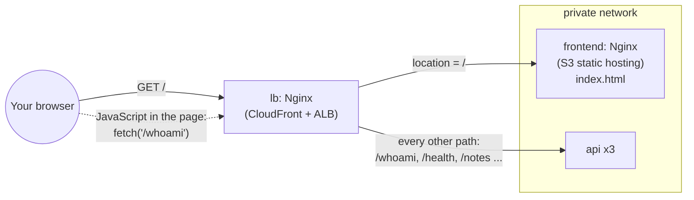

# Lab 08 — Frontend and CDN (S3 static hosting + CloudFront)

> **AWS equivalent:** Amazon S3 static website hosting + Amazon CloudFront (and ACM for HTTPS)  ·  **Time:** ~60 min  ·  **Difficulty:** ★★☆
> **Builds on:** [Lab 07](./07-queues-workers.md)  ·  **Reference solution:** commit `64587b8` (step 26) on `dev`

> **Status:** in progress. Step 26 is written. Steps 27–28 (caching headers, local HTTPS) and the closing sections (5–11) come next.

## 1. What you will learn
- Explain the difference between **static** and **dynamic** content, and why static files are served by something other than the API.
- Describe how AWS hosts a static website (**S3 static website hosting** or a private bucket behind **CloudFront**) and what a **CDN** adds.
- Serve a static page from its **own Nginx container** and route it through the load balancer by **path**, without breaking the API.
- Make a page call the API from the browser (**same origin**, no CORS) and show which replica answered.
- Take a screenshot of a web page with a pinned Playwright container, and use a browser run as a test.

## 2. Theory

### 2.1 The concept
A web application has two kinds of content. **Dynamic** content is built by code at the moment of the request: the list of your notes, the status of a job. **Static** content is a **file that is the same for everybody**: an HTML page, a stylesheet, a JavaScript file, an image. A static file needs no program to produce it, only a place to be **stored** and a way to be **delivered** quickly.

So the two are served by different things. The API (Python, a database behind it) is expensive to run and scale; a static file can sit in object storage and be handed out by a very simple, very fast server. The page, once in the browser, runs its own JavaScript and **calls the API** for the dynamic parts. This is the shape of most modern sites: a static "shell" plus an API.

A **CDN** (*content delivery network*) goes one step further: it keeps **copies** of your static files on servers all around the world (**edge locations**), so a visitor in Casablanca gets the file from a server near them instead of one in Virginia. The copies are kept as long as the **caching headers** of the response allow (step 27).

### 2.2 How AWS does it
| Piece | What it is |
|---|---|
| **S3 static website hosting** | A bucket with **website hosting** switched on serves its objects over plain HTTP, with an `index.html` for the root. You upload the files (`aws s3 sync`), and that is the whole deployment. |
| **CloudFront** | The AWS CDN. A **distribution** has one or more **origins** (where the original files are: an S3 bucket, a load balancer, any server) and **behaviors** (rules such as "paths `/api/*` go to origin A, everything else to origin B"). It caches responses at the **edge locations** according to a **cache policy** and the origin's headers. |
| **Origin Access Control (OAC)** | Lets CloudFront read a **private** bucket, so the bucket is not public and the only way in is the CDN (the recommended setup today). |
| **ACM** | *AWS Certificate Manager*: free public **TLS certificates** for CloudFront and load balancers, so the site is served over HTTPS (step 28). |
| **Route 53** | DNS: the site's name points to the CloudFront distribution. |
| **Invalidation** | Telling CloudFront to forget cached copies after you deploy a new version. |

Console: **S3** and **CloudFront → Distributions**. A very common setup mirrors this lab: one distribution with an S3 origin for `/` (the page) and an **ALB origin** for `/api/*`, so the browser sees **one site** and no CORS is needed.

### 2.3 How we reproduce it locally
| Concept | AWS | This lab |
|---|---|---|
| The static files | objects in an S3 bucket | the files of the `frontend/` folder |
| The static web server | S3 website hosting | the `frontend` service: a plain Nginx serving that folder, read-only |
| One entry point, routing by path | CloudFront behaviors (`/` → S3, `/api/*` → ALB) | the `lb` Nginx: `location = /` → frontend, every other path → API |
| Caching at the edge | CloudFront cache policy, `Cache-Control` from the origin | step 27: `Cache-Control`, `ETag` (the "edge" is your browser) |
| HTTPS certificate | ACM | step 28 (optional): a local certificate made with mkcert |
| Edge locations around the world | CloudFront's network | **not simulated** (one machine) |
| Invalidation, WAF, custom domain | CloudFront / WAF / Route 53 | not simulated |

### 2.4 Diagram

The page comes from `frontend`; the calls it makes afterwards go to the **same address**, so the browser treats it as one site.

## 3. Prerequisites
- [Lab 07](./07-queues-workers.md) completed (at least Lab 02): `make up` runs. If port 80 is busy on your machine, `LB_HOST_PORT` in `.env` (the commands below use **8088**: replace it by yours).
- For screenshots: `scripts/screenshot.sh` runs a **pinned Playwright container** (`mcr.microsoft.com/playwright/python`, Chromium inside). Docker pulls that image the first time, which is **large** and slow; nothing is installed on your machine.

## 4. Steps

> Try each step yourself first, then compare with the reference commit.

### Step 26 — The static frontend
**Why:** until now the only thing at `http://localhost:8088/` was a `404` from the API. This step adds a **web page** and gives it its own home: a separate container, like a bucket with static hosting, behind the same load balancer. The page also proves the setup works from a **browser**: it calls the API through the load balancer and shows which replica answered each call, so you can **see** the load balancing of [Lab 02](./02-load-balancing.md).

**Do it.** Three files, plus the plan tick.

1. `frontend/index.html`: one page, with its CSS and JavaScript inline (no build step, nothing to install). The JavaScript calls `GET /whoami` 12 times, one after the other, and `GET /health` once; for each answer it adds a line and updates a tally per container id. The whole file:
   ```html
   <!doctype html>
   <html lang="en">
   <head>
     <meta charset="utf-8">
     <meta name="viewport" content="width=device-width, initial-scale=1">
     <title>AWS local lab</title>
     <style>
       :root { --bg: #f6f7f9; --card: #fff; --text: #1d2330; --muted: #5b6475; --line: #dde1e8; --ok: #1a7f37; --bad: #cf222e; }
       @media (prefers-color-scheme: dark) {
         :root { --bg: #14171f; --card: #1d222d; --text: #e8ebf2; --muted: #9aa3b5; --line: #2e3544; --ok: #3fb950; --bad: #ff7b72; }
       }
       body { margin: 0; background: var(--bg); color: var(--text); font: 16px/1.5 system-ui, sans-serif; }
       main { max-width: 44rem; margin: 0 auto; padding: 2rem 1rem; }
       h1 { margin: 0 0 .25rem; }
       h2 { font-size: 1.1rem; margin: 0 0 .5rem; }
       .sub { color: var(--muted); margin: 0 0 1.5rem; }
       section { background: var(--card); border: 1px solid var(--line); border-radius: .6rem; padding: 1rem 1.25rem; margin-bottom: 1rem; }
       button { font: inherit; padding: .4rem .9rem; border-radius: .4rem; border: 1px solid var(--line); background: var(--bg); color: var(--text); cursor: pointer; }
       button:disabled { opacity: .5; cursor: progress; }
       code { background: var(--bg); padding: .05rem .3rem; border-radius: .25rem; }
       ul, ol { padding-left: 0; list-style: none; margin: .75rem 0 0; }
       #tally li { display: flex; align-items: center; gap: .6rem; margin: .25rem 0; }
       #tally .name { width: 8.5rem; font-family: ui-monospace, monospace; }
       #tally .bar { height: .9rem; border-radius: .2rem; min-width: .5rem; }
       #calls { display: grid; grid-template-columns: repeat(auto-fill, minmax(10.5rem, 1fr)); gap: .35rem; }
       #calls li { font-family: ui-monospace, monospace; font-size: .85rem; border-left: .35rem solid; padding-left: .5rem; }
       .ok { color: var(--ok); } .bad { color: var(--bad); }
     </style>
   </head>
   <body>
   <main>
     <h1>AWS local lab</h1>
     <p class="sub">A static page served by its own Nginx container, calling the API through the load balancer.</p>

     <section>
       <h2>Which API instance answers?</h2>
       <p>Every call to <code>/whoami</code> goes through the load balancer to one of the API replicas.
          The name is the container id. Reload the page: the order changes.</p>
       <button id="again" type="button">Call 12 more times</button>
       <ul id="tally" aria-live="polite"></ul>
       <ol id="calls"></ol>
     </section>

     <section>
       <h2>API health</h2>
       <p id="health">checking…</p>
     </section>
   </main>

   <script>
     const COUNT = 12;      // calls per run
     const tally = {};      // container id -> number of answers so far

     // A stable colour per name, so the same instance always looks the same.
     function colour(name) {
       let h = 0;
       for (const c of name) h = (h * 31 + c.charCodeAt(0)) % 360;
       return `hsl(${h} 60% 45%)`;
     }

     async function whoami() {
       const start = performance.now();
       const res = await fetch('/whoami', { cache: 'no-store' });   // no-store: never answer from the browser cache
       const { hostname } = await res.json();
       return { hostname, ms: Math.round(performance.now() - start) };
     }

     function showTally() {
       const total = Object.values(tally).reduce((a, b) => a + b, 0);
       document.getElementById('tally').replaceChildren(...Object.entries(tally).sort().map(([name, n]) => {
         const li = document.createElement('li');
         li.innerHTML = `<span class="name"></span><span class="bar"></span><span>${n}</span>`;
         li.querySelector('.name').textContent = name;
         Object.assign(li.querySelector('.bar').style, { background: colour(name), width: `${(n / total) * 14}rem` });
         return li;
       }));
     }

     async function run() {
       const button = document.getElementById('again');
       button.disabled = true;
       for (let i = 1; i <= COUNT; i++) {
         try {
           const { hostname, ms } = await whoami();
           tally[hostname] = (tally[hostname] || 0) + 1;
           const li = document.createElement('li');
           li.textContent = `#${i} ${hostname} ${ms} ms`;
           li.style.borderColor = colour(hostname);
           document.getElementById('calls').appendChild(li);
           showTally();
         } catch (err) {
           document.getElementById('calls').insertAdjacentHTML('beforeend', `<li class="bad">#${i} failed</li>`);
         }
       }
       button.disabled = false;
     }

     async function health() {
       const el = document.getElementById('health');
       try {
         const res = await fetch('/health', { cache: 'no-store' });
         el.textContent = `GET /health: HTTP ${res.status} ${JSON.stringify(await res.json())}`;
         el.className = res.ok ? 'ok' : 'bad';
       } catch (err) {
         el.textContent = 'GET /health failed';
         el.className = 'bad';
       }
     }

     document.getElementById('again').addEventListener('click', run);
     health();
     run();
   </script>
   </body>
   </html>
   ```

2. The container that serves it, in `docker-compose.yml` (a new service, and the load balancer now waits for it):
   ```yaml
     # The static frontend (an S3 bucket with static website hosting, behind CloudFront, in AWS): a plain
     # Nginx that serves the files of ./frontend, read-only. No published port: the load balancer is the
     # only door and sends the path "/" here.
     frontend:
       image: nginx:1.30.6-alpine
       volumes:
         - ./frontend:/usr/share/nginx/html:ro
       networks:
         - private
       healthcheck:
         test: ["CMD", "wget", "-q", "-O", "/dev/null", "http://127.0.0.1/"]
         interval: 10s
         timeout: 3s
         retries: 3
         start_period: 5s
   ```
   and in the `lb` service, under `depends_on`:
   ```yaml
         frontend:
           condition: service_healthy
   ```

3. The route, in `lb/nginx.conf`: a new upstream (next to `api` and `s3`) and a `location` in the default `server` block:
   ```nginx
       # The static frontend (S3 static website + CloudFront in AWS): its own Nginx container.
       upstream frontend {
           zone frontend 64k;
           resolver 127.0.0.11 valid=5s;
           server frontend:80 resolve;
       }
   ```
   ```nginx
           # The page itself: only the exact path "/" goes to the frontend. Every other path (/health,
           # /whoami, /notes, /upload, /jobs ...) is still the API, so existing clients do not change.
           location = / {
               proxy_pass http://frontend;
               proxy_set_header Host $host;
           }
   ```

| Line | What it does | If you change or remove it |
|---|---|---|
| `fetch('/whoami', { cache: 'no-store' })` | Calls the API on the **same address** as the page (a relative URL). `no-store` tells the browser never to answer from its cache, so each call really reaches a replica. | Without `no-store` a browser could reuse an earlier answer and the page would always show the same instance. |
| `const { hostname } = await res.json()` | `/whoami` answers `{"hostname": "<container id>"}`: the name of the replica that handled the call. | |
| `colour(name)` | Derives a stable colour from the name, so the same replica always has the same colour. | |
| `tally[hostname] = (tally[hostname] \|\| 0) + 1` | Counts the answers per replica; `showTally()` draws one bar per replica. | |
| `textContent = ...` (and `.name`) | Writes the container id as **text**, never as HTML: a value from the network must not be interpreted as markup. | `innerHTML` with an untrusted value would be a cross-site scripting hole (here the API is ours, but keep the habit). |
| `health()` | One call to `GET /health`, shown in green or red. | |
| `run()` on load and on the button | Makes the 12 calls when the page opens and again when you press the button. | |
| `image: nginx:1.30.6-alpine` (service `frontend`) | The same pinned Nginx image as the load balancer: its default configuration already serves `/usr/share/nginx/html`. | |
| `volumes: - ./frontend:/usr/share/nginx/html:ro` | Mounts the folder **read-only** at the place Nginx serves files from. Edit `index.html` on the host and reload the page: no rebuild. | Remove `:ro` and the container could write into your folder. |
| `networks: - private` and no `ports:` | Reachable only by the load balancer. | Publishing a port would give the frontend a second, unprotected door. |
| `healthcheck: wget ... http://127.0.0.1/` | Healthy once Nginx answers for `/`. The load balancer starts after it. | |
| `upstream frontend { zone ...; resolver ...; server frontend:80 resolve; }` | The same pattern as `api` and `s3` ([Nginx 04](../courses/nginx/04-upstream-and-load-balancing.md)): the name is found by Docker DNS and followed if the container restarts. | |
| `location = / { proxy_pass http://frontend; ... }` | **Exact** match ([Nginx 02](../courses/nginx/02-config-server-location.md)): only the path `/` goes to the frontend. `location /` (the API) still catches everything else. | With `location /` here, the frontend would swallow every API path. |
| `proxy_set_header Host $host;` | Passes the host name on ([Nginx 03](../courses/nginx/03-proxy-pass-and-headers.md)). | |

**Start it:**
```bash
docker compose up -d --wait
docker compose exec -T lb nginx -t
docker compose exec -T lb nginx -s reload
docker compose ps --format '{{.Name}} {{.Status}}' | grep -E 'frontend|lb'
```
```text
nginx: the configuration file /etc/nginx/nginx.conf syntax is ok
nginx: configuration file /etc/nginx/nginx.conf test is successful
2026/11/22 23:14:59 [notice] 547#547: signal process started
aws-local-lab-frontend-1 Up 14 seconds (healthy)
aws-local-lab-lb-1 Up 13 minutes (healthy)
```
(Output of the commands in one run; the first two lines come from `nginx -t`, the third from the reload.) `docker compose up -d` **did not recreate `lb`** (it says `Up 13 minutes`): the configuration is a bind-mounted file that Compose does not track, so the new `nginx.conf` was not loaded until the **reload**. `nginx -t` first checks the file without applying it (see [Nginx 02](../courses/nginx/02-config-server-location.md)).

**Check 1 — the page, and every other path still going to the API.**
```bash
export MSYS_NO_PATHCONV=1          # Git Bash: otherwise it rewrites strings that start with "/"
curl -s -i http://127.0.0.1:8088/ | head -8
for p in /health /whoami /notes /index.html /; do printf '%-12s -> ' "$p"; curl -s -o /dev/null -w '%{http_code} %{content_type}\n' "http://127.0.0.1:8088$p"; done
```
```text
HTTP/1.1 200 OK
Server: nginx/1.30.6
Date: Sun, 22 Nov 2026 23:15:01 GMT
Content-Type: text/html
Content-Length: 4748
Connection: keep-alive
Last-Modified: Sun, 22 Nov 2026 23:14:28 GMT
ETag: "6b037754-128c"
/health      -> 200 application/json
/whoami      -> 200 application/json
/notes       -> 200 application/json
/index.html  -> 404 application/json
/            -> 200 text/html
```
`GET /` now answers `200 text/html`, **4,748 bytes**: the page, served by the `frontend` container (the `Server: nginx` header is the same either way; `Last-Modified` and `ETag` come from the file, and are the subject of step 27). `/health`, `/whoami` and `/notes` still go to the API and answer JSON. `/index.html` is a `404` **from the API** (JSON): only the exact path `/` is routed to the frontend. That is enough for one self-contained page; a site with several files would route more paths (or a prefix such as `/assets/`).

**Check 2 — the step's check: open it in a browser, and reload.** Open `http://localhost:8088/` (your port). The page calls `/whoami` twelve times and draws a bar per replica. Here is the same page captured by `scripts/screenshot.sh`:
```bash
bash scripts/screenshot.sh http://localhost:8088/ docs/labs/images/lab-08/step-26-frontend.png 3000
```
```text
saved /out/step-26-frontend.png
screenshot written to docs/labs/images/lab-08/step-26-frontend.png
```


The tally shows **three different containers** answering **four calls each**: the load balancer spreads the 12 calls round robin, and the page proves it **from the browser's side**. The health line is green. (The last argument of the script, `3000`, is the extra time in milliseconds to let the 12 calls finish before the capture.)

"Reload shows different instances": a real browser (Chromium in a Playwright container, the same pinned image as the screenshot script) loaded the page **three times** in one session. For each load, the instance that answered **call #1**, and the first four calls, and the tally:
```text
load 1: first 4 calls -> ['fb7c3e0e48a8', '28c28eeb8452', 'ec838779234e', 'fb7c3e0e48a8'] | tally -> ['28c28eeb8452 4', 'ec838779234e 4', 'fb7c3e0e48a8 4']
load 2: first 4 calls -> ['28c28eeb8452', 'ec838779234e', 'fb7c3e0e48a8', '28c28eeb8452'] | tally -> ['28c28eeb8452 4', 'ec838779234e 4', 'fb7c3e0e48a8 4']
load 3: first 4 calls -> ['28c28eeb8452', 'fb7c3e0e48a8', '28c28eeb8452', 'ec838779234e'] | tally -> ['28c28eeb8452 5', 'ec838779234e 3', 'fb7c3e0e48a8 4']
```
(The browser script was a throw-away Python snippet, run in the container with `page.goto(...)`, `wait_for_function` until 12 call lines existed, then `all_inner_texts()`; it is not part of the repository.) The order is **not the same** on each load: call #1 went to `fb7c…` on load 1 and to `28c2…` on loads 2 and 3, and the following calls differ (load 2: `28c2`, `ec83`, `fb7c`; load 3: `28c2`, `fb7c`, `28c2`). The round robin keeps turning **across** page loads, so each reload picks the rotation up where the previous one stopped, and every visit shows a different mix. Load 3 even shows an uneven `5 / 3 / 4`: the page also makes one `GET /health` call, and that call takes **its turn** in the same round robin, which shifts the others.

**Regression check — the whole suite:**
```bash
make test
```
```text
02_failover: FAILED          (only 59 of 60 requests succeeded with one replica dead)
02_load_balancing: all checks passed
03_network_isolation: all checks passed
04_persistence: all checks passed
05_cache: all checks passed
06_storage: all checks passed
07_async: all checks passed
```
(Lines filtered to the summaries; `make` exited with code 2.) Everything passed **except the known intermittent `02_failover`** of Lab 02 (see its Troubleshooting). Because this step changed `lb/nginx.conf`, I checked whether the new route could be the cause: `tests/02_failover.sh` run alone gave **3 failures in 8 runs** with the new configuration and **2 failures in 8 runs** with the previous `lb/nginx.conf` put back temporarily (then restored). The same range: the failure is **not caused by this step**. It is, however, frequent now (about one run in three here), and still unexplained: see the lead in Lab 02.

**What just happened:**
- The lab has its first **web page**, served by a container of its own, and the **load balancer routes by path**: `/` to the frontend, everything else to the API. In AWS this is a CloudFront distribution with two origins (S3 for `/`, an ALB for `/api/*`), or a load balancer with path rules.
- The page and the API share **one origin** (`http://localhost:8088`), so the browser's `fetch('/whoami')` needs no **CORS** configuration. If the page lived on another address than the API, the API would have to say, with headers, that this other site may call it.
- The frontend is **stateless and read-only**: it serves files, nothing writes into the folder, and a second copy of the container would work the same.
- The page makes the load balancing **visible**; this kind of small, honest, in-browser check is what a screenshot in a lab is for.
- **Not yet:** the page is sent **without caching instructions** (no `Cache-Control`), so a browser may ask for it again each time or guess how long to keep it: step 27 sets the headers properly. And the files are bind-mounted from your folder; in AWS they would be **uploaded** to the bucket as part of a deployment.

## 5–11. To be completed at the end of Lab 08
Verify, Troubleshooting, Going to real AWS, Clean up, Check your understanding, Exercises and Further reading are written when the lab ends (step 28). The problems met so far:

| Symptom | Cause | Fix |
|---|---|---|
| `GET /` answers `404` with `{"detail":"Not Found"}` | Before step 26 the load balancer sent every path, `/` included, to the API, which has no `/` route. | Step 26: `location = /` sends the page to the frontend. |
| The new route does nothing after `docker compose up -d` (`/` is still `404`), `lb` says `Up 13 minutes` | `lb/nginx.conf` is a bind-mounted file; Compose does not recreate the container when it changes. | `docker compose exec -T lb nginx -t`, then `docker compose exec -T lb nginx -s reload` (or `docker compose restart lb`). |
| `curl -s -o /dev/null -w '/health %{http_code}\n' URL` prints `C:/Program Files/Git/health 200` (Git Bash on Windows) | Git Bash rewrites strings that start with `/` into Windows paths, including inside `-w`. | `export MSYS_NO_PATHCONV=1` first, or do not start the format string with `/`. |
| `/index.html` answers `404` JSON | Only the exact path `/` is routed to the frontend; every other path is the API's. | Expected here. To serve more files, add routes (a prefix such as `/assets/`) or serve the frontend on its own host name. |
| `make test` fails only in `02_failover.sh` with `59 of 60` | The known intermittent failure of Lab 02 (about 1 run in 3 here, with or without this step's route). | Run it again; see Lab 02 Troubleshooting. |
