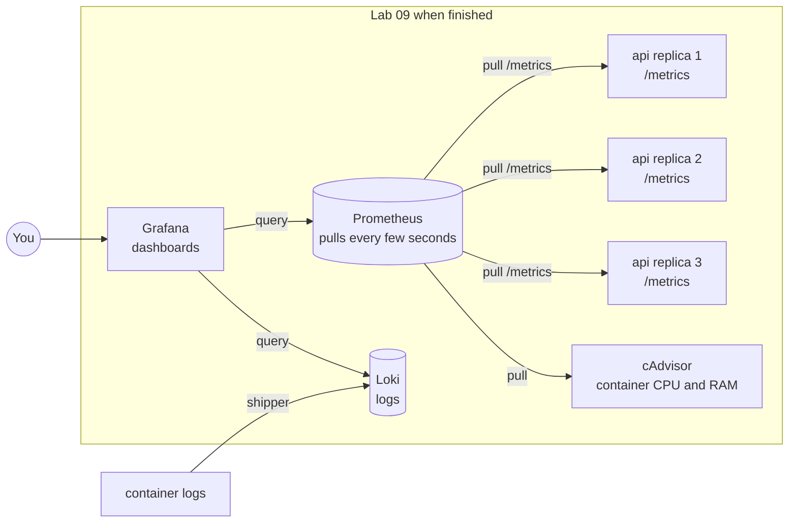

# Lab 09 — Monitoring (CloudWatch)

> **AWS equivalent:** Amazon CloudWatch (metrics, dashboards, logs; alarms are mentioned, not built) — and Amazon Managed Service for Prometheus / Managed Grafana for the tools used here  ·  **Time:** ~3 h  ·  **Difficulty:** ★★★
> **Builds on:** [Lab 08](./08-frontend-cdn.md)  ·  **Reference solution:** commit `f049902` (step 29) on `dev`

> **Status:** in progress. Step 29 is written. Steps 30–35 and the closing sections (5–11) come next.

## 1. What you will learn
- Explain the difference between **metrics** (numbers over time) and **logs** (events as text), and what each one is for.
- Name the three basic metric types — **counter**, **gauge**, **histogram** — and say which question each one answers.
- Make a FastAPI app **expose metrics** (request count, latency, errors) in the format Prometheus reads, without exploding the number of series.
- Explain **pull** vs **push** monitoring, and why Prometheus pulls.
- Map each piece of this lab (Prometheus, cAdvisor, Grafana, Loki) to its **CloudWatch** equivalent.

## 2. Theory

### 2.1 The concept
A running system is a black box. **Monitoring** is what lets you see inside it *while it runs*, so you notice a problem before your users tell you, and find the cause afterwards. Two kinds of data answer two different questions:

| | **Metrics** | **Logs** |
|---|---|---|
| What it is | **Numbers** sampled over time ("requests per second", "CPU %") | **Events** written as text ("GET /notes/7 → 404") |
| Size | Small and cheap: a few numbers per minute, however much traffic there is | Grows with the traffic: one line per event |
| Best for | "**Is** something wrong, and **since when**?" — graphs, trends, alerts | "**What exactly** happened?" — the details of one request or error |
| Lab steps | 29–34 | 35 |

A car dashboard is the analogy: the speedometer and the temperature gauge are **metrics** (you glance at them all the time, they tell you *something is off*); the **log** is the mechanic's detailed report on what broke.

**Three metric types**, which cover almost everything:
- **Counter**: a number that only goes **up** (it restarts at 0 when the process restarts). "Requests handled so far." You never read it as it is; you look at **how fast it grows** (requests *per second*).
- **Gauge**: a number that goes **up and down**. "Requests in progress now", "memory used", "queue length".
- **Histogram**: counts observations in **buckets** ("how many requests took under 5 ms, under 10 ms, under 25 ms..."). From the buckets you can compute **percentiles**: "95 % of requests took less than X". The **average** hides slow requests; the 95th percentile (**p95**) shows them.

**Labels** split one metric into several **series**: `http_requests_total{path="/health", status="200"}` and `{path="/notes", status="500"}` are two series of the same metric. They are what lets you ask "how many *errors* on *this route*?". The danger is **cardinality**: every different label value creates a new series kept in memory. A label such as the raw URL (`/notes/1`, `/notes/2`, ...) or a user id would create millions of series and crash the monitoring system. Labels must have **few, known values**: the *route template* (`/notes/{note_id}`), the status code.

**Pull or push?** Either the monitored program **sends** its numbers somewhere (push, what CloudWatch agents and the AWS SDK do), or a monitoring server **comes and reads** them every few seconds (pull, what Prometheus does). With pull, the app only has to *show* its numbers at an address (`/metrics`), the server knows which targets it expects (and notices when one **does not answer**: the metric `up` is `0`), and a program stuck in a loop cannot flood the server.

### 2.2 How AWS does it
| Piece | What it is |
|---|---|
| **CloudWatch Metrics** | The built-in metrics store. Every AWS service publishes metrics automatically (EC2 `CPUUtilization`, ALB `RequestCount` and `TargetResponseTime`, RDS `DatabaseConnections`...). A metric belongs to a **namespace** (`AWS/ApplicationELB`) and is split by **dimensions** (the equivalent of labels). Your own app can publish **custom metrics** (`PutMetricData`, or the **embedded metric format** in logs). |
| **CloudWatch Alarms** | "If metric X is above Y for N minutes, notify (SNS) or act (Auto Scaling)". |
| **CloudWatch Dashboards** | Graphs of metrics on one page. |
| **CloudWatch Logs** | Log groups and streams: ECS, Lambda and EC2 (via the agent) ship their logs there; **Logs Insights** queries them. |
| **Container Insights** | CPU and memory **per container** for ECS and EKS. |
| **Managed Prometheus + Managed Grafana** | AWS runs Prometheus-compatible storage and Grafana for you, for teams that already use these tools. Same ideas as this lab, no servers to run. |

Console: **CloudWatch → Metrics / Dashboards / Alarms / Log groups**.

### 2.3 How we reproduce it locally
| Concept | AWS | This lab |
|---|---|---|
| App-level metrics (requests, latency, errors) | custom metrics in CloudWatch; ALB `RequestCount`, `HTTPCode_Target_5XX_Count` | step 29: `/metrics` in the API (`prometheus-client`) |
| Metrics storage and queries | CloudWatch Metrics / Managed Prometheus | step 30: **Prometheus**, which pulls the metrics of the 3 replicas |
| Per-container CPU and memory | Container Insights | step 31: **cAdvisor** |
| Dashboards | CloudWatch Dashboards / Managed Grafana | steps 32–34: **Grafana**, dashboards provisioned from files |
| Log collection and search | CloudWatch Logs + Logs Insights | step 35: **Loki** + a log shipper, queried in Grafana |
| Alarms | CloudWatch Alarms + SNS | **not built** (a possible exercise) |
| Metrics of managed services (RDS, S3...) | automatic | not simulated: Postgres, Redis and SeaweedFS expose no metrics here |

### 2.4 Diagram


## 3. Prerequisites
- [Lab 08](./08-frontend-cdn.md) completed (at least Lab 02): `make up` runs, `curl http://localhost:8088/health` answers. If port 80 is busy on your machine, `LB_HOST_PORT` in `.env` (the commands below use **8088**: replace it by yours).
- Nothing new to install: every new component of this lab is a pinned container image.

## 4. Steps

> Try each step yourself first, then compare with the reference commit.

### Step 29 — The API exposes `/metrics`
**Why:** before anything can *collect* numbers, the API has to *have* numbers and a place to show them. This step adds, inside the API, a counter of requests (by route and status code) and a histogram of how long they take, and a route `GET /metrics` that prints them as plain text. In AWS terms: the app starts publishing its own custom metrics.

**Do it.** Two files (plus the plan tick).

1. `api/requirements.txt`: add the library, pinned:
   ```text
   prometheus-client==0.26.0
   ```
2. `api/main.py`: three changes. The imports (`time`, `Request`, and four names from `prometheus_client`):
   ```python
   import time
   ...
   from fastapi import Depends, FastAPI, File, HTTPException, Path, Request, Response, UploadFile, status
   from prometheus_client import CONTENT_TYPE_LATEST, Counter, Histogram, generate_latest
   ```
   The two metrics and the **middleware** (a function that wraps *every* request), placed right after `log = ...`:
   ```python
   # Metrics (CloudWatch metrics in AWS): numbers kept in memory by this process and shown as text at
   # GET /metrics, for Prometheus to read (step 30). Each replica counts only its own requests.
   # The "path" label is the route template (/notes/{note_id}), never the real URL: one series per route,
   # not one per note id.
   REQUESTS = Counter("http_requests_total", "HTTP requests handled", ["method", "path", "status"])
   LATENCY = Histogram("http_request_duration_seconds", "Time to handle one request", ["method", "path"])


   @app.middleware("http")
   async def record_metrics(request: Request, call_next):
       if request.url.path == "/metrics":
           return await call_next(request)  # do not count the reads of the metrics themselves
       start = time.perf_counter()
       status_code = 500  # what is counted if the handler raises
       try:
           response = await call_next(request)
           status_code = response.status_code
           return response
       finally:
           route = request.scope.get("route")
           path = route.path if route else "unmatched"
           LATENCY.labels(request.method, path).observe(time.perf_counter() - start)
           REQUESTS.labels(request.method, path, str(status_code)).inc()
   ```
   And the route, after `/whoami`:
   ```python
   @app.get("/metrics", include_in_schema=False)
   def metrics():
       """The metrics of THIS replica, in the text format Prometheus reads."""
       return Response(generate_latest(), media_type=CONTENT_TYPE_LATEST)
   ```
   | Line | What it does | If you change or remove it |
   |---|---|---|
   | `Counter("http_requests_total", ..., ["method", "path", "status"])` | A counter with three **labels**. `.labels(...).inc()` adds 1 to the series for that combination. The name ends in `_total`: the convention for counters. | A missing label means you can no longer split the numbers (for example errors by route). |
   | `Histogram("http_request_duration_seconds", ...)` | Times each request. Seconds are the standard unit. The default **buckets** go from 5 ms to 10 s. | Buckets that do not fit your latencies give poor percentiles (everything lands in the first bucket, as here: all calls are under 5 ms). |
   | `@app.middleware("http")` | Registers the function so it runs **around every request**: the code before `call_next` runs on the way in, the code after it on the way out. | Without it you would have to add timing code to each of the routes. |
   | `if request.url.path == "/metrics"` | Reading the metrics does not count as traffic. | Prometheus's own reads (every few seconds, from step 30) would show up as requests and hide the real traffic. |
   | `status_code = 500` before the `try` | If the handler **raises**, `call_next` raises too and `status_code` is never set: the request is counted as a `500`, then the error continues. | Without it a crashing request would be **missing** from the error count, exactly when you need it. |
   | `finally:` | Runs whether the request succeeded or failed. | |
   | `route = request.scope.get("route")` and `route.path` | The route that matched, as its **template** (`/notes/{note_id}`). A request that matches no route (a mistyped URL) has no route and is labelled `unmatched`. | Using `request.url.path` instead puts every note id and every random URL into a label: **cardinality explosion** (see 2.1). |
   | `generate_latest()` and `CONTENT_TYPE_LATEST` | Renders all metrics of this process as text, with the content type Prometheus expects. | |
   | `include_in_schema=False` | Keeps `/metrics` out of the generated docs (`/docs`): it is for machines. | |

3. Rebuild and restart the replicas (the image changes: a new dependency):
   ```bash
   docker compose up -d --build --wait api
   ```
   ```text
    Container aws-local-lab-api-2 Healthy
    Container aws-local-lab-api-3 Healthy
    Container aws-local-lab-api-1 Healthy
   ```
   (The last lines of the output.)

**Check 1 — the step's check: `curl /metrics` shows `http_requests_total`.** First some traffic through the load balancer, then the read:
```bash
U=http://127.0.0.1:8088
for i in $(seq 1 30); do curl -s -o /dev/null $U/health; done
for i in 1 2 3; do curl -s -o /dev/null $U/whoami; done
curl -s -o /dev/null $U/notes
curl -s -o /dev/null $U/notes/999999       # a note that does not exist: 404
curl -s -o /dev/null $U/nothing            # a path that does not exist: 404 too
curl -s -o /dev/null -X POST $U/health     # a method that is not allowed: 405
curl -s $U/metrics | grep '^http_requests_total'
```
```text
http_requests_total{method="GET",path="/health",status="200"} 12.0
http_requests_total{method="GET",path="/whoami",status="200"} 1.0
http_requests_total{method="GET",path="/notes/{note_id}",status="404"} 1.0
```
The line format is `name{label="value",...} number`, one line per **series**. Remember that the load balancer sends each request to **one** of the 3 replicas, so each replica only knows its share of the traffic: this answer comes from one replica and shows 12 `/health` calls out of the 30 (the rest went to the other two).

**Check 2 — each replica separately, and what the labels look like.** `docker compose exec --index N api` runs a command inside replica number N; Python's standard library does the request (the image has no `curl`):
```bash
for n in 1 2 3; do
  docker compose exec -T --index $n api python -c "import urllib.request as u; print(u.urlopen('http://localhost:8000/metrics').read().decode())" | grep -E '^http_requests_total'
done
```
Reduced to the combinations seen across the three replicas (`sort | uniq -c` counts how many replicas had each):
```text
      3 GET /health 200
      1 GET /notes 200
      1 GET /notes/{note_id} 404
      3 GET /whoami 200
      1 GET unmatched 404
      1 POST /health 405
```
**What it means:** one series per **route and status**, whatever the id: `/notes/999999` is recorded as `/notes/{note_id}`, and the mistyped `/nothing` as `unmatched`. A `404` from the code (note not found) and a `404` from no matching route are told apart by the label. The `/health` sum over the three replicas is 38 for 30 requests: the 8 extra are most likely the container health checks of Compose: each replica's own check calls its `/health`, and the load balancer's check calls `/health` through the load balancer (I did not count them one by one). (The counters count since the replicas started, a few seconds earlier.)

**Check 3 — the latency histogram** (one replica, only the `/health` series and a few buckets):
```text
# HELP http_request_duration_seconds Time to handle one request
# TYPE http_request_duration_seconds histogram
http_request_duration_seconds_bucket{le="0.005",method="GET",path="/health"} 13.0
http_request_duration_seconds_bucket{le="0.01",method="GET",path="/health"} 13.0
http_request_duration_seconds_bucket{le="0.025",method="GET",path="/health"} 13.0
http_request_duration_seconds_bucket{le="0.1",method="GET",path="/health"} 13.0
http_request_duration_seconds_bucket{le="+Inf",method="GET",path="/health"} 13.0
http_request_duration_seconds_count{method="GET",path="/health"} 13.0
http_request_duration_seconds_sum{method="GET",path="/health"} 0.008805713994661346
```
A histogram is made of three kinds of lines. **`_bucket{le="X"}`**: how many observations took **at most** X seconds (`le` = "less than or equal"; buckets are cumulative, `+Inf` counts everything). **`_count`**: how many observations in all. **`_sum`**: the total of all durations. Here all 13 `/health` calls were under 5 ms (the first bucket already holds 13), and 13 calls took 0.0088 s **in total**, about 0.7 ms each: the average is `_sum / _count`. With these numbers every percentile falls in the first bucket; the histogram becomes interesting under load and on slower routes (step 38).

**Check 4 — a failing request is counted as a `500`.** Stop Postgres, call the notes list (it needs the database), start Postgres again:
```bash
docker compose stop postgres
for i in 1 2 3; do curl -s -o /dev/null -w 'GET /notes -> HTTP %{http_code}\n' http://127.0.0.1:8088/notes; done
for n in 1 2 3; do docker compose exec -T --index $n api python -c "import urllib.request as u; print(u.urlopen('http://localhost:8000/metrics').read().decode())" | grep -E '^http_requests_total.*status="500"'; done
docker compose start postgres
```
```text
GET /notes -> HTTP 500
GET /notes -> HTTP 500
GET /notes -> HTTP 500
http_requests_total{method="GET",path="/notes",status="500"} 1.0
http_requests_total{method="GET",path="/notes",status="500"} 1.0
http_requests_total{method="GET",path="/notes",status="500"} 1.0
```
Each replica took one of the three failing requests and counted it as a `500` on the route `/notes`. This is the number that an **error-rate panel** and an alarm are built on (steps 33 and later). (After `docker compose start postgres` and about 12 s, `GET /notes` answers `200` again.)

**Regression check — the whole suite:**
```bash
make test
```
```text
02_failover: all checks passed
02_load_balancing: all checks passed
03_network_isolation: all checks passed
04_persistence: all checks passed
05_cache: all checks passed
06_storage: all checks passed
07_async: all checks passed
```
The first run of the suite ended with `FAIL only 59 of 60 requests succeeded with one replica dead` in `02_failover` and exit code 2, the known intermittent failure of [Lab 02](./02-load-balancing.md); the other six scripts passed. Run alone a few seconds later, `bash tests/02_failover.sh` printed `PASS 60 of 60 requests succeeded with one replica dead` and `02_failover: all checks passed`.

**What just happened:**
- The API now **measures itself**: each request adds 1 to a counter and one observation to a histogram, in memory, inside the replica that served it. Nothing is sent anywhere yet; `GET /metrics` is just a window on those numbers.
- The labels are **route templates and status codes**, so the number of series stays small and fixed (a handful of routes × a few statuses), however many notes exist.
- Counters live in the **memory of one replica**: they restart at 0 when the container restarts, and three replicas give three partial answers. Putting them together is the job of **Prometheus** (step 30), which pulls every replica and adds them up; that is also why a counter is read as a **rate**, not as a raw number.
- **Not done / to know:** `/metrics` is reachable from outside through the load balancer (`http://localhost:8088/metrics`) because the `location /` rule sends every path to the API. It exposes no secrets, but in a real system you would not publish it to users: Prometheus would read it on the private network only. We leave it for now and revisit it in step 30. The middleware only counts HTTP requests: the worker's jobs have no metrics yet.

## 5–11. To be completed at the end of Lab 09
Verify, Troubleshooting, Going to real AWS, Clean up, Check your understanding, Exercises and Further reading are written when the lab ends (step 35). The problems met so far:

| Symptom | Cause | Fix |
|---|---|---|
| `curl http://localhost:8088/metrics` shows different numbers each time, and `/health` counts look too low | The load balancer sends each request to **one** of 3 replicas; each replica only counts the requests it served. | Normal. Read one replica with `docker compose exec -T --index N api python -c "..."`, or wait for Prometheus (step 30), which adds them up. |
| The `/health` total is higher than the number of `curl` calls you made | Compose's container health checks (each replica's own, and the load balancer's, which goes through the load balancer) call `/health` every few seconds. | Normal. Count a route nobody else calls (such as `/whoami`) when you need exact numbers. |
| `02_failover` fails with `59 of 60` in `make test` | The known intermittent failure of Lab 02 (unrelated to the metrics). | Run it again: `bash tests/02_failover.sh`. |
