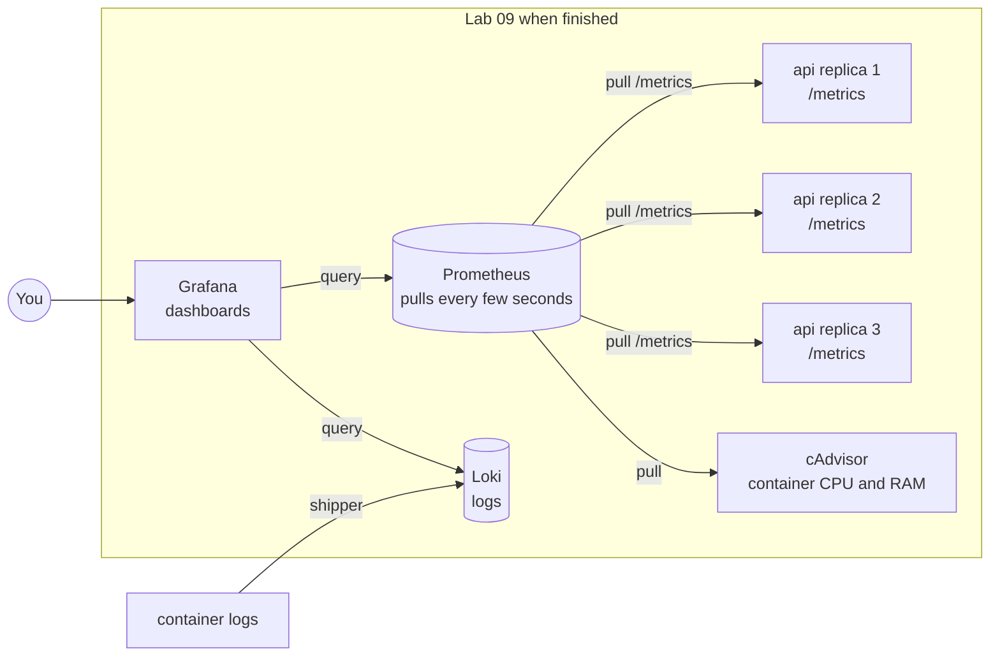
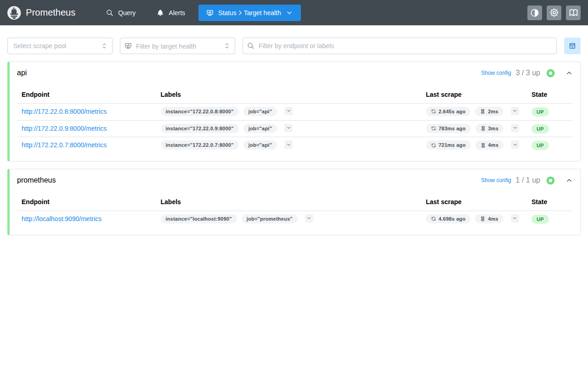

# Lab 09 — Monitoring (CloudWatch)

> **AWS equivalent:** Amazon CloudWatch (metrics, dashboards, logs; alarms are mentioned, not built) — and Amazon Managed Service for Prometheus / Managed Grafana for the tools used here  ·  **Time:** ~3 h  ·  **Difficulty:** ★★★
> **Builds on:** [Lab 08](./08-frontend-cdn.md)  ·  **Reference solution:** commits `f049902` (step 29), `1f7646f` (step 30) on `dev`

> **Status:** in progress. Steps 29–30 are written. Steps 31–35 and the closing sections (5–11) come next.

## 1. What you will learn
- Explain the difference between **metrics** (numbers over time) and **logs** (events as text), and what each one is for.
- Name the three basic metric types — **counter**, **gauge**, **histogram** — and say which question each one answers.
- Make a FastAPI app **expose metrics** (request count, latency, errors) in the format Prometheus reads, without exploding the number of series.
- Explain **pull** vs **push** monitoring, and why Prometheus pulls.
- Map each piece of this lab (Prometheus, cAdvisor, Grafana, Loki) to its **CloudWatch** equivalent.

## 2. Theory

### 2.1 The concept
A running system is a black box. **Monitoring** is what lets you see inside it *while it runs*, so you notice a problem before your users tell you, and find the cause afterwards. Two kinds of data answer two different questions:

| | **Metrics** | **Logs** |
|---|---|---|
| What it is | **Numbers** sampled over time ("requests per second", "CPU %") | **Events** written as text ("GET /notes/7 → 404") |
| Size | Small and cheap: a few numbers per minute, however much traffic there is | Grows with the traffic: one line per event |
| Best for | "**Is** something wrong, and **since when**?" — graphs, trends, alerts | "**What exactly** happened?" — the details of one request or error |
| Lab steps | 29–34 | 35 |

A car dashboard is the analogy: the speedometer and the temperature gauge are **metrics** (you glance at them all the time, they tell you *something is off*); the **log** is the mechanic's detailed report on what broke.

**Three metric types**, which cover almost everything:
- **Counter**: a number that only goes **up** (it restarts at 0 when the process restarts). "Requests handled so far." You never read it as it is; you look at **how fast it grows** (requests *per second*).
- **Gauge**: a number that goes **up and down**. "Requests in progress now", "memory used", "queue length".
- **Histogram**: counts observations in **buckets** ("how many requests took under 5 ms, under 10 ms, under 25 ms..."). From the buckets you can compute **percentiles**: "95 % of requests took less than X". The **average** hides slow requests; the 95th percentile (**p95**) shows them.

**Labels** split one metric into several **series**: `http_requests_total{path="/health", status="200"}` and `{path="/notes", status="500"}` are two series of the same metric. They are what lets you ask "how many *errors* on *this route*?". The danger is **cardinality**: every different label value creates a new series kept in memory. A label such as the raw URL (`/notes/1`, `/notes/2`, ...) or a user id would create millions of series and crash the monitoring system. Labels must have **few, known values**: the *route template* (`/notes/{note_id}`), the status code.

**Pull or push?** Either the monitored program **sends** its numbers somewhere (push, what CloudWatch agents and the AWS SDK do), or a monitoring server **comes and reads** them every few seconds (pull, what Prometheus does). With pull, the app only has to *show* its numbers at an address (`/metrics`), the server knows which targets it expects (and notices when one **does not answer**: the metric `up` is `0`), and a program stuck in a loop cannot flood the server.

### 2.2 How AWS does it
| Piece | What it is |
|---|---|
| **CloudWatch Metrics** | The built-in metrics store. Every AWS service publishes metrics automatically (EC2 `CPUUtilization`, ALB `RequestCount` and `TargetResponseTime`, RDS `DatabaseConnections`...). A metric belongs to a **namespace** (`AWS/ApplicationELB`) and is split by **dimensions** (the equivalent of labels). Your own app can publish **custom metrics** (`PutMetricData`, or the **embedded metric format** in logs). |
| **CloudWatch Alarms** | "If metric X is above Y for N minutes, notify (SNS) or act (Auto Scaling)". |
| **CloudWatch Dashboards** | Graphs of metrics on one page. |
| **CloudWatch Logs** | Log groups and streams: ECS, Lambda and EC2 (via the agent) ship their logs there; **Logs Insights** queries them. |
| **Container Insights** | CPU and memory **per container** for ECS and EKS. |
| **Managed Prometheus + Managed Grafana** | AWS runs Prometheus-compatible storage and Grafana for you, for teams that already use these tools. Same ideas as this lab, no servers to run. |

Console: **CloudWatch → Metrics / Dashboards / Alarms / Log groups**.

### 2.3 How we reproduce it locally
| Concept | AWS | This lab |
|---|---|---|
| App-level metrics (requests, latency, errors) | custom metrics in CloudWatch; ALB `RequestCount`, `HTTPCode_Target_5XX_Count` | step 29: `/metrics` in the API (`prometheus-client`) |
| Metrics storage and queries | CloudWatch Metrics / Managed Prometheus | step 30: **Prometheus**, which pulls the metrics of the 3 replicas |
| Per-container CPU and memory | Container Insights | step 31: **cAdvisor** |
| Dashboards | CloudWatch Dashboards / Managed Grafana | steps 32–34: **Grafana**, dashboards provisioned from files |
| Log collection and search | CloudWatch Logs + Logs Insights | step 35: **Loki** + a log shipper, queried in Grafana |
| Alarms | CloudWatch Alarms + SNS | **not built** (a possible exercise) |
| Metrics of managed services (RDS, S3...) | automatic | not simulated: Postgres, Redis and SeaweedFS expose no metrics here |

### 2.4 Diagram


## 3. Prerequisites
- [Lab 08](./08-frontend-cdn.md) completed (at least Lab 02): `make up` runs, `curl http://localhost:8088/health` answers. If port 80 is busy on your machine, `LB_HOST_PORT` in `.env` (the commands below use **8088**: replace it by yours).
- Nothing new to install: every new component of this lab is a pinned container image.

## 4. Steps

> Try each step yourself first, then compare with the reference commit.

### Step 29 — The API exposes `/metrics`
**Why:** before anything can *collect* numbers, the API has to *have* numbers and a place to show them. This step adds, inside the API, a counter of requests (by route and status code) and a histogram of how long they take, and a route `GET /metrics` that prints them as plain text. In AWS terms: the app starts publishing its own custom metrics.

**Do it.** Two files (plus the plan tick).

1. `api/requirements.txt`: add the library, pinned:
   ```text
   prometheus-client==0.26.0
   ```
2. `api/main.py`: three changes. The imports (`time`, `Request`, and four names from `prometheus_client`):
   ```python
   import time
   ...
   from fastapi import Depends, FastAPI, File, HTTPException, Path, Request, Response, UploadFile, status
   from prometheus_client import CONTENT_TYPE_LATEST, Counter, Histogram, generate_latest
   ```
   The two metrics and the **middleware** (a function that wraps *every* request), placed right after `log = ...`:
   ```python
   # Metrics (CloudWatch metrics in AWS): numbers kept in memory by this process and shown as text at
   # GET /metrics, for Prometheus to read (step 30). Each replica counts only its own requests.
   # The "path" label is the route template (/notes/{note_id}), never the real URL: one series per route,
   # not one per note id.
   REQUESTS = Counter("http_requests_total", "HTTP requests handled", ["method", "path", "status"])
   LATENCY = Histogram("http_request_duration_seconds", "Time to handle one request", ["method", "path"])


   @app.middleware("http")
   async def record_metrics(request: Request, call_next):
       if request.url.path == "/metrics":
           return await call_next(request)  # do not count the reads of the metrics themselves
       start = time.perf_counter()
       status_code = 500  # what is counted if the handler raises
       try:
           response = await call_next(request)
           status_code = response.status_code
           return response
       finally:
           route = request.scope.get("route")
           path = route.path if route else "unmatched"
           LATENCY.labels(request.method, path).observe(time.perf_counter() - start)
           REQUESTS.labels(request.method, path, str(status_code)).inc()
   ```
   And the route, after `/whoami`:
   ```python
   @app.get("/metrics", include_in_schema=False)
   def metrics():
       """The metrics of THIS replica, in the text format Prometheus reads."""
       return Response(generate_latest(), media_type=CONTENT_TYPE_LATEST)
   ```
   | Line | What it does | If you change or remove it |
   |---|---|---|
   | `Counter("http_requests_total", ..., ["method", "path", "status"])` | A counter with three **labels**. `.labels(...).inc()` adds 1 to the series for that combination. The name ends in `_total`: the convention for counters. | A missing label means you can no longer split the numbers (for example errors by route). |
   | `Histogram("http_request_duration_seconds", ...)` | Times each request. Seconds are the standard unit. The default **buckets** go from 5 ms to 10 s. | Buckets that do not fit your latencies give poor percentiles (everything lands in the first bucket, as here: all calls are under 5 ms). |
   | `@app.middleware("http")` | Registers the function so it runs **around every request**: the code before `call_next` runs on the way in, the code after it on the way out. | Without it you would have to add timing code to each of the routes. |
   | `if request.url.path == "/metrics"` | Reading the metrics does not count as traffic. | Prometheus's own reads (every few seconds, from step 30) would show up as requests and hide the real traffic. |
   | `status_code = 500` before the `try` | If the handler **raises**, `call_next` raises too and `status_code` is never set: the request is counted as a `500`, then the error continues. | Without it a crashing request would be **missing** from the error count, exactly when you need it. |
   | `finally:` | Runs whether the request succeeded or failed. | |
   | `route = request.scope.get("route")` and `route.path` | The route that matched, as its **template** (`/notes/{note_id}`). A request that matches no route (a mistyped URL) has no route and is labelled `unmatched`. | Using `request.url.path` instead puts every note id and every random URL into a label: **cardinality explosion** (see 2.1). |
   | `generate_latest()` and `CONTENT_TYPE_LATEST` | Renders all metrics of this process as text, with the content type Prometheus expects. | |
   | `include_in_schema=False` | Keeps `/metrics` out of the generated docs (`/docs`): it is for machines. | |

3. Rebuild and restart the replicas (the image changes: a new dependency):
   ```bash
   docker compose up -d --build --wait api
   ```
   ```text
    Container aws-local-lab-api-2 Healthy
    Container aws-local-lab-api-3 Healthy
    Container aws-local-lab-api-1 Healthy
   ```
   (The last lines of the output.)

**Check 1 — the step's check: `curl /metrics` shows `http_requests_total`.** First some traffic through the load balancer, then the read:
```bash
U=http://127.0.0.1:8088
for i in $(seq 1 30); do curl -s -o /dev/null $U/health; done
for i in 1 2 3; do curl -s -o /dev/null $U/whoami; done
curl -s -o /dev/null $U/notes
curl -s -o /dev/null $U/notes/999999       # a note that does not exist: 404
curl -s -o /dev/null $U/nothing            # a path that does not exist: 404 too
curl -s -o /dev/null -X POST $U/health     # a method that is not allowed: 405
curl -s $U/metrics | grep '^http_requests_total'
```
```text
http_requests_total{method="GET",path="/health",status="200"} 12.0
http_requests_total{method="GET",path="/whoami",status="200"} 1.0
http_requests_total{method="GET",path="/notes/{note_id}",status="404"} 1.0
```
The line format is `name{label="value",...} number`, one line per **series**. Remember that the load balancer sends each request to **one** of the 3 replicas, so each replica only knows its share of the traffic: this answer comes from one replica and shows 12 `/health` calls out of the 30 (the rest went to the other two).

**Check 2 — each replica separately, and what the labels look like.** `docker compose exec --index N api` runs a command inside replica number N; Python's standard library does the request (the image has no `curl`):
```bash
for n in 1 2 3; do
  docker compose exec -T --index $n api python -c "import urllib.request as u; print(u.urlopen('http://localhost:8000/metrics').read().decode())" | grep -E '^http_requests_total'
done
```
Reduced to the combinations seen across the three replicas (`sort | uniq -c` counts how many replicas had each):
```text
      3 GET /health 200
      1 GET /notes 200
      1 GET /notes/{note_id} 404
      3 GET /whoami 200
      1 GET unmatched 404
      1 POST /health 405
```
**What it means:** one series per **route and status**, whatever the id: `/notes/999999` is recorded as `/notes/{note_id}`, and the mistyped `/nothing` as `unmatched`. A `404` from the code (note not found) and a `404` from no matching route are told apart by the label. The `/health` sum over the three replicas is 38 for 30 requests: the 8 extra are most likely the container health checks of Compose: each replica's own check calls its `/health`, and the load balancer's check calls `/health` through the load balancer (I did not count them one by one). (The counters count since the replicas started, a few seconds earlier.)

**Check 3 — the latency histogram** (one replica, only the `/health` series and a few buckets):
```text
# HELP http_request_duration_seconds Time to handle one request
# TYPE http_request_duration_seconds histogram
http_request_duration_seconds_bucket{le="0.005",method="GET",path="/health"} 13.0
http_request_duration_seconds_bucket{le="0.01",method="GET",path="/health"} 13.0
http_request_duration_seconds_bucket{le="0.025",method="GET",path="/health"} 13.0
http_request_duration_seconds_bucket{le="0.1",method="GET",path="/health"} 13.0
http_request_duration_seconds_bucket{le="+Inf",method="GET",path="/health"} 13.0
http_request_duration_seconds_count{method="GET",path="/health"} 13.0
http_request_duration_seconds_sum{method="GET",path="/health"} 0.008805713994661346
```
A histogram is made of three kinds of lines. **`_bucket{le="X"}`**: how many observations took **at most** X seconds (`le` = "less than or equal"; buckets are cumulative, `+Inf` counts everything). **`_count`**: how many observations in all. **`_sum`**: the total of all durations. Here all 13 `/health` calls were under 5 ms (the first bucket already holds 13), and 13 calls took 0.0088 s **in total**, about 0.7 ms each: the average is `_sum / _count`. With these numbers every percentile falls in the first bucket; the histogram becomes interesting under load and on slower routes (step 38).

**Check 4 — a failing request is counted as a `500`.** Stop Postgres, call the notes list (it needs the database), start Postgres again:
```bash
docker compose stop postgres
for i in 1 2 3; do curl -s -o /dev/null -w 'GET /notes -> HTTP %{http_code}\n' http://127.0.0.1:8088/notes; done
for n in 1 2 3; do docker compose exec -T --index $n api python -c "import urllib.request as u; print(u.urlopen('http://localhost:8000/metrics').read().decode())" | grep -E '^http_requests_total.*status="500"'; done
docker compose start postgres
```
```text
GET /notes -> HTTP 500
GET /notes -> HTTP 500
GET /notes -> HTTP 500
http_requests_total{method="GET",path="/notes",status="500"} 1.0
http_requests_total{method="GET",path="/notes",status="500"} 1.0
http_requests_total{method="GET",path="/notes",status="500"} 1.0
```
After `docker compose start postgres` and a 12 s wait, a new request answered:
```text
GET /notes -> HTTP 200
```
Each replica took one of the three failing requests and counted it as a `500` on the route `/notes`. This is the number that an **error-rate panel** and an alarm are built on (steps 33 and later).

**Regression check — the whole suite:**
```bash
make test
```
```text
02_failover: all checks passed
02_load_balancing: all checks passed
03_network_isolation: all checks passed
04_persistence: all checks passed
05_cache: all checks passed
06_storage: all checks passed
07_async: all checks passed
```
The first run of the suite ended with `FAIL only 59 of 60 requests succeeded with one replica dead` in `02_failover` and exit code 2, the known intermittent failure of [Lab 02](./02-load-balancing.md); the other six scripts passed. Run alone a few seconds later, `bash tests/02_failover.sh` printed `PASS 60 of 60 requests succeeded with one replica dead` and `02_failover: all checks passed`.

**What just happened:**
- The API now **measures itself**: each request adds 1 to a counter and one observation to a histogram, in memory, inside the replica that served it. Nothing is sent anywhere yet; `GET /metrics` is just a window on those numbers.
- The labels are **route templates and status codes**, so the number of series stays small and fixed (a handful of routes × a few statuses), however many notes exist.
- Counters live in the **memory of one replica**: they restart at 0 when the container restarts, and three replicas give three partial answers. Putting them together is the job of **Prometheus** (step 30), which pulls every replica and adds them up; that is also why a counter is read as a **rate**, not as a raw number.
- **Not done / to know:** `/metrics` is reachable from outside through the load balancer (`http://localhost:8088/metrics`) because the `location /` rule sends every path to the API. It exposes no secrets, but in a real system you would not publish it to users: Prometheus would read it on the private network only. We leave it open for now: closing it (for example a `location = /metrics` that refuses outside callers in `lb/nginx.conf`) is **not** in the plan yet, and is a candidate small step if you want it. The middleware only counts HTTP requests: the worker's jobs have no metrics yet.

### Step 30 — Prometheus scrapes the three replicas
**Why:** step 29 gave every replica a `/metrics` page, but nobody reads it. **Prometheus** is the program that does: every few seconds it **pulls** `/metrics` from each target, stores the numbers with a timestamp, and answers questions about them (**PromQL**). It is the lab's stand-in for the CloudWatch metrics store (or Amazon Managed Service for Prometheus). The interesting part is *finding* the replicas: they come and go, and each has its own address.

**Do it.** Four files (plus the plan tick).

1. `monitoring/prometheus/prometheus.yml`: what to scrape and how often.
   ```yaml
   # Prometheus configuration (read-only, mounted by docker-compose.yml).
   # Prometheus PULLS: every scrape_interval it opens http://<target>/metrics and stores the numbers.

   global:
     scrape_interval: 5s       # how often to read every target (15-60 s is more usual; 5 s makes the lab lively)
     evaluation_interval: 15s  # how often rules are evaluated (no rules yet)

   scrape_configs:
     # The 3 API replicas. The Docker DNS name "api" answers with the address of EVERY replica, so one
     # DNS query finds all of them, and a replica that is added, removed or re-created is picked up
     # at the next refresh. (Like ECS service discovery or Kubernetes endpoints in a real setup.)
     - job_name: api
       metrics_path: /metrics
       dns_sd_configs:
         - names: ["api"]
           type: A
           port: 8000
           refresh_interval: 5s

     # Prometheus also exposes metrics about itself.
     - job_name: prometheus
       static_configs:
         - targets: ["localhost:9090"]
   ```
   | Line | What it does | If you change or remove it |
   |---|---|---|
   | `scrape_interval: 5s` | Read every target every 5 seconds. | Longer (15–60 s is usual in production) means fewer data points and slower reaction; 5 s keeps the lab lively. |
   | `job_name: api` | A **job** is a group of targets with the same role; its name becomes the label `job="api"` on every series. | |
   | `metrics_path: /metrics` | The path to read (this is also the default). | |
   | `dns_sd_configs` with `names: ["api"]`, `type: A`, `port: 8000` | **DNS service discovery**: Prometheus asks Docker's DNS for the **A records** of the name `api`, which returns the address of **every** replica, and scrapes each on port 8000. | With `static_configs` and a fixed list you would have to edit the file whenever a replica is added or restarted with a new address. |
   | `refresh_interval: 5s` | Ask DNS again every 5 s, so new or removed replicas are noticed. | |
   | `job_name: prometheus`, `localhost:9090` | Prometheus also scrapes its own `/metrics`. | |

2. `docker-compose.yml`: a `prometheus` service, a volume for its data, and the load balancer waits for it:
   ```yaml
     lb:
       # ...
       depends_on:
         # ...
         prometheus:
           condition: service_healthy

     # (new service)
     prometheus:
       image: prom/prometheus:v3.16.0
       command:
         - --config.file=/etc/prometheus/prometheus.yml
         - --storage.tsdb.path=/prometheus
         # Keep two days of numbers: plenty for a lab, and the disk does not fill up.
         - --storage.tsdb.retention.time=2d
       volumes:
         - ./monitoring/prometheus/prometheus.yml:/etc/prometheus/prometheus.yml:ro
         - promdata:/prometheus
       networks:
         - private
       healthcheck:
         test: ["CMD", "wget", "-q", "-O", "/dev/null", "http://127.0.0.1:9090/-/healthy"]
         interval: 10s
         timeout: 3s
         retries: 3
         start_period: 5s

   volumes:
     # ...
     promdata:
   ```
   | Line | What it does | If you change or remove it |
   |---|---|---|
   | `image: prom/prometheus:v3.16.0` | Pinned version of the official image. | `latest` would change under you. |
   | `--config.file=...` | Where the configuration is, inside the container (the file mounted below). | |
   | `--storage.tsdb.path=/prometheus` and `promdata:/prometheus` | The time-series database lives in a **named volume**, so the history survives a restart of the container. | Without the volume the history is lost at every re-creation. |
   | `--storage.tsdb.retention.time=2d` | Delete data older than two days. | The default is 15 days: more disk. |
   | `./monitoring/prometheus/prometheus.yml:/etc/prometheus/prometheus.yml:ro` | The configuration, read-only. | |
   | `networks: - private` | Prometheus is on the **private** network only, like the database: no published port, no route out. It can reach the replicas, which are on that network. | |
   | `healthcheck` with `/-/healthy` | Prometheus's own "I am alive" URL. | |
   | `lb: depends_on: prometheus: condition: service_healthy` | The load balancer starts after Prometheus is ready. | |

3. `lb/nginx.conf`: a new host name for the web page, in the same style as `s3.localhost`:
   ```nginx
       # The metrics server, same trick: Prometheus has no published port, the load balancer is the door.
       upstream prometheus {
           zone prometheus 64k;
           resolver 127.0.0.11 valid=5s;
           server prometheus:9090 resolve;
       }

       # Requests for the host name prometheus.localhost show the Prometheus web page.
       server {
           listen 80;
           server_name prometheus.localhost;

           location / {
               proxy_pass http://prometheus;
               proxy_set_header Host $host;
           }
       }
   ```
   `prometheus.localhost` is chosen by the `Host` header, so `http://prometheus.localhost:8088/` shows the Prometheus page while `http://localhost:8088/` is still the application. The `resolver ... resolve` pair makes Nginx look the name `prometheus` up again every 5 s (the trick of step 4), so a re-created Prometheus is found without restarting the load balancer.

4. `scripts/screenshot.sh`: a small addition, needed for the screenshot below. The Prometheus page keeps one request open for ever (`/api/v1/notifications/live`, a stream of notifications), so the script's default wait, "until the network is idle", never finishes and times out after 30 s (see Troubleshooting). `SHOT_WAIT_UNTIL=load` takes the picture after the page has loaded instead; the default is unchanged.

**Start it and check the configuration first.** `promtool` is the tool that comes with Prometheus; it checks a configuration file without starting anything:
```bash
export MSYS_NO_PATHCONV=1      # Git Bash on Windows: do not rewrite /cfg into a Windows path
docker run --rm -v "$(pwd -W)/monitoring/prometheus:/cfg:ro" --entrypoint promtool prom/prometheus:v3.16.0 check config /cfg/prometheus.yml
docker compose up -d --wait
docker compose exec -T lb nginx -t
docker compose exec -T lb nginx -s reload
```
```text
Checking /cfg/prometheus.yml
 SUCCESS: /cfg/prometheus.yml is valid prometheus config file syntax

 Container aws-local-lab-prometheus-1 Healthy
 Container aws-local-lab-api-1 Healthy
 Container aws-local-lab-api-2 Healthy
 Container aws-local-lab-api-3 Healthy
nginx: configuration file /etc/nginx/nginx.conf test is successful
```
(The last lines of the output of each command, trimmed. `$(pwd -W)` is Git Bash's way to write the current folder as a Windows path: on Linux or macOS use `$(pwd)`. `docker compose up -d` does not re-create `lb` when only its mounted `nginx.conf` changed, hence the explicit `nginx -s reload`, as in Lab 08.)

**Check 1 — the step's check: three targets are up.** Prometheus answers on `prometheus.localhost` through the load balancer. Its HTTP API lists the targets:
```bash
P=http://prometheus.localhost:8088
curl -s -o /dev/null -w 'GET %{url} -> HTTP %{http_code}\n' $P/-/healthy
curl -s $P/-/healthy
curl -s $P/api/v1/targets | python -c "
import sys, json
for t in json.load(sys.stdin)['data']['activeTargets']:
    print(f\"  job={t['labels']['job']:<11} instance={t['labels']['instance']:<18} health={t['health']:<5} scrapeUrl={t['scrapeUrl']}\")"
docker compose ps api -q | xargs docker inspect --format '  {{.Name}} {{range .NetworkSettings.Networks}}{{.IPAddress}} {{end}}'
```
```text
GET http://prometheus.localhost:8088/-/healthy -> HTTP 200
Prometheus Server is Healthy.
  job=api         instance=172.22.0.8:8000    health=up    scrapeUrl=http://172.22.0.8:8000/metrics
  job=api         instance=172.22.0.9:8000    health=up    scrapeUrl=http://172.22.0.9:8000/metrics
  job=api         instance=172.22.0.7:8000    health=up    scrapeUrl=http://172.22.0.7:8000/metrics
  job=prometheus  instance=localhost:9090     health=up    scrapeUrl=http://localhost:9090/metrics
  /aws-local-lab-api-1 172.22.0.7
  /aws-local-lab-api-2 172.22.0.8
  /aws-local-lab-api-3 172.22.0.9
```
(Python only formats the JSON, which would otherwise be one long line.) The three `api` targets are the three replicas: their addresses are exactly those of `api-1`, `api-2` and `api-3` (the last three lines), found by **one DNS query**, not listed by hand. All have `health=up`: the last scrape succeeded. The page of the same list, in a real browser (the step's screenshot):



**Check 2 — querying the numbers (PromQL).** Prometheus has added a label `instance` to every series (the address it scraped) and a metric `up` (1 = the last scrape worked). First 60 requests to `/whoami`, then four questions, asked through the HTTP API (`/api/v1/query`); the same expressions can be typed in the **Graph** page of the web UI:
```bash
P=http://prometheus.localhost:8088
q() {   # q 'EXPRESSION': ask Prometheus and print one line per series
  curl -s -G $P/api/v1/query --data-urlencode "query=$1" | python -c "
import sys, json
d = json.load(sys.stdin)['data']['result']
for r in sorted(d, key=lambda r: str(r['metric'])):
    m = {k: v for k, v in r['metric'].items() if k not in ('__name__', 'job')}
    print('  ', m if m else '', '=>', r['value'][1])
if not d: print('   (no result)')"
}
for i in $(seq 1 60); do curl -s -o /dev/null http://127.0.0.1:8088/whoami; done; sleep 7
q 'sum(http_requests_total{path="/whoami"})'
q 'sum by (instance) (http_requests_total{path="/whoami"})'
q 'sum(rate(http_requests_total[1m]))'
q 'count(up{job="api"} == 1)'
```
```text
1) sum(http_requests_total{path="/whoami"})   (all replicas added up)
    => 170
2) sum by (instance) (http_requests_total{path="/whoami"})   (one line per replica)
   {'instance': '172.22.0.7:8000'} => 23
   {'instance': '172.22.0.8:8000'} => 73
   {'instance': '172.22.0.9:8000'} => 74
3) sum(rate(http_requests_total[1m]))   (requests per second, all routes, last minute)
    => 1.4130960153153833
4) count(up{job="api"} == 1)   (replicas that answer)
    => 3
```
(`q` is the small shell function defined at the top of that block: `curl -G --data-urlencode "query=..."` plus a few lines of Python to print the result. It is not part of the repository.) **What each one says:**
1. **`sum(...)`** adds the series of all replicas: the problem of step 29 (each replica only knows its share) is solved. The total is 170, not 60: the counters count since each replica **started**, and the tests had already sent traffic to them (and restarted some).
2. **`sum by (instance)`** keeps one line per replica: the shares are uneven (23, 73, 74) for the same reason; I did not trace them one by one. The load balancer's rotation is even, but the replicas were not all started at the same time.
3. **`rate(...[1m])`** is the **per-second growth** of a counter over the last minute: about 1.4 requests per second (the health checks and Prometheus's own cadence are included). This, not the raw counter, is what dashboards show (step 33).
4. **`count(up{job="api"} == 1)`** counts the replicas that answered the last scrape: 3.

**Check 3 — Prometheus notices a dead replica.** Stop `api-2`, wait about 12 s (two or three scrapes), look at `up`, start it again:
```bash
docker stop aws-local-lab-api-2
sleep 12
q 'up{job="api"}'
q 'count(up{job="api"} == 1)'
docker compose up -d --wait api
sleep 12
q 'up{job="api"}'
```
```text
   {'instance': '172.22.0.7:8000'} => 1
   {'instance': '172.22.0.8:8000'} => 0
   {'instance': '172.22.0.9:8000'} => 1
   count(up{job="api"} == 1):
    => 2
 Container aws-local-lab-api-3 Healthy
== after restart:
   {'instance': '172.22.0.7:8000'} => 1
   {'instance': '172.22.0.8:8000'} => 1
   {'instance': '172.22.0.9:8000'} => 1
```
(The lines `count(up{job="api"} == 1):` and `== after restart:` are `echo` labels of my script.) I did not check whether Docker's DNS still lists a stopped container: here, 12 s after the stop, the series was still there with value `0`; at a later DNS refresh the target may disappear instead, and its series would then go stale. The stopped replica's series has `up = 0` and the count of live replicas drops to 2: with **pull**, a target that does not answer is noticed by definition (a program that pushes would just go silent). After the restart all three are `1` again; the replica came back at the **same address** here (`172.22.0.8`), so no new series appeared, but had the address changed the next DNS refresh would have found it.

**Regression check — the whole suite:**
```bash
make test
```
```text
02_failover: all checks passed
02_load_balancing: all checks passed
03_network_isolation: all checks passed
04_persistence: all checks passed
05_cache: all checks passed
06_storage: all checks passed
07_async: all checks passed
```
(The summaries only; the exit code of `make` was 0.) `03_network_isolation` still passes: Prometheus is on the private network and has no published port.

**What just happened:**
- A new component, **Prometheus**, pulls the metrics of all replicas every 5 s, **discovering** them through DNS, and keeps two days of history in a volume. The Docker DNS name `api` plays the role of a service registry (in ECS: service discovery; in Kubernetes: the endpoints of a Service).
- The numbers of the three replicas can now be **added up** (`sum`), **compared** (`by (instance)`), turned into **rates** (`rate`) and checked for **health** (`up`): that is the raw material of the dashboards of steps 33 and 34.
- Prometheus is **not reachable from outside directly**: it sits on the private network and the load balancer shows its page under its own host name, the same pattern as `s3.localhost`.
- **Not done:** no alerting rules (a CloudWatch alarm would be the equivalent), no `/metrics` on the load balancer, Postgres, Redis or the worker (step 31 adds per-container CPU and memory instead), and the history is two days only.

## 5–11. To be completed at the end of Lab 09
Verify, Troubleshooting, Going to real AWS, Clean up, Check your understanding, Exercises and Further reading are written when the lab ends (step 35). The problems met so far:

| Symptom | Cause | Fix |
|---|---|---|
| `curl http://localhost:8088/metrics` shows different numbers each time, and `/health` counts look too low | The load balancer sends each request to **one** of 3 replicas; each replica only counts the requests it served. | Normal. Read one replica with `docker compose exec -T --index N api python -c "..."`, or wait for Prometheus (step 30), which adds them up. |
| The `/health` total is higher than the number of `curl` calls you made | Compose's container health checks (each replica's own, and the load balancer's, which goes through the load balancer) call `/health` every few seconds. | Normal. Count a route nobody else calls (such as `/whoami`) when you need exact numbers. |
| `scripts/screenshot.sh` of `http://prometheus.localhost:8088/targets` fails with `Page.goto: Timeout 30000ms exceeded` | The Prometheus page keeps a streaming request open (`/api/v1/notifications/live`), so the script's wait for "network idle" never ends. Found by listing the requests still pending after the page loaded. | `SHOT_WAIT_UNTIL=load bash scripts/screenshot.sh ...` (added in step 30). |
| `promtool: error: path 'C:/prometheus.yml' does not exist` | Git Bash rewrites the container path `/c/prometheus.yml` (mounted with `-v ...:/c`) into a Windows path. | `export MSYS_NO_PATHCONV=1`, and a mount point that does not look like a drive (`/cfg`). |
| `http://prometheus.localhost:8088/` is not served after `docker compose up -d` | `lb` was not re-created (only its mounted `nginx.conf` changed), so it still runs the old configuration. | `docker compose exec -T lb nginx -s reload`. |
| `sum(http_requests_total{...})` is larger than the number of requests you sent | Counters count since each replica started, and the tests had already sent traffic. | Use `rate(...)` or `increase(...[5m])` to look at a period, not the raw counter. |
| `02_failover` fails with `59 of 60` in `make test` | The known intermittent failure of Lab 02 (unrelated to the metrics). | Run it again: `bash tests/02_failover.sh`. |
