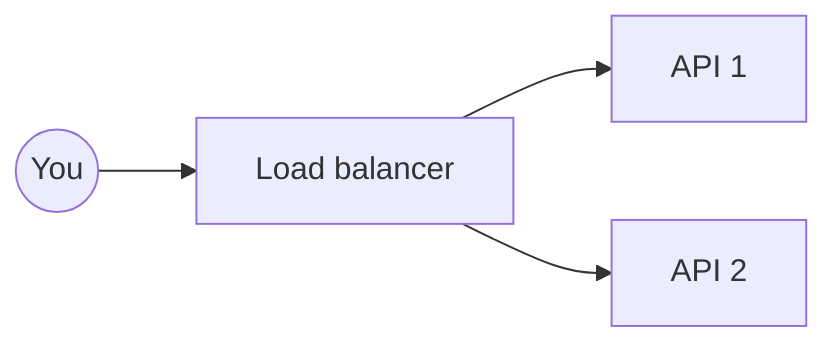

# Lab NN — <Title>

> **AWS equivalent:** <service(s)>  ·  **Time:** ~<N> min  ·  **Difficulty:** ★☆☆
> **Builds on:** [Lab NN-1](./NN-1-name.md)  ·  **Reference solution:** commits `<hash>`…`<hash>` on `dev`

## 1. What you will learn
- <3–5 concrete learning outcomes, e.g. "Explain what a load balancer health check is and why it matters">

## 2. Theory

### 2.1 The concept
<Plain-language explanation of the idea, independent of any tool. Why does it exist? What problem
does it solve? Use an analogy if it helps.>

### 2.2 How AWS does it
<The real AWS service: main components and vocabulary (e.g. target group, listener, security group),
where it lives in the AWS console, and how it is usually configured.>

### 2.3 How we reproduce it locally
<The local tool and why it is a fair stand-in. A table is often clearest:>

| Concept | AWS | This lab |
|---|---|---|
| ... | ... | ... |

### 2.4 Diagram


## 3. Prerequisites
- <Tools and the state you need before starting, e.g. "Lab 03 completed, `make up` runs">

## 4. Steps

> Try each step yourself first, then compare with the reference commit.

### Step 1 — <short title>
**Why:** <one or two sentences linking this action to the theory>

**Do it:**
```bash
<exact commands>
```
<Full content of any file created or changed (or the relevant part, with the path as a heading).>

**Expected result:**
```text
<REAL output captured while building the lab, trimmed to the important lines>
```


**What just happened:** <explain the output line by line where useful>

### Step 2 — ...

## 5. Verify it works
```bash
<commands or tests that prove the whole lab works>
```

## 6. Troubleshooting
| Symptom | Likely cause | Fix |
|---|---|---|
| <real errors met while building this lab> | ... | ... |

## 7. Going to real AWS
- **What changes:** <resources you would create, e.g. ALB + target group + security groups>
- **What this lab does not simulate:** <multi-AZ, IAM, managed backups, ...>
- **Rough cost:** <approximate range, free-tier notes; link to the AWS pricing page>

## 8. Clean up
```bash
<how to stop or reset what this lab created>
```

## 9. Check your understanding
1. <question>
2. <question>
3. <question>

<details><summary>Answers</summary>

1. <answer>
2. <answer>
3. <answer>

</details>

## 10. Exercises (optional)
- <a small challenge that extends the lab, e.g. "Add a 4th replica and watch the distribution">

## 11. Further reading
- <official docs links: AWS docs page for the service, tool docs>
